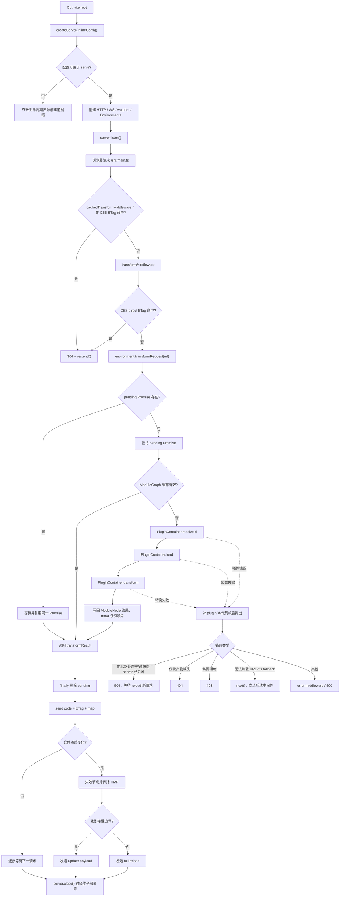

# 00. 系统全景与一条开发请求的完整链路

> **证据基线**：Vite `v8.2.1`，commit `421615865dad3ed39137d17281814fc78a41246c`。本文所有源码、测试与行为结论均限定于该版本。

## 结论与边界

Vite 开发服务器不是“收到 URL 后调用一次编译器”，而是一个长期存活的增量模块系统：

1. CLI 只把参数转换成 `InlineConfig`；
2. `createServer()` 解析配置并创建 HTTP、文件监听、WebSocket 和多个 Environment；
3. 中间件把浏览器 URL 路由到对应 Environment；
4. `transformRequest()` 用 pending Promise 合并并发请求，再查询 ModuleGraph 缓存；
5. 未命中时，PluginContainer 依次执行 `resolveId → load → transform`；
6. 转换结果及依赖关系写回 ModuleGraph，随后作为 HTTP 响应发送；
7. 文件变化使图节点失效，HMR 从变更节点向 importer 传播；关闭时释放 watcher、WS、Environment 和插件资源。

本章只完整串联常规开发态 JavaScript 模块请求。HTML 入口、CSS、依赖预构建、SSR、生产构建和 bundled dev 的特有分支由后续章节展开；它们不能直接套用本文所有细节。

## 核心对象地图

| 对象 | 创建者 | 持有者 | 生命周期 | 关键职责 |
|---|---|---|---|---|
| `ResolvedConfig` | `resolveConfig()` | Dev Server 与各 Environment | 创建或重启时生成 | 固定本轮插件、路径、server 与环境配置 |
| `ViteDevServer` | `_createServer()` | CLI 或 Node API 调用者 | `createServer()` 至 `close()` | 聚合 HTTP、WS、watcher、middlewares 和 environments |
| `DevEnvironment` | `_createServer()` | `server.environments` | server 初始化至关闭/重启迁移 | 隔离 client/SSR 的配置、模块图、插件容器与依赖优化器 |
| `PluginContainer` | Environment 初始化 | 对应 Environment | Environment 生命周期 | 排序并调用插件钩子，维护 hook context 与错误信息 |
| `EnvironmentModuleGraph` | Environment 初始化 | 对应 Environment | Environment 生命周期 | 维护 URL、规范 ID、importer、依赖、失效和 transform 缓存 |
| `ModuleNode` | ModuleGraph 按需创建 | ModuleGraph | 首次创建至 Environment 关闭；失效不会删除节点 | 保存模块身份、依赖边、HMR 接受边界和转换结果；失效时清除可重算结果 |

关键所有权不变量：模块节点、插件上下文和转换缓存都属于某个 Environment。兼容层可以转发调用，但不能把 client 与 SSR 的状态重新混成一个全局容器。

## 阅读地图

先阅读本章形成全局坐标，再按实际请求顺序进入：

1. [CLI 与启动](./01-cli-and-startup.md)
2. [配置解析](./02b-config-resolution.md)
3. [插件体系](./03-plugin-system.md)
4. [Dev Server 生命周期](./04-dev-server-lifecycle.md)
5. [Environment API](./05-environment-api.md)
6. [中间件请求入口](./06-middleware-request-pipeline.md)
7. [模块解析](./07-module-resolution.md)
8. [Transform 与 ModuleGraph](./08-transform-and-module-graph.md)
9. [Import Analysis](./10-import-analysis.md)
10. [HMR](./12-hmr.md)

## 阶段一：CLI 只建立配置输入

下面是目标版本连续源码摘录，截到 `listen()`；后续日志、catch 与 profiler 收尾不在此展开。

来源：`packages/vite/src/node/cli.ts`，默认 `serve` command action。

```ts
// output structure is preserved even after bundling so require()
// is ok here
const { createServer } = await import('./server')
try {
  const server = await createServer({
    root,
    base: options.base,
    mode: options.mode,
    configFile: options.config,
    configLoader: options.configLoader,
    logLevel: options.logLevel,
    clearScreen: options.clearScreen,
    server: cleanGlobalCLIOptions(options),
    forceOptimizeDeps: options.force,
    experimental: {
      bundledDev: options.experimentalBundle,
    },
  })

  if (!server.httpServer) {
    throw new Error('HTTP server not available')
  }

  await server.listen()
```

这里有两个边界：

- `createServer()` 完成对象与中间件初始化，不等于端口已监听；外部副作用发生在 `listen()`。
- `httpServer` 为空是 middleware mode 的合法能力，但 CLI 不能在该模式下独立服务，所以明确失败。

## 阶段二：Server 构造并确定 Environment 所有权

来源：`packages/vite/src/node/server/index.ts`，`createServer()` 与 `_createServer()`；以下为从入口到
配置归属登记的连续源码摘录，后续组件创建省略。

```ts
export function createServer(
  inlineConfig: InlineConfig | ResolvedConfig = {},
): Promise<ViteDevServer> {
  return _createServer(inlineConfig, { listen: true })
}

export async function _createServer(
  inlineConfig: ResolvedConfig | InlineConfig | undefined = {},
  options: {
    listen: boolean
    previousEnvironments?: Record<string, DevEnvironment>
    previousShortcutsState?: ShortcutsState<ViteDevServer>
    previousRestartPromise?: Promise<void> | null
    previousForceOptimizeOnRestart?: boolean
  },
): Promise<ViteDevServer> {
  // The dev server is a long-running, interactive process whose outputs
  // (network responses, HMR updates) cannot be replayed from a cache.
  disableCache()

  const config = isResolvedConfig(inlineConfig)
    ? inlineConfig
    : await resolveConfig(inlineConfig, 'serve')

  if (usedConfigs.has(config)) {
    throw new Error(`There is already a server associated with the config.`)
  }

  if (config.command !== 'serve') {
    throw new Error(
      `Config was resolved for a "build", expected a "serve" command.`,
    )
  }

  usedConfigs.add(config)
```

`usedConfigs` 防止同一个已解析配置同时归属两个活动 server。否则插件、logger 和缓存对象会被两个生命周期共享，关闭或重启其中一个实例时无法确定资源所有权。

状态变化：

`InlineConfig → resolveConfig() → ResolvedConfig → usedConfigs 登记 → Environment/组件创建 → server.listen()`。

## 阶段三：HTTP 中间件进入转换入口

来源：`packages/vite/src/node/server/middlewares/transform.ts`，`transformMiddleware()`；以下连续摘录从
CSS direct 身份规范化开始，到转换响应结束。

```ts
if (isCSSRequest(url)) {
  if (
    req.headers.accept?.includes('text/css') &&
    !isDirectRequest(url)
  ) {
    url = injectQuery(url, 'direct')
  }

  // check if we can return 304 early for CSS requests. These aren't handled
  // by the cachedTransformMiddleware due to the browser possibly mixing the
  // etags of direct and imported CSS
  const ifNoneMatch = req.headers['if-none-match']
  if (
    ifNoneMatch &&
    (await environment.moduleGraph.getModuleByUrl(url))?.transformResult
      ?.etag === ifNoneMatch
  ) {
    debugCache?.(`[304] ${prettifyUrl(url, server.config.root)}`)
    res.statusCode = 304
    return res.end()
  }
}

// resolve, load and transform using the plugin container
const result = await environment.transformRequest(url)
if (result) {
  const depsOptimizer = environment.depsOptimizer
  const type = isDirectCSSRequest(url) ? 'css' : 'js'
  const isDep =
    DEP_VERSION_RE.test(url) || depsOptimizer?.isOptimizedDepUrl(url)
  return send(req, res, result.code, type, {
    etag: result.etag,
    // allow browser to cache npm deps!
    cacheControl: isDep ? 'max-age=31536000,immutable' : 'no-cache',
    headers: server.config.server.headers,
    map: result.map,
  })
}
```

此处有三种提前结束：静态资源或其他中间件已处理、ETag 命中返回 304、转换返回空结果交给后续中间件。只有真正需要模块代码时才进入 Environment。

依赖预构建产物的 URL 含版本 hash，内容可视为不可变；项目源码没有内容地址，因此只能 `no-cache` 并用 ETag 再验证。

## 阶段四：pending、ModuleGraph 与插件管线

`transformRequest()` 首先把同一 URL 的进行中请求记录到 `environment._pendingRequests`。第二个并发请求复用同一个 Promise；完成或失败后 `finally` 删除 pending 项，长期结果只保存在 `ModuleNode.transformResult`。

来源：`packages/vite/src/node/server/transformRequest.ts`，`doTransform()`；源码摘录：

```ts
let module = await environment.moduleGraph.getModuleByUrl(url)
if (module) {
  // try use cache from url
  const cached = await getCachedTransformResult(
    environment,
    url,
    module,
    timestamp,
  )
  if (cached) return cached
}

const resolved = module
  ? undefined
  : ((await pluginContainer.resolveId(url, undefined)) ?? undefined)

// resolve
const id = module?.id ?? resolved?.id ?? url

module ??= environment.moduleGraph.getModuleById(id)
if (module) {
  // if a different url maps to an existing loaded id,  make sure we relate this url to the id
  await environment.moduleGraph._ensureEntryFromUrl(url, undefined, resolved)
  // try use cache from id
  const cached = await getCachedTransformResult(
    environment,
    url,
    module,
    timestamp,
  )
  if (cached) return cached
}

const result = loadAndTransform(
  environment,
  id,
  url,
  options,
  timestamp,
  module,
  resolved,
)

const { depsOptimizer } = environment
if (!depsOptimizer?.isOptimizedDepFile(id)) {
  environment._registerRequestProcessing(id, () => result)
}

return result
```

URL 和规范 ID 必须分两级查图：`/@id/...`、别名 URL 或带 query 的请求可能指向同一个模块。如果只按 URL 缓存，同一源码会被重复转换并形成重复 HMR 身份。

未命中后，PluginContainer 执行：

- `resolveId`：按 hook 顺序返回第一个非空解析结果；
- `load`：返回第一个非空源码，并把 `meta`/watch file 写入模块信息；
- `transform`：让全部匹配插件依次消费前一插件的代码与 module type。

复杂度：单次冷请求的 hook 调度上界约为 `O(R + L + T)`，分别对应三个阶段中实际检查的插件数；URL/ID 图查找和 pending 查找平均为 `O(1)`。HMR 传播复杂度取决于受影响 importer 子图，而不是整个仓库；循环检测需要额外保存访问路径。

替代方案是每次请求都直接从磁盘加载并执行全插件链，结构更简单，但会丢失并发合并、模块身份、依赖图、缓存和精确 HMR，因此不满足开发服务器的增量要求。

## 清理路径：资源并行收口

来源：`packages/vite/src/node/server/index.ts`，`_createServer()` 内部的 `closeServer()`；目标版本
连续源码摘录：

```ts
const closeServer = async () => {
  if (!middlewareMode) {
    teardownSIGTERMListener(closeServerAndExit)
  }

  await Promise.allSettled([
    watcher.close(),
    ws.close(),
    Promise.allSettled(
      Object.values(server.environments).map((environment) =>
        environment.close(),
      ),
    ),
    closeHttpServer(),
    server._ssrCompatModuleRunner?.close(),
  ])
  server.resolvedUrls = null
  server._ssrCompatModuleRunner = undefined
}
```

watcher、WebSocket、各 Environment、HTTP server 与兼容 runner 并行关闭；`allSettled()` 保证一个
disposer 失败不会阻止其余资源释放。外部 URL 与兼容 runner 引用最后清空，关闭后的 server 不再
暴露可用监听状态。

## 同一请求的状态表

| 变化前 | 触发动作 | 变化后 | 失败/清理 |
|---|---|---|---|
| 没有 server | `createServer()` | 已解析配置并创建组件 | 配置命令不匹配等前置校验在长生命周期资源创建前抛错；后续构造失败不能概括为统一自动清理 |
| server 未监听 | `server.listen()` | HTTP 接受请求、Environment 开始工作 | 端口冲突按 `strictPort` 失败或换端口 |
| URL 无 pending | `transformRequest(url)` | `_pendingRequests[url] = Promise` | `finally` 删除 pending，避免失败 Promise 永久缓存 |
| ModuleGraph 无 URL 节点 | `resolveId()` | URL 映射到规范 ID/ModuleNode | 无插件解析时回退原 URL，后续 load 仍可能失败 |
| 节点无结果 | `load → transform` | `transformResult`、依赖边与 meta 写回节点 | 插件错误补充 plugin/id/代码帧后抛给中间件 |
| HTTP 尚未结束 | `send()` | code、ETag、map 与缓存头写入响应 | 优化器换代/处理中映射为 504；访问拒绝映射为 403 |
| 文件未变化 | watcher event | 节点失效并向 importer 传播 | 无 HMR 接受边界时 full reload |
| server 活动 | `server.close()` | watcher、WS、Environment、插件资源释放 | close 设计为可重复等待，避免并发关闭遗漏资源 |

## 完整执行流程图



图中的实线是常规控制流，虚线是异常分支。pending 是短期并发状态，ModuleGraph 是长期增量状态；二者不能合并，否则一次失败会被当成稳定转换结果长期复用。

## 真实测试闭环：meta 如何跨钩子推进

选择仓库测试 `packages/vite/src/node/server/__tests__/pluginContainer.spec.ts` 的 `can pass metadata between hooks`。它不启动真实端口，而是隔离请求链中最关键的 `resolve → load → transform → PluginContainer close hooks`，因此失败时能直接定位 PluginContainer 或 ModuleGraph，而不是受浏览器和网络噪声影响。它不证明 HTTP、watcher、HotChannel、optimizer 或整个 Environment 的资源释放。

下面由目标版本三个逐字源码片段重排而成：文件 import、文件末尾夹具、测试本体。只移动夹具位置并
省略无关测试；测试逻辑、输入和断言未改写。

```ts
import { stripVTControlCharacters } from 'node:util'
import MagicString from 'magic-string'
import { describe, expect, it, vi } from 'vitest'
import type { UserConfig } from '../../config'
import { resolveConfig } from '../../config'
import type { Plugin } from '../../plugin'
import { DevEnvironment } from '../environment'
import { createLogger } from '../../logger'

async function getDevEnvironment(
  inlineConfig?: UserConfig,
): Promise<DevEnvironment> {
  const config = await resolveConfig(
    { configFile: false, ...inlineConfig },
    'serve',
  )

  // @ts-expect-error This plugin requires a ViteDevServer instance.
  config.plugins = config.plugins.filter((p) => !p.name.includes('pre-alias'))

  const environment = new DevEnvironment('client', config, { hot: true })
  await environment.init()

  return environment
}

it('can pass metadata between hooks', async () => {
  const entryUrl = '/x.js'

  const metaArray: any[] = []
  const plugin: Plugin = {
    name: 'p1',
    resolveId(id) {
      if (id === entryUrl) {
        // The module hasn't been resolved yet, so its info is null.
        const moduleInfo = this.getModuleInfo(entryUrl)
        expect(moduleInfo).toEqual(null)

        return { id, meta: { x: 1 } }
      }
    },
    load(id) {
      if (id === entryUrl) {
        const { meta } = this.getModuleInfo(entryUrl) ?? {}
        metaArray.push(meta)

        return { code: 'export {}', meta: { x: 2 } }
      }
    },
    transform(_code, id) {
      if (id === entryUrl) {
        const { meta } = this.getModuleInfo(entryUrl) ?? {}
        metaArray.push(meta)

        return { meta: { x: 3 } }
      }
    },
    buildEnd() {
      const { meta } = this.getModuleInfo(entryUrl) ?? {}
      metaArray.push(meta)
    },
  }

  const environment = await getDevEnvironment({
    plugins: [plugin],
  })

  const entryModule = await environment.moduleGraph.ensureEntryFromUrl(
    entryUrl,
    false,
  )
  expect(entryModule.meta).toEqual({ x: 1 })

  const loadResult: any = await environment.pluginContainer.load(entryUrl)
  expect(loadResult?.meta).toEqual({ x: 2 })

  await environment.pluginContainer.transform(loadResult.code, entryUrl)
  await environment.pluginContainer.close()

  expect(metaArray).toEqual([{ x: 1 }, { x: 2 }, { x: 3 }])
})
```

Given：一个 client `DevEnvironment` 和单插件，目标模块尚未进入图。

When：先 `ensureEntryFromUrl()` 触发解析，再显式执行 `load()`、`transform()`，最后关闭容器。

Then：解析、加载、转换三个对象结果中的 `meta` 依次浅合并为 `{x:1} → {x:2} → {x:3}`，后续 hook 总能读到前一阶段状态；容器关闭时执行插件关闭钩子。

Mechanism：断言既检查 `ModuleNode.meta`，也检查插件各阶段读取到的快照；这排除了“返回值正确但 ModuleGraph 未更新”的假阳性。最后显式 `close()` 只覆盖 PluginContainer 等待在途 hook、执行 `buildEnd`/`closeBundle` 的边界，不代表整个 Server 资源清理。

Source：`EnvironmentModuleGraph._ensureEntryFromUrl()`、`PluginContainer.resolveId()`、`load()` 中的 `_updateModuleInfo()`、`transform()` 和 `close()`。

## 章节—源码—测试证据表

| 机制 | 决定性源码 | 代表性测试 |
|---|---|---|
| CLI/Server 启动 | `cli.ts` action、`server/index.ts::_createServer` | `node/__tests__/dev.spec.ts` |
| 配置与 Environment | `config.ts::resolveConfig`、`server/index.ts` | `node/__tests__/config.spec.ts`、Environment 测试 |
| 中间件路由 | `middlewares/transform.ts::transformMiddleware` | middleware 与 playground 请求测试 |
| resolve/load/transform | `server/pluginContainer.ts::PluginContainer` | `server/__tests__/pluginContainer.spec.ts` |
| pending 与转换缓存 | `server/transformRequest.ts` | `server/__tests__/transformRequest.spec.ts`、ModuleGraph 测试 |
| HMR 传播 | `server/hmr.ts::updateModules` | `server/__tests__/hmr.spec.ts`、HMR playground |
| 关闭与重启 | `server/index.ts::close/restart` | watcher、restart 与资源 teardown 测试 |

## 结论、边界与继续阅读

这条链路的核心不是某个转译器，而是三层状态协作：pending Promise 合并当前并发，ModuleGraph 保存跨请求增量状态，Environment 隔离不同运行目标。PluginContainer 是状态与用户插件之间的调度边界；中间件负责把其结果翻译成 HTTP 语义。

本文未完整展开 HTML hook、CSS 预处理、依赖扫描/目录换代、SSR Module Runner、生产构建和 bundled dev。继续阅读时应分别跟随 README 中对应章节，不能把开发态缓存规则直接推导为生产构建保证。

## 复盘题

1. 为什么 pending Promise 完成后必须删除，而 transformResult 可以继续保留？
2. 为什么同一个模块需要同时维护 URL 和规范 ID 两种索引？
3. `resolveId` 返回 meta 后，哪一步把它变成后续 load/transform 可见的模块状态？
4. ETag 304、优化依赖 immutable cache 与 HMR 失效分别解决什么问题？
5. Environment 隔离消失后，client 与 SSR 的插件状态会产生哪些所有权冲突？
