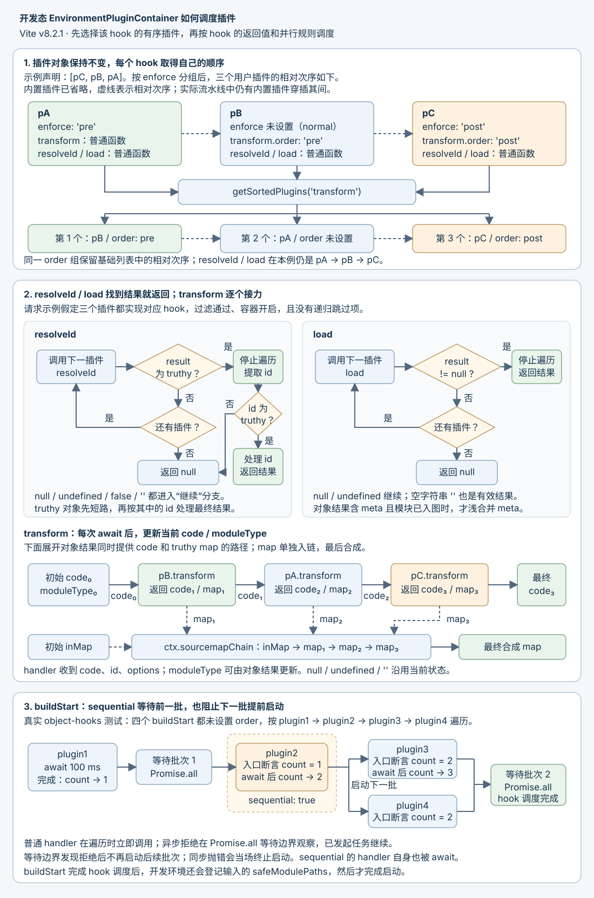

# 03. 插件体系与 PluginContainer

> **证据基线**：Vite `v8.2.1`，commit `421615865dad3ed39137d17281814fc78a41246c`。本文所有源码、测试与行为结论均限定于该版本。

## 阅读边界

Vite 把用户插件与内置插件排成流水线，再为每个 Environment 选择真正参与的插件。本文
解释这两次选择、每种 hook 的调用规则，以及非打包开发模式怎样模拟打包器上下文；Oxc
小节用一个内置插件展示环境派生。各插件的解析、HTML、Import Analysis、CSS 和构建细节
在后续章节展开。

读完应能回答：

1. Vite 插件与 Rolldown/Rollup 插件是什么关系？
2. `apply`、`enforce`、hook `order`、`applyToEnvironment` 分别在哪一层生效？
3. 为什么开发服务器需要模拟 Rolldown PluginContext？
4. `resolveId`、`load`、`transform` 的停止/传递规则为何不同？
5. `this.resolve(id, importer, { skipSelf })` 如何避免递归，又不误伤不同子请求？

## 推荐阅读顺序

1. `plugin.ts`：插件输入类型、全局钩子、Environment 钩子。
2. `plugins/index.ts` 的 `resolvePlugins()`：内部/用户插件的整体流水线。
3. `plugins/index.ts` 的 hook 工具：单钩子排序和 filter 缓存。
4. `plugins/pluginFilter.ts`：声明式过滤条件。
5. `server/pluginContainer.ts`：开发服务器如何实际调度 hook。
6. 四份测试：`hooks.spec.ts`、`index.spec.ts`、`pluginFilter.spec.ts`、`pluginContainer.spec.ts`。

## Vite 插件与打包器插件

`Plugin` 继承 Rolldown 插件接口，再增加：

```text
应用级生命周期
  config / configEnvironment / configResolved
  configureServer / configurePreviewServer
  transformIndexHtml / buildApp / HMR

选择与排序
  apply / enforce / applyToEnvironment

多环境兼容
  sharedDuringBuild
  perEnvironmentStartEndDuringDev
  perEnvironmentWatchChangeDuringDev

模块 Hook 扩展
  resolveId/load/transform 的 ssr、scan、moduleType、filter
```

生产构建和 bundled dev 由 Rolldown 调度插件。本文的 `EnvironmentPluginContainer` 用于
非打包开发管线：它逐个模块执行 resolve/load/transform，执行 options/buildStart 等初始化
钩子，关闭时执行 buildEnd/closeBundle。它没有 generateBundle/writeBundle 等产物生成阶段；
`emitFile()`、`setAssetSource()`、`getFileName()` 只能告警，不能创建构建产物。

## 应用插件与 Environment 插件

应用插件参与整个 Vite 实例的生命周期，能声明 config、server 等全局钩子。

Environment 插件由 `applyToEnvironment(environment)` 派生：

```text
返回 true
  复用当前顶层插件

返回 false/null/undefined
  当前 Environment 排除该插件

返回 PluginOption
  异步展平后，用一组 Environment 专属插件替换
```

配置解析在 `configResolved` 后调用工厂，传入的是 `PartialEnvironment`：名字和环境配置
已经可用，Server/Builder 的完整运行时尚未建立。工厂适合按配置维护独立缓存；其返回
插件参与环境模块流水线，config/configResolved/configureServer 等应用钩子仍由顶层插件
列表调度，因此不能靠派生插件补跑这些钩子。

源码摘录，`packages/vite/src/node/plugin.ts`，`resolveEnvironmentPlugins()`：

```ts
for (const plugin of environment.getTopLevelConfig().plugins) {
  if (plugin.applyToEnvironment) {
    const applied = await plugin.applyToEnvironment(environment)
    if (!applied) {
      continue
    }
    if (applied !== true) {
      environmentPlugins.push(
        ...((await asyncFlatten(arraify(applied))).filter(Boolean) as Plugin[]),
      )
      continue
    }
  }
  environmentPlugins.push(plugin)
}
```

派生结果原位替换原插件：这里不会再次检查替换插件的 apply/enforce/order，也不会递归
执行它们的 applyToEnvironment；具体 hook 调用时才按 hook.order 排序。

`perEnvironmentPlugin(name, factory)` 只是一个轻量占位插件，核心就是把 factory 放进
`applyToEnvironment`。该模型由
[PR #18544](https://github.com/vitejs/vite/pull/18544) 扩展；内部插件逐步迁移见
[PR #19588](https://github.com/vitejs/vite/pull/19588)。

`config.ts` 在所有 `configResolved` Promise 完成后才派生各环境插件，让工厂读到该阶段
对插件和配置的修改；相关兼容问题见 [issue #20170](https://github.com/vitejs/vite/issues/20170)。

## 应用选择、环境选择与两层排序

不要混淆四个字段：

| 字段                 | 决定什么                                  | 发生时间                      |
| -------------------- | ----------------------------------------- | ----------------------------- |
| `apply`              | 整个插件是否用于 serve/build              | 配置文件加载后、config 钩子前 |
| `enforce`            | 插件放入整体流水线的 pre/normal/post 层级 | 用户插件初次排序              |
| hook `order`         | 某一个 hook 内的 pre/normal/post          | 查询该 hook 时                |
| `applyToEnvironment` | 插件是否/如何用于某个 Environment         | configResolved 后             |

### 整体插件流水线

`resolvePlugins()` 大致装配：

```text
optimized deps / package watcher / pre-alias / alias
→ 用户 enforce:pre
→ Vite 核心 resolve、CSS、Oxc、JSON、Worker、Asset
→ 用户 normal
→ define、CSS post、HTML、URL、build pre
→ 用户 enforce:post
→ build post、DevTools
→ client injection、CSS analysis、import analysis
```

最后三个插件排在基础列表末尾，让默认 hook 顺序下的客户端注入、CSS 分析和导入分析
读取前序转换结果。单个 hook 的 order 仍可改变调用次序，不能把基础列表末尾理解为
任何插件都无法越过的顺序保证。

若任一 Environment 使用 `isBundled`，serve 也要装配 build 插件。Worker 不安装主应用
package watcher/DevTools，并为每次子构建创建独立插件实例。

### 单个 hook 排序

同一插件可以让 transform 是 pre、load 是 post：

```ts
{
  transform: { order: 'pre', handler() {} },
  load: { order: 'post', handler() {} },
}
```

所以排序不能只做一次。`createPluginHookUtils()` 为每个 hook 首次查询时单独排序并缓存。
`getSortedPluginsByHook()` 用 pre/normal/post 三个插入边界，在一个数组中稳定排序，避免每
个 hook 创建三份临时数组。缓存按该工具持有的插件列表建立；某个 hook 一旦查过，
后续查询不重新观察插件增删或 order 变化。派生 Environment 插件后，容器另建一套缓存。

## 声明式 Hook Filter

`resolveId`、`load`、`transform` 的对象 hook 可以把廉价过滤条件交给容器：

```ts
transform: {
  filter: {
    id: { include: '**/*.js', exclude: '**/vendor/**' },
    code: 'import.meta',
    moduleType: ['js'],
  },
  handler(code, id) {},
}
```

语义：

- load/transform 的 ID 字符串是 glob；相对 glob 以 cwd 为根，`**` 开头和绝对 glob
  保留自身范围。ID 的反斜杠统一成 `/`，query 不会在这里自动删除。
- resolveId 的公开 filter 类型只接受正则及其数组/include/exclude 写法。
- code 字符串是字面子串，不是 glob；也可用正则。
- exclude 优先于 include。
- include 缺省或为空数组时，所有未被 exclude 的输入通过；moduleType 则是允许列表，
  显式空列表拒绝全部模块类型。
- transform 的 ID、code、moduleType 三组条件采用短路 AND。
- 正则每次匹配后复位 `lastIndex`，避免全局/粘滞正则沿上次结果继续搜索。

源码摘录，`packages/vite/src/node/plugins/pluginFilter.ts`，`createFilterForTransform()`：

```ts
let fallback = moduleTypeFilterFn?.(moduleType) ?? true
if (!fallback) {
  return false
}
if (idFilterFn) {
  fallback &&= idFilterFn(id)
}
if (!fallback) {
  return false
}
if (codeFilterFn) {
  fallback &&= codeFilterFn(code)
}
return fallback
```

先判断 moduleType，再判断 ID，最后匹配 code。容器默认从 `moduleType: 'js'` 开始；普通
请求入口可按加载结果或扩展名传入别的类型，前一 transform 的对象结果也可修改类型。
例如前一插件把 TS 改成 JS 并返回 `moduleType: 'js'`，下一插件按 js 的过滤器判断，同时
看到已经转换的 code，不能拿最初输入代替当前输入。

过滤器按插件对象放入 WeakMap。缓存值即使是 `undefined` 也要记录，否则“没有 filter”的
普通插件反而会在每次请求中重复解析配置。

Hook filter 由 [PR #19602](https://github.com/vitejs/vite/pull/19602) 引入，与 pluginutils
行为对齐见 [PR #19736](https://github.com/vitejs/vite/pull/19736)。

## 开发态 PluginContainer

每个 Environment 有自己的 `EnvironmentPluginContainer`：

```text
createEnvironmentPluginContainer(environment, plugins)
  ├─ 创建容器与 hook 排序缓存
  ├─ 运行并缓存 options
  └─ 返回 Environment 专属容器

服务器初始化或首次 resolveId
  └─ buildStart → dev 入口登记到 safeModulePaths

模块转换请求
  ├─ resolveId
  ├─ load
  └─ transform

关闭
  ├─ 阻止新的可恢复请求
  ├─ 等待当前已跟踪 hook Promise 的快照 settle
  ├─ buildEnd
  └─ closeBundle
```

同一 Environment 仍可建立多条插件流水线，因此 factory 显式接收 plugins，不强制读取
`environment.plugins`。内部 `createIdResolver()` 就需要一条精简解析管线。

`createServer()` 默认在初始化时等待 client 的 buildStart；其他环境或独立容器可由首次
resolveId 惰性启动。buildStart 先把 `_started` 置为 true，再执行 hook 并登记入口，这样
hook 和入口登记重入 resolveId 时不会等待自身。直接并发调用 buildStart 会等待同一个
`_buildStartPromise`；resolveId 只在 `_started` 仍为 false 时触发并等待启动，load/transform
本身也不触发启动。需要严格保证初始化已完成的调用方，应先等待 buildStart。

默认 buildStart/buildEnd/watchChange 只通知 client；顶层 server 配置或插件上的对应
`perEnvironment*` 标志可让非 client 容器也通知该插件。closeBundle 没有这层筛选。

### Hook 调度规则

| Hook                                          | 调度           | 返回值                                          |
| --------------------------------------------- | -------------- | ----------------------------------------------- |
| `options`                                     | 串行、缓存     | 后一插件接收前一结果                            |
| `buildStart/watchChange/buildEnd/closeBundle` | 并行批次       | 忽略                                            |
| `resolveId`                                   | 串行 hookFirst | 第一个 truthy 结果终止；false 继续              |
| `load`                                        | 串行 hookFirst | 第一个非 null/undefined 结果终止                |
| `transform`                                   | 串行全部执行   | 当前 code/moduleType 传给下一插件，map 另行积累 |

transform 的字符串结果替换 code，但空字符串被 `if (!result)` 忽略；要清空源码需返回
`{ code: '' }`。对象结果的 meta 和 moduleType 可独立更新，map 只有同时提供 code 且 map
为 truthy 时才加入映射链；`{ map }` 或 `map: null` 不会清除先前映射。

并行 hook 可声明 `sequential: true`。容器先等待当前并行批次清空，独占执行该插件，再开启
下一批次；它相当于并行流水线中的 barrier。

把两次排序放进一个具体例子：`pA` 的 enforce 是 pre，`pB` 未设 enforce，`pC` 的 enforce
是 post；三个用户插件在基础列表中的相对位置是 `pA → pB → pC`。若只有 `pB.transform`
设为 order pre、`pC.transform` 设为 order post，transform 的用户插件次序就成为
`pB → pA → pC`，resolveId/load 仍保留原相对次序。图中省略了穿插其间的内置插件。



图中的 buildStart 取自 `playground/object-hooks/vite.config.ts`：plugin2 在入口断言
`count === 1`，证明前一批 plugin1 已完成；plugin3、plugin4 都在入口断言 `count === 2`，
证明 sequential 的 plugin2 已完成，下一批普通 handler 随后才启动。页面测试继续断言
四个 transform 按各自 order 替换标记后的结果是 `ok`。

源码摘录，`server/pluginContainer.ts`，`hookParallel()`，sequential 分支中的三步：

```ts
await Promise.all(parallelPromises)
parallelPromises.length = 0
await handler.apply(context(plugin), args(plugin))
```

普通 handler 的返回值先加入 parallelPromises，不逐个 await；在 sequential 前或循环末尾
等待 Promise.all 时，容器才观察批次内的异步拒绝。等待边界发现拒绝后不再启动后续批次；
handler 同步抛错则当场终止启动。已经发起的任务不会被取消。

关闭容器用 `Promise.allSettled()` 等待已跟踪任务的快照，即使其中某个任务拒绝，也会
进入 buildEnd。buildEnd/closeBundle 自身仍使用 `Promise.all()`；buildEnd 拒绝会使 close
拒绝并跳过 closeBundle。`_closed` 防止再次启动关闭流程，后续 close 调用直接返回。
服务器重启时，可恢复 Environment 的旧 resolve/load/transform 请求抛
`ERR_CLOSED_SERVER`；transform 中间件映射为 504，让浏览器重试，而不是显示编译错误。

## PluginContext 层级

```text
BasicMinimalPluginContext
  日志、meta、error
  │
  └─ MinimalPluginContext
       + environment
       │
       └─ PluginContext
            + 当前 plugin/id/code
            + fs / parse / resolve / load
            + ModuleInfo / watch files
            │
            ├─ ResolveIdContext
            ├─ LoadPluginContext
            │    + 当前模块 addWatchFile 集合
            └─ TransformPluginContext
                 + originalCode / sourcemapChain
```

config/configEnvironment 发生得太早，没有 watchMode/Environment。configResolved 等全局钩子
仍没有单一当前 Environment。resolveId/load/transform 等模块钩子才通过
`this.environment` 获得准确归属。

`hooks.spec.ts` 分别创建各钩子的测试插件，验证日志/meta 上下文以及 serve/build 的 watchMode
差异；hotUpdate 测试还断言 environment 字段存在。模块钩子的 ssr 兼容参数取决于当前
Environment 的 consumer，准确环境信息优先从 `this.environment` 读取。

## `this.resolve()` 与递归跳过

错误的简化模型是“skipSelf 就把当前插件永久放入 skip Set”。真实场景：

```text
p1 处理 foo
→ p1 this.resolve(foo)             应跳过 p1，防直接递归

p2 处理 foo
→ p2 this.resolve(foo/modified)
→ p1 可以处理 foo/modified         不应因之前出现过 p1 而跳过
```

容器记录的是插件交给 `this.resolve(id, importer)` 的委托请求：

1. 首次委托记录 `(plugin, id, importer)`；嵌套 resolveId 遇到相同 id/importer 时跳过该插件。
2. 嵌套请求改了 ID 或 importer，旧记录还未标记 called，就允许该插件处理新请求。
3. 该插件再次委托同一三元组时，把旧记录标为 `called: true`。从此沿这条递归分支继续
   解析时都跳过它，防止 ID 来回改写后形成循环。

源码摘录，`server/pluginContainer.ts`，`resolveId()` 合并跳过记录的分支：

```ts
const mergedSkip = new Set<Plugin>(skip)
for (const call of skipCalls ?? []) {
  if (call.called || (call.id === rawId && call.importer === importer)) {
    mergedSkip.add(call.plugin)
  }
}
```

`PluginContext.resolve()` 在再次委托相同三元组时复制并修改记录，保留外层调用的原状态：

```ts
if (sameCallIndex !== -1) {
  skipCallsTemp[sameCallIndex] = {
    ...skipCallsTemp[sameCallIndex],
    called: true,
  }
} else {
  skipCallsTemp.push({ id, importer, plugin: this._plugin })
}
```

在 `pluginContainer.spec.ts` 的循环用例 (1) 中，p1 委托 foo，p2 委托 foo/modified，p1
处理新 ID 后又委托 foo。此时 p1 的 foo 记录置 called；p2 再次委托 foo/modified 又把
自己的记录置 called，下一层两个插件都跳过，返回 null，最后采用 p1 的 success 回退值。
用例 (2) 在它们后面放置 p3，证明跳过循环插件后仍能继续解析，并由 p3 返回 success。

显式 `skipSelf: false` 只停止新增当前记录，外层已有记录仍会继承。上述修复见
[PR #18903](https://github.com/vitejs/vite/pull/18903)。

`resolveId()` 是 hookFirst；返回 string 会转为 `{ id }`，普通磁盘路径规范化为 `/`，外部
URL 和 `\0` 虚拟 ID 保持原样。

## `this.load()` 与 ModuleInfo

插件在 transform 中调用 `this.load({ id })` 时，目标模块可能还没经过浏览器请求：

```text
ensureEntryFromUrl
→ 更新已支持的 ModuleInfo
→ container.load(id)
→ 有源码才运行 container.transform(code, id)
→ 返回最终 ModuleInfo
```

这里没有普通请求入口的磁盘读取回退；若所有 load hook 都未返回源码，就直接返回已入图
模块的信息，不运行 transform。只要返回了源码，transform 就必须完成后才返回 ModuleInfo，
否则调用方得到 load meta 而不是最终 meta。它也不写入普通请求的 transformResult 缓存。

源码摘录，`server/pluginContainer.ts`，`PluginContext.load()` 中的条件：

```ts
const loadResult = await this._container.load(options.id)
const code = typeof loadResult === 'object' ? loadResult?.code : loadResult
if (code != null) {
  await this._container.transform(code, options.id)
}
```

`will load and transform the module` 用例让 y.js 的 load 写 `meta.code='2'`，transform 再改为
`'3'`；x.js 的 transform 调用 this.load(y.js) 后输出 `'3'`，直接证明返回的是转换后的
meta。resolve 返回的 meta 则由 ModuleGraph 建点时保存；对象结果含 meta 且模块已入图时，
容器的 load/transform 才浅合并 meta，保留未被本次结果覆盖的键。能力与修复分别见
[PR #11469](https://github.com/vitejs/vite/pull/11469) 和
[PR #14965](https://github.com/vitejs/vite/pull/14965)。

开发模块图只实现一部分 Rollup ModuleInfo。Proxy 对未知字段抛明确错误，但对 `then` 返回
undefined，避免 async 函数把 ModuleInfo 当 thenable。

旧 `server.pluginContainer.getModuleInfo()` 需要合并 client 与 ssr：普通字段 client 优先，
meta 先合并 ssr 再由 client 覆盖。否则生态插件从旧入口会丢掉一个环境的元数据，见
[PR #18895](https://github.com/vitejs/vite/pull/18895)。

## Oxc：同一插件的 JS/native 双路径

`oxcPlugin()` 是理解 `applyToEnvironment` 的具体样本：

```text
unbundled Environment
→ JS transform hook
→ filter(id / cleanUrl(id) / refresh filter)
→ transformWithOxc()

bundled Environment
→ applyToEnvironment 返回 Rolldown nativeTransformPlugin
→ Rust/native 路径直接并入 bundler
```

两条路径都处理 include/exclude、JSX refresh 和 sourcemap 配置。JS 路径从顶层 config.oxc
建立过滤器，native 路径从 environment.config.oxc 读取并交给 Rolldown；不能把它们当成
同一份 JS handler。native 转换直接并入打包器，减少在 JS hook 与打包器之间重复解析 AST。

源码摘录，`plugins/oxc.ts`，`applyToEnvironment()` 中 native 路径的 sourcemap 条件：

```ts
transformOptions.sourcemap =
  environment.config.mode !== 'build' || !!environment.config.build.sourcemap
```

这里检查配置字符串 mode，不是 Environment 的 dev/build 类型；常规生产 mode 为
`'production'` 时前半条件成立。JS 路径则检查 `environment.mode !== 'build'`。这是当前
两条路径的具体差别。

### 文件语言与 tsconfig

`transformWithOxc()` 优先使用显式 `options.lang`，否则从 id 推断：

- `.cjs/.mjs` → js；
- `.cts/.mts` → ts；
- 有效尾扩展直接使用，适配 Vue block 等虚拟 id；
- 普通 query URL 先 cleanUrl 再取扩展名。

Oxc 返回它解析过的 tsconfigFilePaths；dev server 把每个路径加入 watcher，包括 root 外的
配置。`reloadOnTsconfigChange` 仍只在变化路径以 `/tsconfig.json` 结尾时全量失效并重载，
因此被监听的其他名称的 extends JSON 不会仅因进入 watcher 就触发这条分支。Vite 复用
tsconfig resolution cache，减少重复解析；相关优化见
[PR #21643](https://github.com/vitejs/vite/pull/21643)。

### JSX refresh 过滤

即使 JSX options 开启 refresh，以下情况仍关闭：

- server consumer；
- 用户 refresh filter 排除；
- 文件不是 JSX，代码也没有导入 jsx-runtime/jsx-dev-runtime。

JS 路径用 `id.split('?')[0].endsWith('x')` 判断 JSX 文件，runtime 导入判断用源码子串；
不是单独解析 import 语句。用户 refresh 过滤器匹配了非标准扩展时，插件把 language 强制
为 js，否则 Oxc 会把未知扩展误作语言名。

旧 jsxInject 在 JS 路径按 `/\.(?:j|t)sx\b/` 匹配 ID，再加到 Oxc 输出前，以分号分隔。
这里要区分 JSX runtime（如 react/jsx-runtime）与 Oxc 的语法转换 helper（@oxc-project/runtime）。
`plugins/index.ts` 仅给非打包环境安装 oxcRuntimePlugin；打包环境由 Rolldown 处理 helper
解析。helper 的 ESM 迁移见 [PR #21829](https://github.com/vitejs/vite/pull/21829)。

### 诊断归一化

Oxc/Rolldown 可一次返回多个错误。Vite 最多把前 5 项的 plugin/id/loc/frame/stack/cause 拼进 wrapper
message；原始 errors 通过 getter 暴露，避免 console.error 在已打印 summary 后再次展开全部细节。
`UNSUPPORTED_TSCONFIG_OPTION` 按 message 跨模块去重，其他 warning 仍逐次进入插件 logger。

### esbuild 兼容迁移

`convertEsbuildConfigToOxcConfig()` 只迁移仍有对应语义的 JSX、define 与过滤选项。特别注意：

```text
esbuild.jsxSideEffects = true
→ JSX 有副作用
→ Oxc jsx.pure = false
```

两个布尔值必须取反；相关回归见 [PR #22809](https://github.com/vitejs/vite/pull/22809)。banner/footer 不
属于 Oxc 语法配置，由兼容插件处理并警告用户迁移到 transform hook。

`plugins/oxc.spec.ts` 最值得读的是 useDefineForClassFields 矩阵：tsconfig target 决定 class field 语义，
Oxc 输出 target 只决定是否降级，不能反向覆盖 TypeScript 语义。

## 错误与 Source Map

PluginContext 的 error/warn 等方法按已知上下文补充这些字段：

```text
plugin + id + loc + frame + pluginCode
```

字段并非每次都有：load 上下文没有活动源码，带 pos 的日志通常只有插件名和原始 pos；
transform 上下文才持有当前 id/code，可生成代码帧。transform 调度器捕获 handler 直接
抛出的错误后再交给 ctx.error；resolveId/load 没有这层捕获，直接抛错会原样向上传播。

兼容 `pos`、`position`、`loc`、`line/column` 多种生态格式；CSS 预处理器若把 loc 指向
include 文件，会读取真实文件生成 frame。transform 错误的 loc 还能通过组合 Source Map
回溯到原始源码位置。回溯成功后只替换 loc；已经生成的 frame、id、pluginCode 不会随之
重建，因此 frame 仍可能展示当前转换代码。

Source Map 采用惰性链式合并：

- `{ mappings: '' }` 是空映射哨兵；一旦缓存为 combinedMap，后续 map 也会被丢弃。
- 无 version 的其他对象使当前合成返回 null，并停止处理本轮剩余映射。
- MagicString 未传 filename 时可能生成 `sources: ['']` 或 `[null]`；Vite 修复为当前模块
  ID 和原始源码，历史问题见 [issue #13657](https://github.com/vitejs/vite/issues/13657)。
- 没有可用 Map 时，插件调用 getCombinedSourcemap() 会按 originalCode 生成 boundary
  精度的回退 Map。它不会恢复插件修改后的真实位置；容器最终返回的 map 则仍可能为
  null 或空映射哨兵，不自动使用这张回退 Map。

各 transform 的 map 按转换顺序暂存。组合时把“最新输出到上一阶段”的 map 放在前面，
把已合成的“上一阶段到原始源码”的 map 放在后面，得到最新输出到原始源码的映射。
MagicString 的空 source 修复只作用于当前合成的第一个有效 Map，不重写所有 map 的来源。

源码摘录，`server/pluginContainer.ts`，`_getCombinedSourcemap()`：

```ts
combinedMap = combineSourcemaps(cleanUrl(this.filename), [
  m as RawSourceMap,
  combinedMap as RawSourceMap,
]) as SourceMap
```

## 测试阅读重点

- `plugins/hooks.spec.ts`：各生命周期上下文、watchMode、Environment、watchChange 错误。
- `plugins/index.spec.ts`：同一 filter 在 Dev Container 与 Rolldown build 中行为一致。
- `plugins/pluginFilter.spec.ts`：include/exclude、glob/正则、Windows、三条件 AND。
- `server/__tests__/pluginContainer.spec.ts`：meta 传播、`this.load()`、Source Map、skipSelf。

`watchChange` 的异步 rejection 必须被 watcher 入口捕获并记录，不能形成未处理 Promise；
相关修复见 [PR #22188](https://github.com/vitejs/vite/pull/22188)。

## 关键源码证据

目标版本源码摘录，来源：`packages/vite/src/node/plugins/index.ts`，
`getSortedPluginsByHook()`：

```ts
let pre = 0,
  normal = 0,
  post = 0
for (const plugin of plugins) {
  const hook = plugin[hookName]
  if (hook) {
    if (typeof hook === 'object') {
      if (hook.order === 'pre') {
        sortedPlugins.splice(pre++, 0, plugin)
        continue
      }
      if (hook.order === 'post') {
        sortedPlugins.splice(pre + normal + post++, 0, plugin)
        continue
      }
    }
    sortedPlugins.splice(pre + normal++, 0, plugin)
  }
}
```

三个插入边界同时保证 `pre → normal → post` 与组内稳定顺序。排序按 `hookName` 执行，正是同一
插件不同 hook 可以拥有不同顺序的实现依据。

## 推荐断点

1. `resolvePlugins()` 返回数组：观察用户插件落在哪两个内部插件之间。
2. `getSortedPluginsByHook()`：给同一插件的 load/transform 设置不同 order。
3. `getCachedFilterForPlugin()`：第二次请求确认不再编译 glob。
4. `EnvironmentPluginContainer.buildStart()`：并发调用两次，观察同一启动 Promise；再从 hook 内重入 resolveId。
5. `resolveId()` 与 `PluginContext.resolve()`：观察 skipCalls 三元组变化。
6. `PluginContext.load()`：加载浏览器从未请求的辅助模块。
7. `_formatLog()`：让 transform 在生成 Source Map 后按位置抛错。
8. `_getCombinedSourcemap()`：观察每个插件 Map 如何反向组合。

## 复盘题

1. `enforce: 'pre'` 与 `transform: { order: 'pre' }` 有什么不同？
2. 为什么 Environment 插件工厂应在 configResolved 后执行？
3. 为什么 transform filter 必须针对每一轮的当前 code，而不是最初 code？
4. resolveId/load 为什么遇到首个结果停止，transform 为什么不能？
5. `skipSelf` 为什么不能只用 `Set<Plugin>` 实现？
6. 关闭服务器时为什么要先等待在途 hook，再执行 buildEnd/closeBundle？
7. 为什么 MagicString 的空 source 要替换成模块 ID，而不能原样返回？
