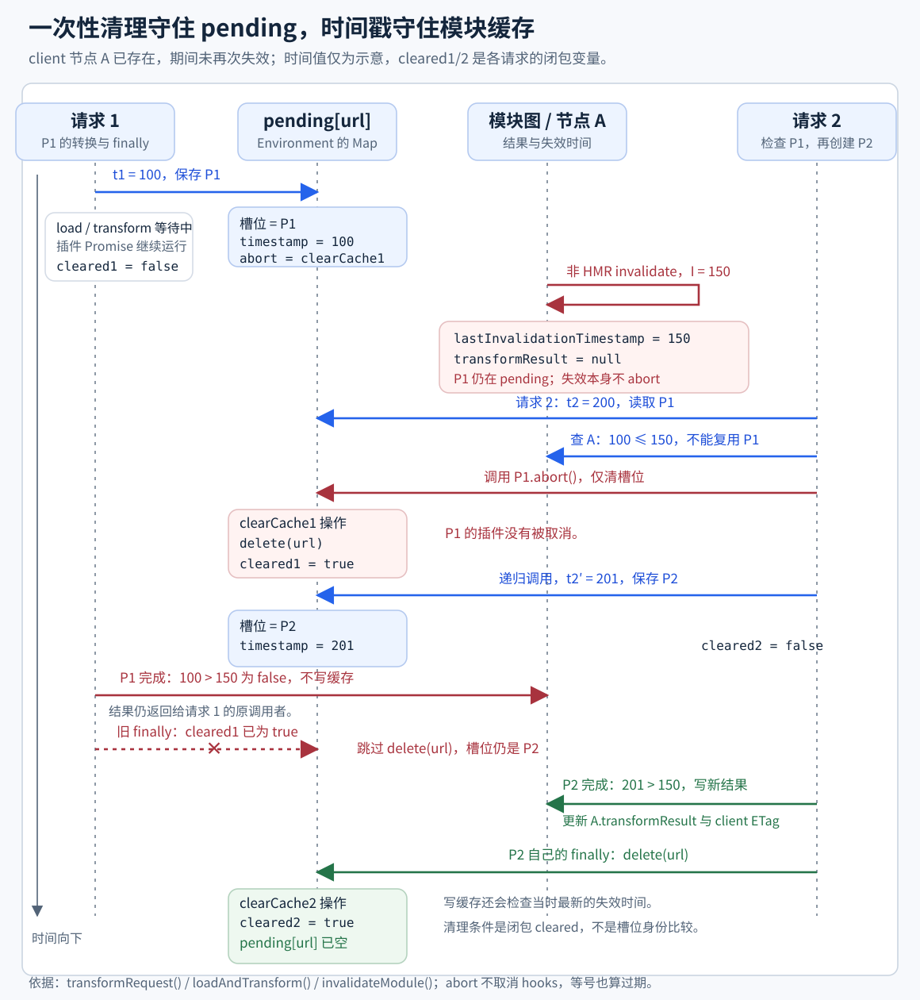
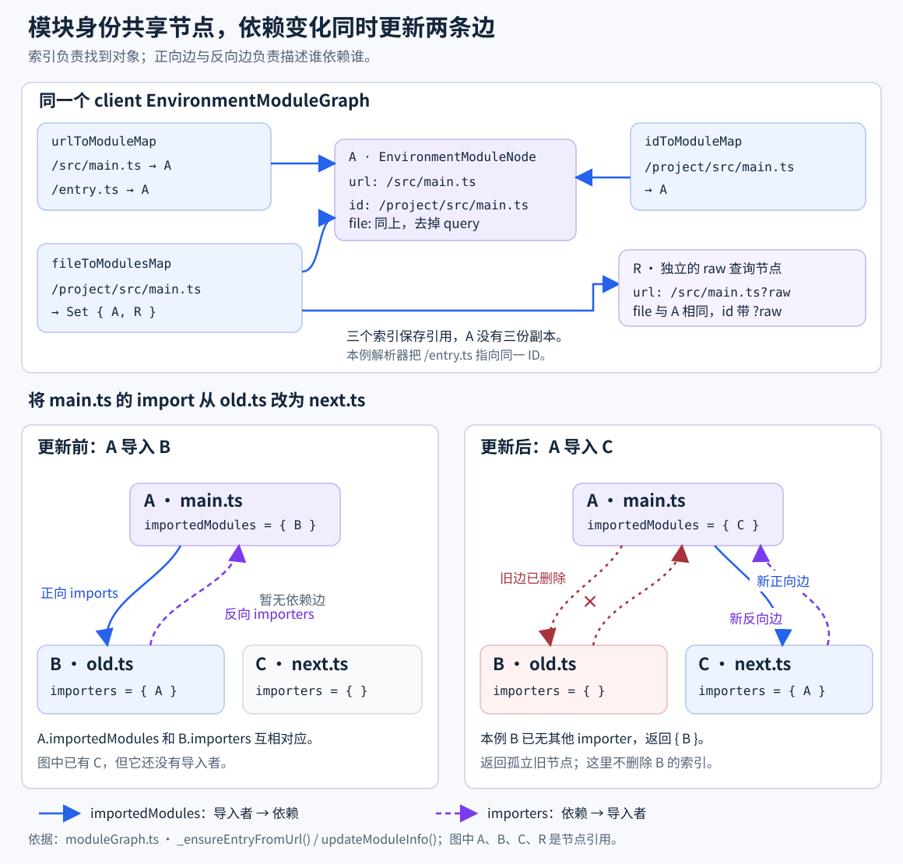

# 08. Transform 与模块图

> **证据基线**：Vite `v8.2.1`，commit `421615865dad3ed39137d17281814fc78a41246c`。本文所有源码、测试与行为结论均限定于该版本。

## 阅读边界

本节研究开发服务器收到模块请求后，怎样把 URL 解析、加载、转换并缓存，以及 ModuleGraph
怎样记录模块身份、依赖边和失效状态。插件 hook 的调度规则已在第 03 章说明，文件 ID 如何得到已在
第 07 章说明；本章聚焦两者进入请求热路径后的协作。

读完应能回答：

1. URL、resolved ID 和 file 为什么是三种身份，分别在哪些索引中使用？
2. 两个相同 URL 的并发请求怎样共享 Promise，失效穿插其中时为何必须开新请求？
3. 请求首次 load 成功后为何才确保节点？import analysis 为依赖预建节点又有什么不同？
4. transformResult、ETag、pending request 和 HTTP 304 分别是哪一层缓存？
5. 硬失效与软失效保存、清除哪些状态，失效为什么需要向 importer 传播？
6. client 软失效为什么只改 import 时间戳，SSR 又为什么连代码都不用改？
7. Source Map 补源码为什么存在 package 安全边界？
8. client/ssr 分图后，旧 ModuleGraph API 怎样仍表现为一张图？

## 推荐阅读顺序

1. `middlewares/transform.ts`：从 HTTP 请求类型、URL 规范化和 304 进入主链。
2. `transformRequest.ts` 的 `transformRequest()` 与 `doTransform()`：理解并发和两级缓存。
3. 同文件的 `loadAndTransform()`：串起 access check、load、入图、transform 和结果缓存。
4. `moduleGraph.ts` 的三张索引表、`_ensureEntryFromUrl()` 和 `updateModuleInfo()`。
5. `invalidateModule()` 与 `handleModuleSoftInvalidation()`：理解 HMR 快路径。
6. `sourcemap.ts`：理解转换产物如何补源码、标记 ignoreList 和防止越界读取。
7. `mixedModuleGraph.ts`：最后看 Environment API 迁移期的旧接口兼容，不要先被代理代码打断主线。
8. `transformRequest.spec.ts`、`moduleGraph.spec.ts` 与 `sourcemap.spec.ts`：复盘扩展名推断、ID 去重、双图兼容和包根边界。

## 一次 HTTP 模块请求

```text
GET /src/main.ts?t=...
→ cachedTransformMiddleware
   └─ 非 CSS 且 URL+ETag 精确命中 → 304
→ transformMiddleware
   ├─ 跳过 document、非 GET/HEAD、/、favicon
   ├─ decode URL，移除 HMR timestamp
   ├─ 处理 .map 请求
   ├─ 识别 JS / ?import / CSS / HTML proxy
   ├─ 移除 ?import，解开 /@id/ 虚拟 ID
   ├─ CSS 按 direct/import 分离身份
   └─ environment.transformRequest(url)
      → transformRequest
      → doTransform
      → loadAndTransform
→ send(code, etag, cache-control, sourcemap)
```

`Sec-Fetch-Dest: document` 的请求必须继续交给 HTML/static fallback。若把导航请求误当 JS，服务器
会返回转换后的模块代码而不是页面。缓存快路径放行 document 请求时追加
`Vary: Sec-Fetch-Dest`，让该文档响应的缓存区分请求目的。

### CSS 为什么有两个 URL 身份

同一 `style.css` 有两种消费者：

```text
import './style.css'       → JS 模块，运行时注入样式
<link href="/style.css">  → ?direct，直接返回 text/css
```

二者源码文件相同，转换代码和 ETag 却不同。通用缓存中间件发现 CSS 时不立即 304；主 transform
中间件先根据 Accept 规范化为 direct/import URL，再查对应节点的 ETag。否则浏览器可能把 JS
包装结果的 ETag 用于 `<link>` 请求。

### HTTP 错误不是一律 500

```text
依赖优化仍在处理 / 旧优化产物    → 504，等待页面用新版本重试
普通模块不存在                  → 交给下游，最终通常 404
资源 ID 被 server.fs 拒绝       → 可读文件返回 403，不存在路径交给下游
可恢复服务器已经关闭            → 504，客户端连接新实例
真正的插件/转换异常              → next(error)，由错误中间件格式化
```

版本 hash 对应的优化依赖可使用一年 immutable 缓存；项目源码仍是 `no-cache + ETag`。两者的
可变性不同，不能共用 cache-control。

## 模块的三种身份

```text
URL       浏览器/Runner 请求身份，例如 /src/data.ts?raw
id        resolveId 后的插件身份，例如 /abs/app/src/data.ts?raw
file      去 query 的磁盘关联，例如 /abs/app/src/data.ts
```

EnvironmentModuleGraph 因此维护不同索引：

| 索引               | 用途                     | 关键约束                                 |
| ------------------ | ------------------------ | ---------------------------------------- |
| `urlToModuleMap`   | 从请求回到节点           | query 不同通常是不同模块身份             |
| `idToModuleMap`    | 从规范 ID 去重节点       | 多个 URL 可解析到同一节点                |
| `fileToModulesMap` | 文件变化找到所有派生模块 | 一个文件可有 raw、url、worker 等多个节点 |
| `etagToModuleMap`  | HTTP 条件请求快速查节点  | 只供 client 图使用，更新结果时维护       |

`ensureEntryFromUrl()` 先 resolve URL，再按 resolved ID 查已有节点。`/x.js` 与 `/xx.js` 若都解析到
`/x.js`，第二个 URL 只登记到同一节点，而不是复制 meta、importers 和失效状态。这一竞态/去重
边界的历史修复见 [PR #9759](https://github.com/vitejs/vite/pull/9759)。

未解析 URL 的查找本身也是异步操作。`_ensureEntryFromUrl()` 用 `_unresolvedUrlToModuleMap` 缓存 Promise，让同 URL 的并发入图
共享一次 resolve；成功后把该项替换为节点，后续查找仍可直接复用。它与 transform 的 pending request 类似，但前者
只合并“URL 对应哪个节点”，后者合并完整加载和转换。

## 四层缓存不能混为一谈

```text
HTTP ETag                         浏览器已有内容，可能直接 304
environment._pendingRequests      同一时刻合并 transform Promise
ModuleNode.transformResult        服务端长期内存转换结果
deps optimizer immutable output   带内容版本的磁盘/HTTP 产物
```

`doTransform()` 先按 URL 找节点；未命中才 resolve，再按规范 ID 找节点。第二次查询解决“URL 尚未
登记，但相同 ID 已转换”的情况。命中节点后又分两条：有软失效状态则快速修补；有普通
transformResult 则直接返回。

不要把 pending Promise 当结果缓存。它只活到请求 settle，`finally` 会清掉槽位；长期复用由
ModuleNode 保存。这样失败 Promise 不会永久污染后续请求。

## 并发请求与失效竞态

`transformRequest()` 给每次真实处理记录单调时间，并把 `{ request, timestamp, abort }` 放进
`_pendingRequests`。同 URL 再来时：

```text
已有请求开始时间 > 模块最近失效时间
  → 在途结果仍新鲜，共享 Promise

已有请求开始时间 <= 模块最近失效时间
  → 时序是“请求 1 → 失效 → 请求 2”
  → 清掉旧 pending 所有权，请求 2 建立新 transform
```

这里的 abort 只是不再共享旧 Promise，不强行取消插件 hook。插件可能有不可取消的异步副作用，
旧调用者仍可收到旧结果；关键是旧结果不能覆盖新缓存。`loadAndTransform()` 完成时再次比较开始
时间与 `lastInvalidationTimestamp`，只有较新的请求能写 transformResult。

下面沿同一个已入图 URL 观察两个请求。非 HMR 失效先清节点结果并写入失效时间；它没有删除
pending，旧请求也继续运行。请求 2 发现旧时间戳后才释放 P1 的槽位，再递归取得新时间戳、建立 P2。
若图中节点尚不存在，源码会直接复用 pending；图示选择已有节点的失效分支。



图中 `cleared1` 与 `cleared2` 是各请求 `clearCache` 闭包的变量，不在 pending 记录中。P1 的 abort
第一次删除槽位并置 `cleared1=true`；P2 随后占用该 URL。P1 结束时，旧 finally 因这个标志跳过再次
删除，所以 P2 能继续被后续请求复用。源码没有进行“Map 当前值是否仍是 P1”的身份比较。

这一清理条件来自 `transformRequest.ts` 的 `transformRequest()`（源码摘录）：

```ts
let cleared = false
const clearCache = () => {
  if (!cleared) {
    environment._pendingRequests.delete(url)
    cleared = true
  }
}
```

`abort` 和 finally 共用这个函数。与此同时，写缓存仍需满足“请求开始时间严格晚于节点最近失效
时间”：P1 的结果返回原调用者，但不能缓存；P2 只有在完成时仍新鲜才写入结果。图中没有再次失效，
所以 P2 通过检查，最后由自己的 finally 清掉槽位。

这套双重保护分别覆盖历史上的模块图竞态、过期结果写缓存、失效后继续复用 pending request：
[PR #5470](https://github.com/vitejs/vite/pull/5470)、
[PR #7254](https://github.com/vitejs/vite/pull/7254)、
[PR #7283](https://github.com/vitejs/vite/pull/7283)。访问被拒绝的并发请求也必须正常 settle，不能
留下永久 pending 槽位，见 [PR #20503](https://github.com/vitejs/vite/pull/20503)。

## loadAndTransform 的阶段边界

### 1. 访问控制

会读取真实文件的 `?raw`、`?url`、`?inline`、SVG 查询先同时检查 clean path 与完整 ID，防止
恶意 query 绕过 server.fs。普通 ID 在最终文件确定后由 load 回退检查。虚拟模块以 `\0` 开头，
不应当按宿主文件路径检查。

### 2. 插件 load 优先，磁盘只是回退

```text
pluginContainer.load(id)
├─ 返回 string/object → 使用插件的 code、map、moduleType
└─ 返回 null
   ├─ server.fs 允许 → UTF-8 读取文件并加入 watcher
   └─ 仍无 code → 区分 publicDir import 与普通不存在，抛专用错误
```

二进制、虚拟模块和特殊 query 应由插件拥有；文件系统回退只负责普通文本。publicDir 文件构建时
原样复制，不经过插件转换，因此源码 import 它不是“路径碰巧找不到”，而是违反资源模型。

### 3. 首次请求 load 成功后确保节点

`loadAndTransform()` 在拿到 code 后才为尚无节点的请求调用 `_ensureEntryFromUrl()`，避免仅凭
resolve 结果就把未加载的 API/缺失 URL 登记为本次转换模块。节点先于 transform 建立，import
analysis 才能把当前模块的依赖边写回图中。

这不是“图中所有节点都已 load”的保证：import analysis 的 `updateModuleInfo()` 会先为依赖
调用 `ensureEntryFromUrl()`，即使浏览器还未请求它们。图既保存已转换模块，也保存已发现的依赖身份。

### 4. transform 与 Source Map 规范化

插件 transform 串行传递 code、map 和 moduleType。插件未声明类型时，Vite 从已知扩展名推断
非 JS 类型；无扩展名继续留空。推断函数不剥离 query，`file.ts?raw` 不会被当作末尾为 `ts`。
字符串 map 解析成对象，缺失 map 保留 null，空 mappings 则是
显式“无需 fallback”的结果。

`moduleRunnerTransform` 关闭时结果生成弱 ETag；开启时通过 `ssrTransform()` 改写成 Module
Runner 协议。默认 client 与 server 分别采用这两条分支，配置也可以显式覆盖。最后只有未在处理中失效的结果才写图缓存。

## 模块图怎样维护依赖边

`updateModuleInfo()` 接收 import analysis 解析出的依赖，完成双向更新：

```text
当前模块 importedModules = 新集合
每个新依赖.importers += 当前模块
每个已移除依赖.importers -= 当前模块
当前模块.acceptedHmrDeps / acceptedHmrExports / isSelfAccepting = 新 HMR 元数据
返回本次移除且已没有 importer 的旧依赖集合
```

三个索引和依赖边引用的是同一批节点。下图先把 URL、ID、file 的查找入口连接到节点 A，再对照
一次依赖改写前后的关系：`main.ts` 不再导入 `old.ts`，改为导入 `next.ts`。



更新时，`updateModuleInfo()` 先给新依赖 C 的 `importers` 加入 A，再把 A 的 `importedModules`
替换为新集合，并从已移除的 B 上删除 A。图中 B 没有其他 importer，因此它进入返回的
`noLongerImported` 集合；此方法没有把 B 从 URL、ID 或 file 索引中删除。R 与 A 的 file 相同，
但 R 的 resolved ID 带 query，所以它仍是另一个节点。

只维护 `A.importedModules` 而不维护 `B.importers`，文件变化时就无法向上寻找受影响边界。删除文件
时还要清理它作为 importer 留在依赖节点中的反向引用，避免悬挂边。

CSS 分析过程中可能只有文件依赖、尚无浏览器 URL，`createFileOnlyEntry()` 会创建 asset 节点。
它只进入 `fileToModulesMap`，没有 resolved ID，也不进入 URL/ID 索引；后续正常请求仍会建立
自己的节点。文件变化通过 file 索引同时找到这些节点，asset 节点本身不提供可直接返回的转换结果。

## 硬失效与软失效

| 状态   | 保存什么                                        | 下次请求                       |
| ------ | ----------------------------------------------- | ------------------------------ |
| 未失效 | `transformResult`                               | 直接内存命中                   |
| 硬失效 | 标记 `HARD_INVALIDATED`，清结果/ETag/错误       | 完整 load + transform          |
| 软失效 | 把旧 `transformResult` 移入 `invalidationState` | 复用旧代码并修补 import 时间戳 |

失效会清 `transformResult`、旧 SSR 执行结果/错误和 ETag 反向索引。非 HMR 失效更新
`lastInvalidationTimestamp`，阻止较早启动的请求写缓存；HMR 传播更新 `lastHMRTimestamp`，
供浏览器 import URL 的 `?t=` 使用，并复位运行时 invalidate 的去重标记。传播到 importer 时：

- 显式失效的根模块必须硬失效；
- importer 声明 accept 该依赖时停止传播；其余 JS importer 的静态 import 边可以软失效；
- 依赖已经通过软失效向上传播时，其他 JS importer 也可继续软失效；非静态硬失效边走完整转换；
- 同一轮传播中，硬失效可以把先前的软失效升级；
- `seen` 防止循环依赖无限递归，但升级判断必须发生在提前返回之前；
- 直接 CSS 请求不能按 JS import 语法重写，需走硬失效边界
  （[PR #18252](https://github.com/vitejs/vite/pull/18252)）。

软失效是 HMR 性能优化（[PR #14654](https://github.com/vitejs/vite/pull/14654)）：模块本身源码没变，
无需重跑整条插件管线。client 用 `es-module-lexer` 扫描旧转换结果，对已更新依赖写入新的 `?t=`；
静态直接 import 还可触发预热。实现保留旧 map，避免为仅改变依赖 URL 的模块重跑转换；URL 长度变化仍会改变该行后续字符列，
这里没有重新生成精确列映射。code 对应的 ETag 必须重算。

SSR 不靠浏览器 query 破缓存，Module Runner 管理执行缓存，所以直接复用旧 transformResult。无论
client 还是 SSR，修补结束都再次做时间戳新鲜度检查，防止修补过程中发生第二次失效。

## Source Map：可调试性与安全边界

Source Map 处理分四类：

1. 从源码的 Source Map 引用读取 inline/external map，并用等长空白移除引用，保持行列稳定；
2. 对缺失的 `sourcesContent` 并行读取原源码；
3. 根据 `server.sourcemapIgnoreList` 合并 `x_google_ignoreList`；
4. 响应 `.map` 请求或把 map 以内联 data URL 附加到 JS/CSS。

第三方 map 不能被当作可信文件读取清单。若转换文件在 node_modules，Vite 先找最近的普通包或
`@scope/pkg` 根；外部 map 文件和需要补读的 source 路径都必须仍位于该包内。否则恶意依赖可用
`../../.env` 一类路径把宿主文件读进 `sourcesContent` 并发送给浏览器。这个边界见
[PR #22158](https://github.com/vitejs/vite/pull/22158)。嵌套 node_modules 必须取最后一段，才能
限制到真正产出 map 的内层包。

补读普通 source 的文件读取失败会记录告警，虚拟 source 则不尝试磁盘读取。这种容错限于
补读流程；畸形 URI 的解码错误或用户 `sourcemapIgnoreList` 回调抛错仍可能使转换失败。

## Mixed ModuleGraph 兼容层

Environment API 把 client 与 ssr 状态拆成独立 EnvironmentModuleGraph，但旧插件仍期待：

```text
server.moduleGraph.getModuleById(id) → 一个 ModuleNode
module.importers / importedModules   → 一个 Set
idToModuleMap / fileToModulesMap     → 一张 Map
```

`mixedModuleGraph.ts` 用包装对象提供“合并视图”：

- ModuleNode 同时持有可选 `_clientModule` 与 `_ssrModule`；
- 相同 URL/ID 的双环境节点合成一个包装实例；
- importers/importedModules 返回合并 Set；单端依赖集合与索引 Map 使用兼容读取对象；
- ensureEntryFromUrl/resolveUrl/updateModuleTransformResult 的旧 `ssr?: boolean` 选择对应图，
  getModuleByUrl 则忽略该参数、并行查两图；
- `DualWeakMap` 以一对底层节点缓存包装对象，保证同一输入始终返回同一实例。

稳定实例很重要：插件可能用节点作 Set/Map key 或比较引用。只保证字段相等仍会破坏插件，相关
修复见 [PR #18455](https://github.com/vitejs/vite/pull/18455)。阅读这里时把它当迁移适配器，不要
反向理解为 client/ssr 又共享了缓存；真实状态仍在两张 Environment 图中。

## 用例怎样映射源码

| 用例                         | 固定的契约                             | 对应源码                      |
| ---------------------------- | -------------------------------------- | ----------------------------- |
| `getModuleTypeFromId` 表驱动 | 复合文件名取已知末尾类型，无扩展名不猜 | `defaultModuleTypes`          |
| 失效清除 SSR error           | 重试不能继续抛旧执行错误               | `invalidateModule()`          |
| 两 URL 解析到同一 ID         | 复用同节点及 meta                      | `_ensureEntryFromUrl()`       |
| backward compatibility       | 双图节点、Set 遍历和失效保持旧 API     | `mixedModuleGraph.ts`         |
| node_modules 包根表驱动      | 普通/scope/嵌套/Windows 安全边界       | `getNodeModulesPackageRoot()` |

模块类型用例固定扩展名查表结果；图用例直接构造节点、依赖和错误状态，分别验证失效清理、
resolved ID 复用与兼容视图。下面把这些状态连接到一次具体模块请求。

## 关键源码证据

目标版本源码摘录，来源：`packages/vite/src/node/server/transformRequest.ts`，
`transformRequest()`：

```ts
const timestamp = monotonicDateNow()

url = removeTimestampQuery(url)

const pending = environment._pendingRequests.get(url)
if (pending) {
  return environment.moduleGraph.getModuleByUrl(url).then((module) => {
    if (!module || pending.timestamp > module.lastInvalidationTimestamp) {
      // 在途请求开始于最近一次失效之后，可安全共享同一 Promise。
      return pending.request
    } else {
      // 时序：请求 1 → 模块失效 → 请求 2。请求 1 已过期，先清除其 pending 槽位，再让请求 2
      // 建立新的 transform；abort 只停止复用，不强行取消正在执行的插件 Promise。
      pending.abort()
      return transformRequest(environment, url, options)
    }
  })
}
```

同 URL 的请求通常复用 pending Promise；若模块在该请求开始后已失效，则释放旧 pending 槽位
并递归建立新请求。旧插件 hook 继续执行，原调用者仍等待它；写缓存时另做时间戳检查。
因此并发去重不能只按 URL 缓存，还必须和模块图的失效时间比较。

成功入图后，原始 URL 索引保留节点，见 `moduleGraph.ts` 的 `_ensureEntryFromUrl()`（源码摘录，
省略节点初始化和 file 索引写入）：

```ts
const modPromise = (async () => {
  const [url, resolvedId, meta] = await this._resolveUrl(rawUrl, resolved)
  mod = this.idToModuleMap.get(resolvedId)
  // 新 ID 创建节点；已有 ID 复用，并补登记 URL。
  // 此处省略两个分支的实现。
  this._setUnresolvedUrlToModule(rawUrl, mod)
  return mod
})()
this._setUnresolvedUrlToModule(rawUrl, modPromise)
return modPromise
```

`rawUrl → Promise → ModuleNode` 是这个索引的变化；`pending request → 删除槽位` 则是转换请求索引
的变化。两者合并的任务与保留时长都不同。

失效时间和 importer 分支来自同文件 `invalidateModule()`（源码摘录，省略状态合并、seen 与清理）：

```ts
if (isHmr) {
  mod.lastHMRTimestamp = timestamp
  mod.lastHMRInvalidationReceived = false
} else {
  mod.lastInvalidationTimestamp = timestamp
}
```

```ts
const shouldSoftInvalidateImporter =
  (importer.staticImportedUrls?.has(mod.url) || softInvalidate) &&
  importer.type === 'js'
this.invalidateModule(
  importer,
  seen,
  timestamp,
  isHmr,
  shouldSoftInvalidateImporter,
)
```

例如 `main.js` 静态导入 `data.js`，未 accept 该依赖，但 main 自身接受 HMR。data 内容变化时，watcher 的 onFileChange
把 data 硬失效、main 软失效，并写入两者的 lastInvalidationTimestamp；HMR 更新随后写入依赖的
lastHMRTimestamp。下一次 main 请求消费旧结果，只把 data 的 import URL 改成带新 `?t=` 的 URL，
重算 ETag 后写回 main 缓存。若 main 是通过 watch 文件而非静态 import 依赖 data，根节点的硬失效
会把 main 也硬失效；下次请求必须重新 load 和 transform。

## 建议断点

用一个含 TS、CSS 和动态 import 的最小页面，按顺序观察：

1. `viteTransformMiddleware`：记录原始 URL、规范化 URL、Accept 与 Sec-Fetch-Dest。
2. `transformRequest`：观察 `_pendingRequests` 是否合并两个相同请求。
3. `doTransform`：分别观察 URL 命中、resolved ID 命中和全未命中。
4. `loadAndTransform`：记录插件 load 是否接管、节点何时入图、transform 前后 code/map。
5. `updateModuleInfo`：观察 importedModules 与目标节点 importers 的双向变化。
6. `invalidateModule`：修改深层依赖，观察软/硬状态怎样传播到 importer。
7. `handleModuleSoftInvalidation`：观察依赖 URL 的 `?t=` 与 ETag 更新。

并发竞态可在 load hook 中手工挂起 Promise：发请求 A，修改文件触发失效，再发请求 B。正确结果
是 B 不复用 A，且 A 即使最后完成也不能写回模块缓存。它对应两处检查：pending 复用前比较时间戳，转换完成后再次比较时间戳。

## 复盘题

1. 为什么清掉 pending request 还不够，写 transformResult 前仍要比较时间戳？
2. 如果只用 URL 作为唯一索引，alias 或虚拟 URL 会制造什么重复状态？
3. 为什么直接 CSS 的 ETag 判断晚于普通模块的快速 304？
4. 请求 load 成功前不主动入图，为何不妨碍 import analysis 先为依赖建立节点？
5. 软失效为什么重新计算 ETag、保留旧 map？URL 长度变化影响哪种调试精度？
6. 环形依赖中，`seen` 判断放在软→硬升级之前会发生什么？
7. 为什么 sourcemap 的 source 读取边界是 package root，而不只是 node_modules root？
8. Mixed ModuleGraph 若每次访问都创建新包装节点，会破坏哪些插件代码？
