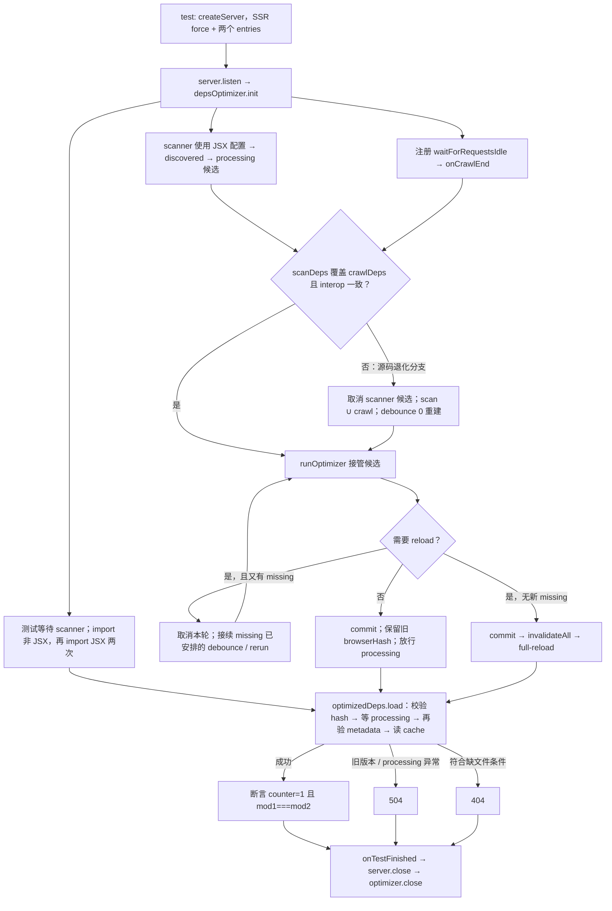

# 11. 依赖预构建

> **证据基线**：Vite `v8.2.1`，commit `421615865dad3ed39137d17281814fc78a41246c`。本文所有源码、测试与行为结论均限定于该版本。

## 阅读边界

本章研究开发服务器怎样发现第三方依赖、把它们预构建为浏览器可消费的 ESM、缓存结果，并在运行期
发现漏网依赖时安全换代。它不只是一次打包，而是一套允许“服务器先启动、优化在后台完成、请求按需
等待”的并发状态机。

上游的裸包解析见第 07 章，Import Analysis 怎样把裸包 URL 指向优化产物见第 10 章。本章重点是：

```text
扫描/真实 crawl 发现依赖
→ 建立 discovered 元数据与 processing Promise
→ Rolldown 在唯一临时目录预构建
→ 比较 hash、fileHash、needsInterop
→ 目录换代提交，或丢弃结果后合并重跑
→ 必要时使模块图失效并 full reload
```

读完应能回答：

1. 依赖预构建同时解决了 CJS 兼容和请求数量的什么问题？
2. scanner 与浏览器触发的真实模块 crawl 为什么要并行运行、最后再比较？
3. `optimized`、`discovered`、`chunks` 分别代表什么状态？
4. 依赖文件还未落盘时，Import Analysis 为什么已经能返回优化 URL？
5. `hash`、`browserHash`、`fileHash` 各自保护哪一层一致性？
6. 什么情况下新增一个依赖可以无感提交，什么情况下必须 full reload？
7. 为什么打包期间又发现依赖时，有时要直接丢弃已经完成的候选结果？
8. 正式缓存目录为什么用两次 rename 换代，而不是先删除再复制？
9. `preAliasPlugin` 和 `optimizedDepsPlugin` 怎样把异步优化接入普通 resolve/load？
10. `holdUntilCrawlEnd` 用首屏等待换取了什么稳定性？

## 推荐阅读顺序

1. `optimizer/index.ts` 的类型区：`DepsOptimizer`、`OptimizedDepInfo`、`DepOptimizationMetadata`。
2. `plugins/preAlias.ts`：看 alias 后的裸依赖怎样提前命中优化器。
3. `optimizer/scan.ts` 的 `scanImports()`、`computeEntries()`、`rolldownScanPlugin()`。
4. `optimizer/resolve.ts`：看 include 的嵌套语法、glob 与 package exports 边界。
5. `optimizer/optimizer.ts` 的 `createDepsOptimizer()`：先只读 `init()`、`registerMissingImport()`、
   `onCrawlEnd()`。
6. 回到 `optimizer/index.ts` 的 `runOptimizeDeps()` 和 `prepareRolldownOptimizerRun()`。
7. `optimizer/rolldownDepPlugin.ts`：理解入口映射、external、CJS facade 和资源 URL。
8. 再读 `runOptimizer()`：串起批次、提交、重跑与 reload 决策。
9. `plugins/optimizedDeps.ts`：从请求侧观察 `processing`、旧 hash 和缺文件错误。
10. 最后读 scanner、竞态、exports glob、插件兼容四组测试。

不要从 `runOptimizer()` 的所有分支开始硬读。先建立元数据状态和请求等待协议，再看调度分支，复杂度会
明显下降。

## 模块边界与对象所有权

依赖优化器不是全局单例。每个未禁用依赖优化、且未进入 Bundled Dev 的 `DevEnvironment` 各持有一份
`DepsOptimizer`。创建发生在 `DevEnvironment` 构造期，但冷缓存读取、scanner 与首轮优化延迟到
`environment.listen()`；关闭则由同一个 Environment 负责。这解释了一个看似反常的合法场景：
`createServer()` 后、`listen()` 前可以先 `transformRequest()`，此时优化器对象已经存在，`init()` 却还没
执行。

| 模块                                         | 负责                                                  | 不负责                      | 上游 → 下游                                                  |
| -------------------------------------------- | ----------------------------------------------------- | --------------------------- | ------------------------------------------------------------ |
| `server/environment.ts`                      | 创建、启动、关闭 Environment 私有优化器               | 依赖发现和打包决策          | Server 生命周期 → `DepsOptimizer.init/close`                 |
| `optimizer/scan.ts`                          | 从入口快速预测裸依赖集合                              | 生成正式产物、决定 reload   | entries/config/plugins → `id → src`                          |
| `optimizer/optimizer.ts`                     | 协调 scanner、真实 crawl、批次 Promise、重跑和 reload | 具体 bundle 输出、HTTP 响应 | 发现结果/运行时 missing → `runOptimizeDeps`/metadata/HMR     |
| `optimizer/index.ts`                         | 元数据/hash、Rolldown 构建、临时目录与目录换代        | 决定哪轮候选应发布          | 完整依赖快照 → `DepOptimizationResult`                       |
| `plugins/preAlias.ts` / `plugins/resolve.ts` | 把裸包解析到 optimized/discovered URL                 | 读取优化文件                | import specifier → `registerMissingImport/getOptimizedDepId` |
| `plugins/optimizedDeps.ts`                   | 等待批次、校验版本、读取 code/map                     | 触发新一轮优化              | 优化 URL → code/map 或稳定错误码                             |
| `middlewares/transform.ts`                   | 把优化器错误码映射为 HTTP 504/404                     | 判断优化结果新旧            | plugin error → HTTP response                                 |

`DepsOptimizer` 闭包同时持有调度标志、scanner/构建取消句柄与 discovered 批次 Promise；这些状态都不跨
Environment 共享。

## 为什么需要预构建

### 统一模块格式

浏览器原生 ESM 不能直接理解 Node 风格 `require()`、`module.exports`。很多包还是纯 CJS，另一些包同时
出现 ESM 语法与 CJS 导出。优化器让 Rolldown 提前把这些入口整理为 ESM，并记录 `needsInterop`，供
Import Analysis 在必要时补 named/default import 兼容。

### 压缩请求瀑布

一个看似单入口的 ESM 包可能由数百个内部模块组成。开发态逐文件服务会产生大量 HTTP 请求。预构建
把稳定的第三方依赖合并为较少入口和共享 chunk；项目源码仍保持按文件转换，继续享受快速 HMR。

因此预构建边界通常是：

```text
node_modules 中可优化的裸包 → 记录为依赖入口，停止继续扫描包内部源码
linked/workspace package      → 当作项目源码继续 crawl，直到遇到它真正的第三方依赖
CSS/asset/worker/query         → 交给对应 Vite 插件，不进入 JS 依赖预构建
```

## 两条发现路径：预测与校验

### scanner：快速预测

开发服务器冷启动把 `DevEnvironment` 窄化成 `devToScanEnvironment()` 视图后交给 `scanImports()`，
复用插件容器与 resolve 配置，视图不暴露模块图或完整 server 状态。单独调用 `optimizeDeps()` 时则创建
轻量 `ScanEnvironment`。扫描计算入口后调用 Rolldown，只遍历依赖图，不生成正式产物：

```text
optimizeDeps.entries
  优先于顶层 input / build.rolldownOptions.input
  优先于项目内所有 HTML
→ 解析 HTML/SFC 的 script 块
→ 遍历 JS/TS/JSX、import.meta.glob
→ 遇到 node_modules 裸包时登记 id → resolved path，并 externalize
```

结果按 ID 排序。异步解析完成顺序可能每次不同，固定顺序能让依赖集合序列化、browserHash 和日志保持
稳定。

scanner 追求低成本，不追求成为完整编译器。以 Vue `<script setup lang="ts">` 为例，直接转译 TS
可能删除“只在模板使用”的 import；`extractImportPaths()` 因而用轻量正则把静态 import 重新附加为
side-effect import。它允许少量假阴性，因为真实 crawl 会补齐；误识别的候选也会在 resolve 时过滤。

### 真实模块 crawl：运行语义的事实来源

服务器开始处理首个页面后，正常插件管线会转换源码，Import Analysis/resolve 遇到尚未优化的裸依赖时
调用 `registerMissingImport()`。这条路径看到的是插件真实转换后的模块图，所以用于校验 scanner 的预测。

两者并行是冷启动优化：

```text
后台：scanner → 提前开始构建候选优化结果
前台：浏览器请求 → 真实 transform/import crawl
                          ↓
                  waitForRequestsIdle()
                          ↓
             onCrawlEnd() 比较双方依赖全集
```

如果 scanner 没漏依赖且 interop 预测一致，就直接采用已经在后台生成的候选结果；如果真实 crawl 补出
新依赖，则取消候选，把双方并集重打包。这样宁愿首轮多做一次后台工作，也避免浏览器先拿到马上过期的
模块 URL 后再整页刷新。

这套冷启动 scanner 最初见 [PR #8869](https://github.com/vitejs/vite/pull/8869)。
更早的非阻塞发布与 URL 版本协议可沿
[PR #6758](https://github.com/vitejs/vite/pull/6758)、
[PR #7379](https://github.com/vitejs/vite/pull/7379) 和
[PR #7568](https://github.com/vitejs/vite/pull/7568) 追溯；后文只讨论目标版本的最终实现。

### 决定性源码 1：scanner 在裸包边界登记后停止 crawl

来源：`packages/vite/src/node/optimizer/scan.ts`，`rolldownScanPlugin()` 的
`vite:dep-scan:resolve`。以下删节摘录给出 scanner 的核心分类不变量：普通 `node_modules` 裸包成为
预构建入口，linked 包继续当源码遍历。

```ts
if (/^[\w@][^:]/.test(id)) {
  const resolved = await resolve(id, importer)
  if (resolved) {
    if (shouldExternalizeDep(resolved, id)) {
      return externalUnlessEntry({ path: id })
    }
    if (isInNodeModules(resolved) || include?.includes(id)) {
      if (isOptimizable(resolved, optimizeDepsOptions)) {
        depImports[id] = resolved
      }
      return externalUnlessEntry({ path: id })
    } else if (isScannable(resolved, optimizeDepsOptions.extensions)) {
      return path.resolve(resolved)
    } else {
      return externalUnlessEntry({ path: id })
    }
  } else {
    missing[id] = normalizePath(importer!)
  }
}
```

关键不是 `external` 等于“浏览器 external”。这里只是告诉 **Rolldown scanner** 不再沿该包内部展开；
登记的 `depImports[id]` 随后才成为正式预构建输入。linked 包没有停在边界，因为其源码变化应继续由 Vite
开发管线处理；scanner 只收集它沿途遇到的第三方包。

## scanner 怎样处理 HTML、SFC、JSX 与 glob

### HTML/SFC 脚本隔离

扫描器先去掉 HTML 注释，再为每个 `<script>` 块创建独立虚拟模块。不能把多个块简单拼到一个作用域：
Vue/Svelte 可能同时有 module/local script，重复变量会让扫描器误报语法错误。

- 纯 HTML 只收集 `type="module"`。
- Vue/Svelte/Astro 等框架文件允许普通 script。
- Svelte module script 可以重导出；组件实例 script 的 export 通常表示 props，不应 `export *`。
- 虚拟 script resolve 时恢复原 SFC 文件作为 importer，让 alias/相对路径语义与真实编译一致。

### JSX 隐式 runtime

automatic JSX runtime 的 import 是转换器注入的，源文件未必写出 `react/jsx-runtime` 或
`vue/jsx-runtime`。scanner 必须采用依赖优化专用的 JSX transform 配置，否则首个 JSX 请求才发现
runtime，会触发优化器重跑。相关历史修复见
[PR #20495](https://github.com/vitejs/vite/pull/20495)。

### `import.meta.glob`

scanner 在遍历前展开 glob，因此 glob 命中的文件也能贡献依赖。package.json `imports` 子路径模式需要
先解析，不能把 `#alias/*.js` 当普通磁盘 pattern；对应修复见
[PR #22018](https://github.com/vitejs/vite/pull/22018)。

### 入口解析必须复用插件与 root

顶层 `input` 可以先写成插件认识的虚拟 ID，再由插件解析到实际存在、可扫描的文件；入口解析后仍会
经过 `isScannable()` 和 `fs.existsSync()` 过滤，因此这条路径要求最终落在磁盘文件。对应测试的
`virtual:entry` 正是被映射到 fixture 的 `entry.js`；支持该场景见
[PR #23101](https://github.com/vitejs/vite/pull/23101)。相对
`build.rolldownOptions.input` 必须以项目 root 为基准，而不是 `process.cwd()`；回归修复见
[PR #22769](https://github.com/vitejs/vite/pull/22769)。

服务器在后台扫描期间关闭时，插件容器会用 `ERR_CLOSED_SERVER` 拒绝解析。结果本来就会丢弃，因此这是
取消控制流，不应变成未处理 rejection；见
[PR #22784](https://github.com/vitejs/vite/pull/22784)。

## 显式 include：嵌套依赖、glob 与 exports

`optimizeDeps.include` 不只是普通包名。`createOptimizeDepsIncludeResolver()` 支持：

```text
foo > bar > baz
```

它表示从 `foo` 的安装位置找 `bar`，再从 `bar` 的安装位置解析 `baz`，用于强制优化没有被应用源码直接
导入的嵌套依赖。

include 含 glob 时，`expandGlobIds()` 要尊重 package.json `exports`：

1. 先枚举包公开的 exports key/value；
2. 从 value 的 wildcard 找真实文件；
3. 把捕获值反推回公开子路径；
4. 再用用户 include pattern 过滤；
5. `null` value 表示显式封锁，必须跳过。

不能直接在包目录 glob，否则会绕过 exports 封装边界，把私有文件变成可导入入口。`null` 子路径的
回归修复见 [PR #22611](https://github.com/vitejs/vite/pull/22611)。

`noDiscovery: true` 时 scanner 完全关闭，只优化 include。若 include 也为空，优化器整体禁用；此时纯
CJS 包不会被自动转换，用户需要明确承担配置责任。

## 元数据就是状态机协议

`DepOptimizationMetadata` 不只是写入 `_metadata.json` 的缓存描述，它也是运行时协调对象。

| 区域          | 含义                                               |
| ------------- | -------------------------------------------------- |
| `optimized`   | 已成功打包并提交的入口依赖                         |
| `discovered`  | 已发现、最终文件名已确定，但当前批次尚未提交的入口 |
| `chunks`      | Rolldown 生成的共享 chunk 或依赖内部动态入口       |
| `depInfoList` | 三类对象的统一索引，支持按最终文件路径反查         |

单个 `OptimizedDepInfo` 的关键字段：

```text
id           规范化依赖名
src          真实入口文件
file         最终 deps cache 路径；发现时即可确定
browserHash  浏览器 URL 的 ?v= 版本
fileHash     已提交入口的 imports 图稳定性指纹
needsInterop 输入/输出导出形状是否需要额外兼容
processing   该 discovered 项所属批次的完成 Promise
exportsData  提前启动的入口导出分析 Promise
```

关键设计是“路径先确定，内容后落盘”。`registerMissingImport()` 可以立即把 `file?v=browserHash` 返回给
Import Analysis，但 `optimizedDepsPlugin.load()` 在读文件前等待 `processing`。因此单个请求被精准
阻塞，服务器其他初始化和源码转换不必等待整个依赖打包。

每批新依赖共享一个 `processing` Promise。开始一轮打包时，当前 Promise 被封存进队列，随后发现项
绑定下一批 Promise。正常提交会放行已封存批次；因又有 missing 而取消候选时仍保留队列，让请求等待
更完整的重跑结果。构建失败或关闭分支也会 resolve 队列以结束等待，此时请求仍要做版本检查和文件
读取，Promise fulfilled 本身不表示构建成功。

### 决定性源码 2：missing 先获得稳定 URL，再等待内容

来源：`packages/vite/src/node/optimizer/optimizer.ts`，`registerMissingImport()` 与
`addMissingDep()`。这是“路径先确定、文件后落盘”的真正写入点。

```ts
function registerMissingImport(id: string, resolved: string): OptimizedDepInfo {
  let missing = metadata.discovered[id]
  if (missing) {
    return missing
  }

  missing = addMissingDep(id, resolved)

  if (initState === 'initialized' && !waitingForCrawlEnd) {
    debouncedProcessing()
  }
  return missing
}

function addMissingDep(id: string, resolved: string) {
  newDepsDiscovered = true

  return addOptimizedDepInfo(metadata, 'discovered', {
    id,
    file: getOptimizedDepPath(environment, id),
    src: resolved,
    browserHash: getDiscoveredBrowserHash(
      metadata.hash,
      depsFromOptimizedDepInfo(metadata.optimized),
      depsFromOptimizedDepInfo(metadata.discovered),
    ),
    processing: depOptimizationProcessing.promise,
    exportsData: extractExportsData(environment, resolved),
  })
}
```

`registerMissingImport()` 的返回不是“已经可读的文件”，而是一张未来文件的凭证。`resolve.ts` 马上把它
变成 `${file}?v=${browserHash}`；真正的 `load()` 必须尊重 `processing`。初始化前只登记、不 debounce
的分支也在这里，不是 `listen()` 禁止转换。

### 协调状态表

| 阶段                 | `initState`                | `waitingForCrawlEnd` |        `currentlyProcessing` | metadata 主变化                        | 请求命运                                                              |
| -------------------- | -------------------------- | -------------------: | ---------------------------: | -------------------------------------- | --------------------------------------------------------------------- |
| 构造完成、未 listen  | `idle`                     |              `false` |                      `false` | missing 可进 `discovered`              | 得到 URL；不得抢跑 bundle                                             |
| 冷缓存 init          | `initializing`             |               `true` |                       `true` | 重建 metadata，include 先登记          | 静态 crawl 继续收集                                                   |
| scanner 运行         | `initializing/initialized` |               `true` |                       `true` | scan 结果补入 `discovered`             | 候选可后台构建，默认不发布                                            |
| crawl 结束、候选完整 | `initialized`              |              `false` |                       `true` | 候选交给 `runOptimizer`                | 等候 commit                                                           |
| crawl 发现漏项       | `initialized`              |              `false` |                       `true` | 候选 cancel；两边并集进入新批次        | 原批次 Promise 不提前放行                                             |
| 无 reload 提交       | `initialized`              |              `false` |               `true → false` | `discovered → optimized`；旧 hash 保留 | processing resolve，读新文件                                          |
| 需 reload 且无新漏项 | `initialized`              |              `false` |               `true → false` | 新 metadata 发布                       | 模块图失效、full reload                                               |
| 需 reload 且又有漏项 | `initialized`              |              `false` | `true → false → 下一轮 true` | 当前结果 cancel，metadata 仍旧         | 接续 `registerMissingImport()` 已安排的 debounce/rerun，避免双 reload |
| close                | 任意                       |                 任意 |                         任意 | 正式 cache 不因 close 删除             | scanner/build 取消；Environment 等待在途请求                          |

表里的 `currentlyProcessing` 是调度互斥，不代表 CPU 一直在打包；首轮等待 crawl 时也为 `true`，用于阻止
普通 debounce 越过首轮协调点。

## 三种 hash 各管一层一致性

```text
lockfileHash = 最近 lockfile + 必要时 patch 目录状态
configHash   = 会影响优化输出的 resolve/build/optimizeDeps 配置
hash         = lockfileHash + configHash

browserHash  = hash + 本轮依赖 id/src 集合 + 可选 session timestamp
fileHash     = hash + 入口输出路径 + 该 chunk 的 imports 列表
```

- `hash` 决定磁盘缓存能否跨启动复用。
- `browserHash` 是浏览器 URL 版本，防止旧请求与新优化目录混用。
- `fileHash` 判断新增依赖是否改变旧入口的共享 chunk 图。

若 lockfile/config hash 一致，启动直接复用 `_metadata.json`，跳过扫描与打包。`force` 会无条件清缓存。
空依赖结果也写元数据；否则每次启动空项目都要重复扫描。

配置 hash 只序列化会影响优化结果的字段。函数/正则转字符串，插件只记录名称，避免不可序列化对象让
缓存随机失效。lockfile 搜索优先检查常见包管理器以缩短路径遍历；同时兼容多个新旧 lockfile 格式。

## 初始化、首轮候选与验收

`initState` 有 `idle → initializing → initialized` 三态。`createServer()` 与 `listen()` 之间也允许用户
主动发起 transform，此时可能早于 `init()` 发现依赖。若立即启动打包，`init()` 随后重置 metadata，
提交阶段就会拿到错配状态。现在 pre-init 只登记 missing，等待 initialized 后再调度；修复见
[PR #22852](https://github.com/vitejs/vite/pull/22852)。

### 决定性源码 3：init 同时启动真实 crawl 闸门与 scanner 候选

来源：`packages/vite/src/node/optimizer/optimizer.ts`，`init()`。这是源码删节摘录；仅用教程注释标出
日志与错误处理的省略，保留三条并行线的原始语句。

```ts
if (!cachedMetadata) {
  waitingForCrawlEnd = true
  currentlyProcessing = true

  environment.waitForRequestsIdle().then(onCrawlEnd)

  if (noDiscovery) {
    runOptimizer()
  } else {
    // 教程删节：scanner Promise、日志与错误收尾；deps 是扫描结果。
    for (const id of Object.keys(deps)) {
      if (!metadata.discovered[id]) {
        addMissingDep(id, deps[id])
      }
    }
    const knownDeps = prepareKnownDeps()
    startNextDiscoveredBatch()
    optimizationResult = runOptimizeDeps(environment, knownDeps)
    // 教程删节：holdUntilCrawlEnd=false 的提前发布分支。
  }
}
```

这里的 `waitForRequestsIdle()` 是 Environment 的首轮 eager request crawl 闸门，不是等待整个浏览器
生命周期。scanner 候选使用 `prepareKnownDeps()` 快照；之后新增的 `discovered` 只能由验收或重跑明确吸收。

### 决定性源码 4：crawl 结束后验收候选，而非盲目提交

来源：同文件 `onCrawlEnd()`。以下为源码删节摘录，省略零依赖与日志分支；保留“采用预测”或“取消后
取并集”的原始决定语句。

```ts
const result = await afterScanResult
currentlyProcessing = false

const crawlDeps = Object.keys(metadata.discovered)
const scanDeps = Object.keys(result.metadata.optimized)

const needsInteropMismatch = findInteropMismatches(
  metadata.discovered,
  result.metadata.optimized,
)
const scannerMissedDeps = crawlDeps.some((dep) => !scanDeps.includes(dep))
const outdatedResult = needsInteropMismatch.length > 0 || scannerMissedDeps

if (outdatedResult) {
  result.cancel()
  for (const dep of scanDeps) {
    if (!crawlDeps.includes(dep)) {
      addMissingDep(dep, result.metadata.optimized[dep].src!)
    }
  }
  debouncedProcessing(0)
} else {
  startNextDiscoveredBatch()
  runOptimizer(result)
}
```

`crawlDeps` 当前包含 include、scanner 已登记项与真实请求漏项，所以 `scannerMissedDeps` 只需问“crawl
集合中有没有 scan 输出没有的项”。反向差集不能丢：循环把 scanner 独有项补回 `discovered`，保证重跑
输入是并集。`needsInteropMismatch` 同样会使候选过期，因为 Import Analysis 的导入改写取决于它。

### `holdUntilCrawlEnd`

默认 `true`：scanner 可以提前构建，但候选结果等真实静态 crawl 结束后才发布。优点是首屏几乎不会因
漏依赖改变共享 chunk 而 reload；代价是浏览器更晚拿到优化文件。

设为 `false`：scanner 完成即可提交，浏览器能更早并行请求；若真实 crawl 随后发现新依赖，则进入普通
重跑，旧 `fileHash` 稳定时仍可无感，否则 full reload。这一权衡由
[PR #15244](https://github.com/vitejs/vite/pull/15244) 引入。

## 一轮优化怎样生成并发布

`runOptimizeDeps()` 先创建唯一 processing 目录，并写局部 `package.json` 声明 `type: module`。随后
`prepareRolldownOptimizerRun()`：

1. 等待每个入口的 `exportsData`；
2. 把 `react-dom/client` 一类 ID 扁平化为稳定输出名；
3. 将扁平入口映回 Vite 已解析的真实 src；
4. 合并用户 Rolldown 选项、兼容转换后的 esbuild 插件与内置 dep 插件；
5. 创建可取消、可延后 `build()` 的 Rolldown context。

打包结果把入口写进 `optimized`，非入口写进 `chunks`。入口 `fileHash` 主要取决于 `chunk.imports`；代码
内容变化本身由 lockfile/config hash 和开发重启处理，这里关心的是“旧浏览器模块引用的 chunk 图是否
还成立”。

### 提交前为什么仍可能丢弃结果

`runOptimizer()` 比较新旧结果：

```text
needsInterop 变化
或主 hash 变化
或任一旧入口 fileHash 变化
  → needsReload
```

- 无需 reload：提交目录，但保留浏览器已经使用的旧 browserHash；新依赖可无感加入。
- 需要 reload，且打包期间没有再发现依赖：提交新版本、清模块图、广播 full reload。
- 需要 reload，但打包期间又发现依赖：取消当前结果，接续 missing 登记时已经安排的 debounce/rerun，再打包
  更完整快照，避免连续两次 reload；这条分支不执行 `onCrawlEnd()` 的 scan∪crawl 合并代码，也不保证立即开始。

最后一种分支最容易漏读：已经花时间打好的结果仍不能发布，因为它一发布就知道还要再次换代。已封存批次
Promise 保持等待，后续结果正常提交或失败/关闭处理才将它放行。

### 决定性源码 5：reload 判定、无感合并与丢弃重批

来源：`packages/vite/src/node/optimizer/optimizer.ts`，`runOptimizer()`。源码删节摘录用教程注释标出
原位补全与日志省略；决定分支保持原样。

```ts
const needsReload =
  needsInteropMismatch.length > 0 ||
  metadata.hash !== newData.hash ||
  Object.keys(metadata.optimized).some((dep) => {
    return metadata.optimized[dep].fileHash !== newData.optimized[dep].fileHash
  })

const commitProcessing = async () => {
  await processingResult.commit()

  if (!needsReload) {
    newData.browserHash = metadata.browserHash
    for (const dep in newData.optimized) {
      newData.optimized[dep].browserHash = (
        metadata.optimized[dep] || metadata.discovered[dep]
      ).browserHash
    }
  }
  // 教程删节：更新 chunks/discovered 引用，替换 metadata，resolve 批次 Promise。
}

if (!needsReload) {
  await commitProcessing()
} else {
  if (newDepsDiscovered) {
    processingResult.cancel()
  } else {
    await commitProcessing()
    fullReload()
  }
}
```

无 reload 分支保留旧 `browserHash` 不是性能小优化，而是模块身份协议：浏览器已执行的 `react?v=old` 与
新依赖一起打包后，若旧入口 import 图未变，就必须仍叫 `react?v=old`，避免同一逻辑包出现第二实例。
反之，`fileHash` 变化说明旧入口引用的共享 chunk 图变了，仅替换磁盘而不 reload 会让现有模块图与新
目录错配。

## 缓存目录换代：双 rename 的保证与缺口

构建始终写唯一临时目录；Rolldown build 失败或 commit 开始前取消时，只删除该目录，不触碰当前正式缓存。
commit 成功路径先写 `_metadata.json`，再执行：

```text
正式 deps 目录  → 唯一 backup 目录
processing 目录 → 正式 deps 目录
后台删除 backup
```

相较“删除正式目录，再移动新目录”，两次 rename 把缓存不可用窗口压到最小，也避免请求读到半写文件。
POSIX 使用同步 rename；Windows 的杀毒软件可能短暂锁目录，所以 `safeRename()` 对 EACCES/EPERM 重试，
只在目标路径仍不存在时再次调用 rename；目标已存在时仍按原锁冲突错误继续等待，超时后报错。临时目录换代方案见
[PR #12622](https://github.com/vitejs/vite/pull/12622)。异常退出残留超过 24 小时的临时目录在下次启动
异步清理，不阻塞当前冷启动。

这不是跨两次 rename 的事务：若旧正式目录已移到 backup，而 processing→正式目录这一步仍失败，源码没有
回滚，旧内容可能只留在 backup、正式路径暂时缺失。因此“保留旧 cache”的保证只适用于 build 失败和 commit
前取消，不能扩大到 commit 中途 I/O 失败。

### 决定性源码 6：正式目录只接收完整候选

来源：`packages/vite/src/node/optimizer/index.ts`，`runOptimizeDeps()` 返回结果的 `commit()`。

```ts
commit: async () => {
  if (cleaned) {
    throw new Error('Can not commit a Deps Optimization run as it was cancelled')
  }
  committed = true

  // 教程删节：先把完整 metadata 写入 processing 目录。
  const dataPath = path.join(processingCacheDir, METADATA_FILENAME)
  fs.writeFileSync(dataPath, stringifyDepsOptimizerMetadata(metadata, depsCacheDir))

  const temporaryPath = depsCacheDir + getTempSuffix()
  const depsCacheDirPresent = fs.existsSync(depsCacheDir)
  if (isWindows) {
    if (depsCacheDirPresent) {
      await safeRename(depsCacheDir, temporaryPath)
    }
    await safeRename(processingCacheDir, depsCacheDir)
  } else {
    if (depsCacheDirPresent) {
      fs.renameSync(depsCacheDir, temporaryPath)
    }
    fs.renameSync(processingCacheDir, depsCacheDir)
  }

  if (depsCacheDirPresent) {
    fsp.rm(temporaryPath, { recursive: true, force: true })
  }
},
```

这里的“提交”不是把两个 rename 合成一次不可分割事务；旧目录移到 backup 与新目录移到正式名
之间仍有很短窗口。保证是正式路径不会指向**半写目录**；“旧 cache 不受影响”只适用于 build 失败或
commit 前取消。Windows 的 `safeRename()` 还会对 EACCES/EPERM 最多退避 5 秒。

## Rolldown 依赖插件的边界

`rolldownDepPlugin()` 统一把 Vite 的解析语义接入预构建：

- ESM import 和 CJS require 使用不同 resolve 条件与 package cache；
- 入口 ID 必须映回 Vite 预先解析的 src，避免 Rolldown 再选到不同条件入口；
- CSS、WASM、SFC、已知 asset 默认 external；用户声明可优化扩展名可移出该集合；
- `require()` 静态资源先经虚拟 facade 变成 import，再 external；
- browser external 用 Proxy 在访问属性时给出明确兼容警告；
- 相对 `new URL('./asset', import.meta.url)` 要按原依赖文件解析，再改写为相对 deps 输出目录。

资源 `new URL` 的相对位置修复见
[PR #21434](https://github.com/vitejs/vite/pull/21434)。动态模板需要 glob 枚举，仍交给主 asset 插件；优化器
只安全处理可静态确定的相对字面量。

`rolldownCjsExternalPlugin()` 只在 browser 平台把 external require 改成 import facade。Node 原生支持
require，保留语义更准确；neutral 平台无法推断目标运行时能力，也保守跳过。

`pluginConverter.ts` 只实现依赖扫描/预构建需要的 esbuild 插件子集：`onResolve`、`onLoad`、
`onStart`、`onEnd` 与有限 BuildResult。它是迁移兼容层，不代表任意 esbuild 插件都可无损运行在
Rolldown 上。

## alias 与请求侧怎样接入

### `preAliasPlugin`

普通 alias 插件把 `react` 改成某个 replacement 后，后续逻辑可能看不出它原本是裸依赖。
`preAliasPlugin` 提前解析 replacement：

- replacement 已在 optimized/discovered 中：直接返回优化 URL；
- replacement 可优化但尚未登记：调用 `registerMissingImport()`；
- SSR 未显式 include：保守不优化，因为单凭文件路径无法可靠判断 package/CJS 身份。

这个桥接修复了 alias 指向的依赖绕过优化器的问题；历史起点见提交
[`54dab71e4`](https://github.com/vitejs/vite/commit/54dab71e4)。

### `optimizedDepsPlugin`

`load()` 先校验 URL 版本，再等待 discovered 所属批次，等待后重新读取 metadata，最后才读正式 cache。
默认不容忍旧 URL，因为同一逻辑模块的两个优化版本可能产生重复实例；具体错误条件见下表。

### 决定性源码 7：请求等待、二次验版本、再读正式目录

来源：`packages/vite/src/node/plugins/optimizedDeps.ts`，`optimizedDepsPlugin().load()`。源码删节摘录省略
debug 与外围 ID 判定，等待、二次校验、读文件和错误分支保持原样。

```ts
const info = optimizedDepInfoFromFile(metadata, file)
if (info) {
  if (
    browserHash &&
    info.browserHash !== browserHash &&
    !environment.config.optimizeDeps.ignoreOutdatedRequests
  ) {
    throwOutdatedRequest(id)
  }
  try {
    await info.processing
  } catch {
    throwProcessingError(id)
  }
  const newMetadata = depsOptimizer.metadata
  if (metadata !== newMetadata) {
    const currentInfo = optimizedDepInfoFromFile(newMetadata!, file)
    if (
      info.browserHash !== currentInfo?.browserHash &&
      !environment.config.optimizeDeps.ignoreOutdatedRequests
    ) {
      throwOutdatedRequest(id)
    }
  }
}

try {
  const [code, map] = await Promise.all([
    fsp.readFile(file, 'utf-8'),
    fsp
      .readFile(`${file}.map`, 'utf-8')
      .then((map) => JSON.parse(map))
      .catch(() => null),
  ])
  return map ? { code, map } : code
} catch {
  if (browserHash && !environment.config.optimizeDeps.ignoreOutdatedRequests) {
    throwOutdatedRequest(id)
  }
  throwFileNotFoundInOptimizedDep(id)
}
```

等待期间 `commitProcessing()` 可能整体替换 metadata，所以放行后要用新快照再次按文件查找。这里
比较的是所持 `info.browserHash` 与新记录，不是重新比较 URL 的原始 `?v=`。提交还会原位补全旧
`discovered` 对象的 hash、interop，并清 `processing`，因此持有该对象的请求能看到最终信息；其他
旧记录若已与新快照不同，则进入过期分支。具体错误条件如下：

| 触发条件                                                       | 稳定错误码                                | HTTP | 含义                                 |
| -------------------------------------------------------------- | ----------------------------------------- | ---: | ------------------------------------ |
| 请求 hash 与 `info.browserHash` 不同                           | `ERR_OUTDATED_OPTIMIZED_DEP`              |  504 | 旧页面请求；reload 后换 URL          |
| `info.processing` 自身 reject                                  | `ERR_OPTIMIZE_DEPS_PROCESSING_ERROR`      |  504 | 优化等待异常                         |
| 等待期间 metadata 换代，原 `info.browserHash` 与新文件记录不同 | `ERR_OUTDATED_OPTIMIZED_DEP`              |  504 | 等候者所持记录已与当前快照分离       |
| `readFile` 失败且 URL 带 hash、未忽略过期                      | `ERR_OUTDATED_OPTIMIZED_DEP`              |  504 | 优先按换代处理，不武断判文件永久缺失 |
| `readFile` 失败且无 hash，或显式忽略过期                       | `ERR_FILE_NOT_FOUND_IN_OPTIMIZED_DEP_DIR` |  404 | 真正走缺文件提示，建议检查 `exclude` |

`createDepsOptimizer()` 在构建失败时记录错误、resolve 已封存批次并清空 `discovered`，没有通过
批次 Promise 拒绝请求。等候者继续走版本与文件检查：带 hash 且未忽略过期的缺文件请求返回过期
504；无 hash 或开启 `ignoreOutdatedRequests` 时返回缺文件 404。处理错误 504 则仅在所等 Promise
本身 reject 时产生。

## 真实完整测试：JSX runtime 扫描后的模块复用结果

来源：`packages/vite/src/node/__tests__/scan.spec.ts`。下方只删去同文件其他测试所需 import；本测试体、
准备、操作、断言与 `onTestFinished` 清理语句保持目标版本原样；原测试内解释性注释为篇幅省略。

```ts
import path from 'node:path'
import { expect, test } from 'vitest'
import { createServer, createServerModuleRunner } from '..'

test('scan jsx-runtime', async (ctx) => {
  const server = await createServer({
    configFile: false,
    logLevel: 'error',
    root: path.join(import.meta.dirname, 'fixtures', 'scan-jsx-runtime'),
    environments: {
      client: {
        optimizeDeps: {
          noDiscovery: true,
        },
      },
      ssr: {
        resolve: {
          noExternal: true,
        },
        optimizeDeps: {
          force: true,
          noDiscovery: false,
          entries: ['./entry-jsx.tsx', './entry-no-jsx.js'],
        },
      },
    },
  })
  ctx.onTestFinished(() => server.close())

  await server.listen()

  const runner = createServerModuleRunner(server.environments.ssr, {
    hmr: { logger: false },
  })

  await server.environments.ssr.depsOptimizer?.scanProcessing
  await runner.import('./entry-no-jsx.js')

  const mod1 = await runner.import('./entry-jsx.js')
  const mod2 = await runner.import('./entry-jsx.js')
  expect((globalThis as any).__test_scan_jsx_runtime).toBe(1)
  expect(mod1).toBe(mod2)
})
```

### GWTMS 证据拆解

- **Given**：SSR Environment 强制冷缓存，scanner 从 JSX 与非 JSX 两个入口开始；client 自动发现关闭，
  测试结束时关闭 server。
- **When**：`listen()` 初始化优化器；测试等 `scanProcessing` settle，先 import 非 JSX 入口，让真实
  request crawl 启动，再连续两次 import JSX 入口。优化文件请求仍由各自 `processing` 等待提交。
- **Then**：fixture 的全局执行计数为 `1`，两次 import 返回同一模块对象。
- **Mechanism / Source**：`prepareRolldownScanner()` 把 JSX transform 传给扫描器，提前发现自动注入的
  runtime；`init()` 建候选、`onCrawlEnd()` 验收、`runOptimizer()` 发布。计数与对象身份断言检查的是
  此后 Runner 两次导入仍复用同一实例。

## 同一 Demo 的端到端流程与时间线



同步边界在 `registerMissingImport()`：它同步建立未来 URL；异步边界依次是 exports 分析、scanner、
Rolldown build、processing 等待和磁盘读取。提交点之前候选只在唯一临时目录，提交点之后请求才可从正式
目录读取。图中的 scan miss、reload、504/404 是源码规定的关键分支；本测试只直接断言成功路径末端的模块
执行次数和对象身份。

## 关闭、错误与清理边界

### 决定性源码 8：关闭只取消本实例拥有的后台工作

来源：`packages/vite/src/node/optimizer/optimizer.ts`，`close()`。

```ts
async function close() {
  closed = true
  await Promise.allSettled([
    discover?.cancel(),
    depsOptimizer.scanProcessing,
    optimizationResult?.cancel(),
  ])
}
```

`allSettled` 收集这些异步收尾的结果。scanner cancel 只置标记，`scanProcessing` 另行等待后台任务；
预构建 cancel 等待准备阶段、设置 context 标记并删除候选目录，不中断或等待已开始的 write。这里没有
删除已提交正式 cache，也没有发送 reload；
Environment 的 `close()` 还会并行关闭插件/HotChannel，并等待 `_pendingRequests` settle。

| 失败/取消点                                     | 保留什么                  | 清理/后续                                                            |
| ----------------------------------------------- | ------------------------- | -------------------------------------------------------------------- |
| scanner 错误或关闭                              | 当前正式 cache            | 普通错误跳过本候选；`ERR_CLOSED_SERVER` 当取消处理                   |
| Rolldown build 失败，或 reload 候选又遇 missing | 当前正式 cache / metadata | 删除或取消 processing 候选；rebatch 时不提前放行旧批次               |
| commit 已开始后异常或迟到 cancel                | 正在换代的目录            | `committed` 阻止清理任务删除在途目录；中途 I/O 失败没有回滚保证      |
| Environment close                               | 已提交正式 cache          | 并行取消 scanner/build，关闭插件与 HotChannel，并等待在途请求 settle |

## 章节—源码—测试证据表

| 机制章节                | 决定性源码                                          | 代表性测试/fixture                                                                 | 证据边界                                                 |
| ----------------------- | --------------------------------------------------- | ---------------------------------------------------------------------------------- | -------------------------------------------------------- |
| scanner 分类与入口      | `scan.ts::rolldownScanPlugin`                       | `scan.spec.ts` script/input/glob 组                                                | 检查 scanner 发现的依赖集合                              |
| JSX 隐式 runtime        | `scan.ts::prepareRolldownScanner`                   | `scan jsx-runtime`                                                                 | 检查执行计数与两次导入的实例复用                         |
| include / exports       | `optimizer/resolve.ts::expandGlobIds`               | `resolve.spec.ts` 的 null exports 用例                                             | 证明私有子路径不会被 include glob 暴露                   |
| init/crawl 协调         | `optimizer.ts::init/onCrawlEnd`                     | `scan jsx-runtime`                                                                 | 源码证明候选验收分支                                     |
| listen 前发现           | `optimizer.ts::registerMissingImport`               | `discoverBeforeListen.spec.ts`                                                     | 证明 initialized 前不启动 bundle 且无错误                |
| reload/rebatch          | `optimizer.ts::runOptimizer`                        | optimizer/playground 组合回归                                                      | reload/rebatch 条件由源码分支给出，组合回归观察最终更新  |
| Rolldown 产物与插件边界 | `index.ts::runOptimizeDeps`、`rolldownDepPlugin.ts` | `playground/optimize-deps`、`rolldownDepPlugin.spec.ts`、`pluginConverter.spec.ts` | 检查 CJS/ESM/静态资源和兼容层结果                        |
| 目录换代                | `index.ts::commit`                                  | 缓存复用与 playground 间接覆盖                                                     | 双 rename 结论来自决定性源码；不提供中途失败回滚         |
| URL 等待/错误           | `optimizedDeps.ts::load` + transform middleware     | optimize-missing-deps playground                                                   | load 错误码与 transform middleware 一起给出 504/404 条件 |
| close                   | `optimizer.ts::close`、`environment.ts::close`      | `scan ignores ... mid-scan`                                                        | 检查 closed-server 扫描返回空结果                        |

## 请求等待与版本发布的联系

发现依赖时先返回未来 URL，请求加载时再等所属批次；批次正常提交后读正式文件，失败放行后则进入
版本或缺文件错误。`fileHash` 与 interop 决定新依赖能否沿用现有 URL，改变旧入口图时需要换代刷新。
双 rename 发布的是完整目录，第二次移动失败仍可能留下正式路径缺失。
