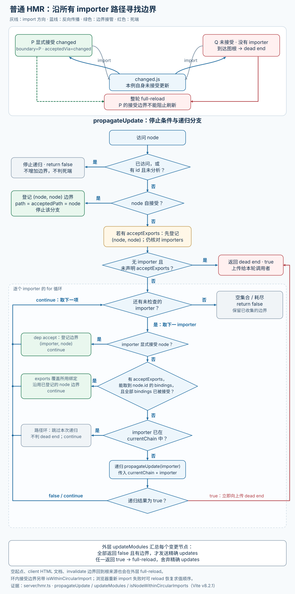
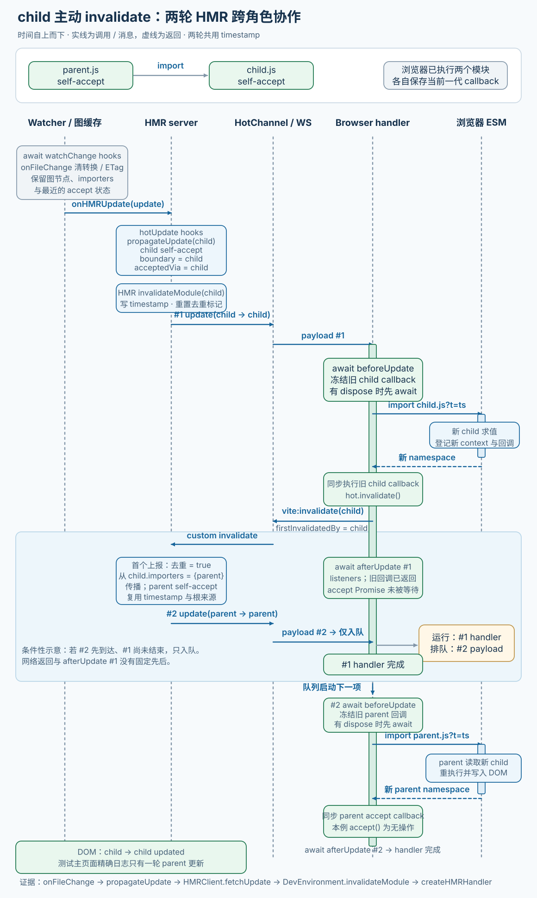

# 12. HMR

> **证据基线**：Vite `v8.2.1`，commit `421615865dad3ed39137d17281814fc78a41246c`。本文所有源码、测试与行为结论均限定于该版本。

## 阅读边界

本章研究普通 unbundled 开发模式下，一次文件变化怎样从 watcher 事件变成浏览器中的局部模块替换：

```text
watcher create/update/delete
→ handleHMRUpdate
→ plugin hotUpdate / handleHotUpdate
→ 模块图反向传播，寻找 accept 边界
→ update / full-reload / prune payload
→ HotChannel / WebSocket
→ HMRClient 重新导入、dispose、accept callback
```

模块图节点和失效状态见第 08 章，Import Analysis 怎样写入 `acceptedHmrDeps`、
`acceptedHmrExports`、`importedBindings` 见第 10 章。本章从这些图数据出发，解释传播与运行时生命周期。

实验性的 bundledDev 会让客户端根据 `changedIds` 自行计算边界，走
`bundledDevHmrClient.ts`/`server/bundledDev.ts` 的另一套协议；本章先完成普通按模块 URL 更新主线，
再单列一节对照 bundled-dev，避免混读。Module Runner 的服务端 HMR 执行器留到第 15 章。

读完应能回答：

1. self accept、dependency accept、acceptExports 各在哪个节点停止传播？
2. 为什么文件变化后要先使模块图失效，再让客户端重新 import？
3. 一个没有 importer 的模块为何通常是 full reload 死端，但 acceptExports 模块可以例外？
4. `path` 与 `acceptedPath` 在 update payload 中分别代表谁？
5. 为什么循环 import 内找到了 accept 边界，客户端仍可能需要 reload？
6. `import.meta.hot.invalidate()` 为什么会产生第二轮服务端传播？
7. dispose、prune、hot.data 的生命周期有何区别？
8. 同一文件变化产生的多个 update 为什么并行 fetch、串行执行 callback？
9. HMR WebSocket 为什么同时校验 allowedHosts、Origin token，却允许 vite-ping 无 token？
10. HTML、`<link>` CSS、JS import CSS 分别怎样更新？
11. bundled-dev 为什么改由浏览器按实际执行图寻找 boundary？
12. ErrorOverlay 如何避免 CSP、应用 CSS、恶意错误文本和非 DOM realm 的影响？

## 推荐阅读顺序

1. `types/hot.d.ts`：先建立用户 API 的 accept/dispose/prune/data/invalidate 语义。
2. `types/hmrPayload.d.ts`：看服务端与运行端之间的消息协议。
3. `shared/hmr.ts` 的 `HMRContext`：看模块执行时怎样登记 API。
4. 同文件 `HMRClient.fetchUpdate()`：理解运行端的“重新导入 → callback”两阶段。
5. `server/hmr.ts` 的 `updateModules()` 与 `propagateUpdate()`。
6. `isNodeWithinCircularImports()`：主传播清楚后再读循环判定。
7. 回到 `handleHMRUpdate()`：串起 watcher、插件 hooks 与多 Environment 调度。
8. `server/ws.ts` 和 `normalizeHotChannel()`：理解 transport，而非把 WebSocket 当 HMR 算法本体。
9. `client/client.ts` 的 `handleMessage()`、断线重连和 CSS link 更新。
10. `client/overlay.ts` 的构造、文本分段和 close 生命周期。
11. 主线掌握后，对照 `client/bundledDevHmrClient.ts` 的 `computeHmrUpdate()`。
12. server HMR 单元测试、`playground/hmr` 与 `playground/hmr-full-bundle-mode`。

## 三层协议不要混读

HMR 可以拆成三个相对独立的层次：

```text
图算法层
  输入：变更 ModuleNode + import/accept 边
  输出：传播边界或 full reload

消息层
  HotPayload 经 HotChannel/WebSocket/进程内 transport 发送

执行层
  HMRClient 维护 callback/data/dispose，重新导入并执行边界
```

`server/hmr.ts` 不执行用户模块；`shared/hmr.ts` 不推导模块图边界；`ws.ts` 更不理解 accept 语义。按这
三层阅读，可以避免把网络重连、传播算法和模块生命周期搅在一起。

## Import Analysis 给 HMR 留下什么数据

每次模块转换后，Import Analysis 把以下信息写进 EnvironmentModuleNode：

| 字段                 | 来源                               | 传播用途                       |
| -------------------- | ---------------------------------- | ------------------------------ |
| `isSelfAccepting`    | `hot.accept()`/CSS                 | 当前节点直接成为边界           |
| `acceptedHmrDeps`    | `hot.accept('./dep', cb)`          | importer 接受特定直接依赖      |
| `acceptedHmrExports` | `hot.acceptExports(['foo'])`       | 判断部分导出能否停止传播       |
| `importedBindings`   | importer 实际导入的 named bindings | 与 accepted exports 做集合比较 |
| `importers`          | 普通 import 反向边                 | 从变更模块向上遍历             |
| `lastHMRTimestamp`   | 模块图 invalidate/prune            | 给重新获取的 URL 加 `?t=`      |

`isSelfAccepting === undefined` 很重要：它表示该模块还没经过 Import Analysis，通常也没在浏览器加载。
传播此时停止且不 reload，不能把“未分析”当成“明确不接受”。`propagateUpdate()` 返回 `false` 只表示未遇死端，
不保证收集到更新；`updateModules()` 遇到空 updates 只记日志并返回，不发送 update。这个边界来自
[Issue #7561](https://github.com/vitejs/vite/issues/7561)。

## 文件事件总入口

`handleHMRUpdate(type, file, server)` 先处理几类全局特例：

- Vite 配置、配置依赖或当前 mode 的 env 文件：重启 server；
- `@vite/client` 自身：所有 Environment full reload；
- 普通 HTML 但模块图无节点：client 定向页面 reload；
- 其他 watcher 文件：按每个 Environment 查 `getModulesByFile(file)`。

create 事件会额外把 `_hasResolveFailedErrorModules` 加入候选。新文件可能正好修复此前失败的 import；若
只按“新文件当前对应的节点”查询，失败模块根本不会重新 transform。

函数进入时保存 `server.environments` 快照。任一插件 hook 都可能调用 `server.restart()`，await 返回后
若快照已被替换，本次事务立即停止，不向新 Environment 发送旧模块图结果。这个竞态修复见
[PR #22992](https://github.com/vitejs/vite/pull/22992)。

## 插件怎样参与更新

新 API `plugin.hotUpdate(options)` 在每个 Environment 独立运行：

```ts
type HotUpdateOptions = {
  type: 'create' | 'update' | 'delete'
  file: string
  timestamp: number
  modules: EnvironmentModuleNode[]
  read(): string | Promise<string>
  server: ViteDevServer
}
```

hook 返回模块数组时，会替换后续传播起点。插件可以：

- 过滤普通模块；
- 把一个真实 watch file 映射到虚拟模块；
- 返回额外受影响模块；
- 自行发送 custom/full-reload 后返回空数组。

旧 `handleHotUpdate` 只在 update 事件执行，并通过 mixed module graph 同时表达 client/SSR 节点。兼容
期间 client 新 hook 的过滤结果会同步回 mixed context，再把旧 hook 结果映射回各 Environment；这段
复杂桥接是迁移代码，不是新 API 推荐的数据模型。`hotUpdate` 支持可从提交
[`ba77cee60`](https://github.com/vitejs/vite/commit/ba77cee60) 和
[`fc1d72654`](https://github.com/vitejs/vite/commit/fc1d72654) 继续追踪。

默认所有 Environment 的传播并行运行；`server.hotUpdateEnvironments` 可接管环境选择与调度顺序。

## 反向传播算法

`updateModules()` 对每个变更节点调用 `propagateUpdate()`。箭头表示 import：

```text
entry → parent → changed
```

传播从 `changed` 沿 `importers` 反向走向 `parent`、`entry`，直到找到接受边界或死端。

下图先给一个多 importer 的具体图：P 接受 changed，Q 却到达未接受的图根，因此整轮仍需刷新。
下半部分再展开真实 DFS 的停止与递归条件；普通路径环只跳过该递归，死端和外层刷新条件才决定最终结果。



### 1. self accept

```text
changed.isSelfAccepting === true
→ boundary = changed
→ acceptedVia = changed
→ 停止该分支
```

CSS JS 模块通常自接受。服务端发送：

```text
path         = changed URL
acceptedPath = changed URL
```

客户端重新导入自身，再执行自身 accept callback。

### 2. dependency accept

```text
parent.acceptedHmrDeps.has(changed)
→ boundary = parent
→ acceptedVia = changed
→ 停止该分支
```

payload 中：

```text
path         = parent URL       // 去哪里找 callback
acceptedPath = changed URL      // 重新 import 哪个模块
```

这两个字段不能互换。HMRClient 从 `hotModulesMap.get(path)` 找 parent callbacks，只把重新导入的
acceptedPath namespace 放进匹配依赖的参数槽位。

### 3. acceptExports

acceptExports 是“有条件的自接受”。模块先成为自身边界，但每个 importer 仍要检查：

```text
importer.importedBindings.get(node.id)
⊆ node.acceptedHmrExports
```

若实际使用的 bindings 全被接受，该 importer 分支停止；只要使用一个未接受导出，就继续向上传播。
side-effect import 的 binding 集为空，因此自然满足子集关系。namespace import 与动态 import 无法安全
证明只使用部分导出，通常按使用全集处理。

acceptExports 最初以 partial accept 实验能力进入，见
[PR #7324](https://github.com/vitejs/vite/pull/7324)。它不是 tree-shaking：判断依据是开发态导入语法和
模块图记录，不分析任意运行时代码对 namespace 的属性访问。

### 4. 死端

以下任一分支会要求 full reload：

- 未接受模块没有 importer，已到图根；
- HTML 是顶层页面模板；
- `hot.invalidate()` 在同一轮闭合回 firstInvalidatedBy；
- 任一 importer 链递归返回死端。

多个变更模块合并处理时，只要一条路径需要 reload，最终就发送 full-reload；已收集的精确 updates 不再
单独发送，避免页面先局部替换又立刻刷新。

### 遍历去重与路径状态

`traversedModules` 是整轮共享集合，避免菱形图重复遍历；`currentChain` 是当前 DFS 路径，用来避免递归
环并诊断循环 import。边界列表保留 `boundary + acceptedVia`，同一边界接受不同依赖时仍可生成不同
update。

## 循环 import 为什么特殊

ESM 循环依赖的值和副作用依赖首次求值顺序。普通 dynamic import 带时间戳只能重新执行局部模块，无法
可靠重建整条循环的初始顺序。

找到 accept 边界后，`isNodeWithinCircularImports()` 从边界继续沿 importers 搜索；若重新遇到从原
变更节点走到边界的 `nodeChain` 中节点，就标记 `isWithinCircularImport`。例如：

```text
A → B → C → ACCEPTED → D → E → CHANGED
    ↑______________________________|
```

服务端仍发送精确 update，让简单循环有机会成功；浏览器重新 import 若失败，`importUpdatedModule()` 的
catch 会解释原因并 reload，恢复执行顺序。循环检测改进见
[PR #14867](https://github.com/vitejs/vite/pull/14867)。

这不同于 invalidate 循环。后者会持续发起下一轮 HMR，必须在服务端识别并直接 full reload；无限循环
修复见 [PR #19870](https://github.com/vitejs/vite/pull/19870)。

## 模块图失效与时间戳

传播边界计算后，`environment.moduleGraph.invalidateModule()` 会：

- 写入单调 HMR timestamp；
- 清 transformResult 或标记软失效；
- 递归处理受影响 importer；
- 用 invalidatedModules 集合避免重复。

客户端重新导入使用：

```text
acceptedPath?t=<timestamp>
```

Import Analysis 也会给本轮依赖 URL 附加时间戳。二者共同绕开浏览器原生 ESM 的永久模块缓存，让新实例
真正执行，而不是再次得到旧 namespace。

这里使用 `monotonicDateNow()`，防止系统时钟回拨产生较小 timestamp，导致 URL 版本顺序失真；修复见
[PR #20158](https://github.com/vitejs/vite/pull/20158)。

## `invalidate()` 是第二轮传播

模块在 accept callback 或执行阶段发现自己无法安全接管更新时调用：

```ts
import.meta.hot.invalidate('reason')
```

HMRContext 向本地事件监听器和服务端都发送 `vite:invalidate`，payload 记录：

- `path`：当前模块；
- `message`：诊断原因；
- `firstInvalidatedBy`：整条 invalidate 链的最初模块。

服务端只接收已 self-accept、已有 HMR timestamp 且本轮尚未上报的模块，再把它的 importers 作为
`updateModules()` 起点。这样跳过刚刚拒绝接管更新的模块，寻找更高边界。没有 importer 时刷新页面；
同轮多标签上报由 `lastHMRInvalidationReceived` 去重。firstInvalidatedBy 在同步 accept callback
调用期间由 HMRClient 暂存，后续 invalidate 才能继承同一根；callback 返回后由 `finally` 清空。

多标签页会同时对同一个更新发送 invalidate，服务端按同一轮身份去重，否则 parent 会更新两次。

## 客户端为什么分“获取”和“执行”两阶段

`HMRClient.queueUpdate()` 把同一 microtask 内收到的 updates 先全部交给 `fetchUpdate()`：

```text
每个 update：
  固定当前合格 callbacks
  → await disposer
  → import acceptedPath?t=timestamp
  → 返回一个尚未执行的 callback closure

Promise.all(全部 fetch)
→ 按 payload 原顺序执行 closures
```

重新获取可以并行，减少网络等待；accept callbacks 必须保持服务端顺序，否则 HTTP 往返快慢会改变模块
副作用顺序。更外层 `createHMRHandler()` 又把完整 HotPayload 串行化，因为一次 invalidate 可能在当前
payload 处理过程中触发下一轮更新。这个竞态修复见
[PR #19793](https://github.com/vitejs/vite/pull/19793)。

合格 callback 必须在重新 import 前固定：新模块执行会创建新 HMRContext，清空旧 callbacks 并登记
新一代回调；若 import 后才筛选，就会错误调用新代码的 callback 处理旧更新。

代码分割分支可能在服务端模块图存在，但当前页面尚未加载，hotModulesMap 找不到 path 时静默跳过；见
[Issue #721](https://github.com/vitejs/vite/issues/721)。

## HMRContext 生命周期

每次模块执行都会调用 `createHotContext(ownerPath)` 创建新 context：

```text
首次执行
  dataMap[ownerPath] = {}
  登记 accept/dispose/prune/on

更新前
  dispose(data)
  重新 import 新 URL

新一代执行
  保留同一个 data 对象
  清旧 accept callbacks
  从全局 custom listener 表移除旧 context listeners
  登记新 callbacks/listeners

模块脱离图
  dispose(data) → prune(data) → 删除 data
```

- dispose 是“当前实例即将被替换或移除”；可写 data 交给下一代。
- prune 是“模块已没有 importer，不再属于当前运行图”；用于最终撤销样式、事件等副作用。
- data 在普通更新中保留，在 prune 后必须删除；否则未来重新导入会继承已结束生命周期的状态。修复见
  [PR #23002](https://github.com/vitejs/vite/pull/23002)。

正常 prune 会先等待本批所有 dispose，再等待所有 prune，最后删除 data；若 dispose 拒绝，后续 prune
不会执行，但 `finally` 仍删除 data。回调成功时下一条 payload 要等清理完成才开始；见
[PR #20698](https://github.com/vitejs/vite/pull/20698)。即使模块本身不是 self-accepting，删除其 import
边也要触发 prune；相关修复见 [PR #20768](https://github.com/vitejs/vite/pull/20768) 和
[PR #21093](https://github.com/vitejs/vite/pull/21093)。

## 深挖：一次 `invalidate` 怎样跨两轮 HMR 完成事务

下面以官方 playground 的 `child self-accept → child 主动 invalidate → parent self-accept` 为例，
把服务端边界与浏览器 callback 的两轮协作连起来。

### Demo：服务端图与浏览器 callback 表通过 URL 对齐

fixture 来自 `playground/hmr/invalidation/child.js` 与 `parent.js`：

```js
// child.js
if (import.meta.hot) {
  // Need to accept, to register a callback for HMR
  import.meta.hot.accept(() => {
    // Trigger HMR in importers
    import.meta.hot.invalidate()
  })
}

export const value = 'child'
```

```js
// parent.js
import { value } from './child'

if (import.meta.hot) {
  import.meta.hot.accept()
}

console.log('(invalidation) parent is executing')

document.querySelector('.invalidation-parent').innerHTML = value
```

首次加载后，服务端 ModuleGraph 记录 `parent → child`，两者都是 self-accept；浏览器
`hotModulesMap` 则分别保存两个已执行模块当前一代的 callback。前者回答“更新向哪里传播”，后者回答
“哪个实例登记了什么 callback”。它们通过规范 URL 对齐，不共享 ModuleNode 或 HMRContext 对象。

### 两轮传播的决定性源码

#### 入口与第一轮：静态声明先把 child 选成边界

watcher 收到本次 change 后，`server/index.ts::onFileChange()` 的当前实现顺序是：等待所有 Environment
的 `pluginContainer.watchChange`，调用各自 `moduleGraph.onFileChange(file)` 清旧转换结果，再进入
`onHMRUpdate`。图失效清
transform/ETag/SSR 结果，但保留 ModuleNode、importer 边和最近一次成功分析留下的 accept 状态。

`server/hmr.ts::propagateUpdate()` 首先命中 child 的 self-accept 分支：

```ts
if (node.isSelfAccepting) {
  const boundary = node as EnvironmentModuleNode & {
    type: 'js' | 'css'
  }
  boundaries.push({
    boundary,
    acceptedVia: boundary,
    isWithinCircularImport: isNodeWithinCircularImports(node, currentChain),
  })
  return false
}
```

因此第一轮 `boundary === acceptedVia === child`，`updateModules()` 生成
`path=acceptedPath=/invalidation/child.js` 的 `js-update`，并用本轮 timestamp 失效 child 及受影响
importer。服务端此时只读取静态 accept 声明，不执行 callback，也不知道它随后会调用 `invalidate()`。

客户端处理第一轮时，`HMRClient.fetchUpdate()` 先冻结 child 的旧 callback，执行 dispose，再 import
带 timestamp 的新 child。新模块执行会创建新 HMRContext、登记下一代 callback；提交 closure 执行的仍是
import 前冻结的旧 callback。

#### 浏览器回传：把 child 提升为第二轮的起点信息

旧 callback 调用 `HMRContext.invalidate()`。来源：`packages/vite/src/shared/hmr.ts`：

```ts
invalidate(message: string): void {
  const firstInvalidatedBy =
    this.hmrClient.currentFirstInvalidatedBy ?? this.ownerPath
  this.hmrClient.notifyListeners('vite:invalidate', {
    path: this.ownerPath,
    message,
    firstInvalidatedBy,
  })
  this.send('vite:invalidate', {
    path: this.ownerPath,
    message,
    firstInvalidatedBy,
  })
}
```

第一轮 payload 没有 `firstInvalidatedBy`，所以 child 用自己的 `ownerPath` 建立根来源。callback closure
用 `try/finally` 临时设置并清除 `currentFirstInvalidatedBy`，避免后续无关 invalidate 继承本轮状态。

#### 第二轮：服务端去重，并从 child 的 importers 继续

`DevEnvironment.invalidateModule()` 不把 child 再当边界，而是把它的 importers 交给
`updateModules()`。来源：`packages/vite/src/node/server/environment.ts`：

```ts
const mod = this.moduleGraph.urlToModuleMap.get(m.path)
if (
  mod &&
  mod.isSelfAccepting &&
  mod.lastHMRTimestamp > 0 &&
  !mod.lastHMRInvalidationReceived
) {
  mod.lastHMRInvalidationReceived = true
  const file = getShortName(mod.file!, this.config.root)
  updateModules(
    this,
    file,
    [...mod.importers].filter((imp) => imp !== mod),
    mod.lastHMRTimestamp,
    m.firstInvalidatedBy,
  )
}
```

本例的新起点是 `child.importers = { parent }`。parent self-accept，于是第二个 payload 为
`path=acceptedPath=/invalidation/parent.js`，沿用 child 的 `lastHMRTimestamp`，并携带
`firstInvalidatedBy=/invalidation/child.js`。`lastHMRInvalidationReceived` 只允许第一个客户端上报启动
这轮传播；下一次真实 HMR 失效会把它重置为 `false`。

若 child 已是图根，importers 为空，`updateModules()` 会 full reload；若新边界又闭合到
`firstInvalidatedBy`，也会以 `circular import invalidate` 退回刷新。这些是同一入口的保护分支，不是本
fixture 的实际结果。

## 同一 Demo 的端到端执行图

图中把 watcher 的缓存失效、服务端静态边界、WebSocket 消息和浏览器求值放在独立角色上。
watcher 先清转换结果再计算边界；传播之后的 HMR 失效才写入本轮 timestamp。`dispose` 是框架的可选
等待点，本 fixture 的 child/parent 未登记 disposer。



`vite:invalidate` 的网络接收与 `afterUpdate #1` 没有固定先后；服务端可能已生成甚至发回 #2。可依赖的
保证是 `client.ts` 用 `createHMRHandler(handleMessage)` 包装 transport handler：即使 #2 已到达，也要
等 #1 的 dispose、import、同步 callback 调用及 afterUpdate listener 等待结束后才开始处理。
accept callback 返回的 Promise 不会被 `fetchUpdate()` 等待；异步 callback 后续工作不在这条串行
保证内，`currentFirstInvalidatedBy` 也仅覆盖同步调用。

## 关键状态变化

| 状态/所有者                            | 初次执行后  | child 文件变化     | payload #1                              | invalidate 回到服务端                    | payload #2 后                                      |
| -------------------------------------- | ----------- | ------------------ | --------------------------------------- | ---------------------------------------- | -------------------------------------------------- |
| `lastHMRTimestamp` / server            | `0`         | 写入本轮 timestamp | 保持                                    | 第二轮复用                               | 等待下次变化                                       |
| `lastHMRInvalidationReceived` / server | `false`     | 重置 `false`       | `false`                                 | 首个上报置 `true`，其他标签忽略          | 下次真实失效再重置                                 |
| child callbacks / browser              | 旧一代      | 仍是旧一代         | 先冻结；新 import 登记下一代            | 旧 callback 已提交                       | 新一代等待下次更新                                 |
| `currentFirstInvalidatedBy` / browser  | `undefined` | `undefined`        | 首轮无根值，invalidate 回退到 child URL | #1 的 `finally` 已清空；根来源随 #2 返回 | parent callback 期间为 child URL，`finally` 后清空 |
| DOM `.invalidation-parent`             | `child`     | `child`            | `child`                                 | 等待 parent 执行                         | `child updated`                                    |

## 真实完整测试：多标签 invalidate 只产生一轮上游更新

来源：`playground/hmr/__tests__/hmr.spec.ts`，`invalidate works with multiple tabs`。下面只列该用例实际
使用的 import，test body 保持原样；原文件 import 区还服务同文件大量其他用例。

```ts
import type { Page } from 'playwright-chromium'
import { expect, test } from 'vitest'
import {
  browser,
  editFile,
  page,
  untilBrowserLogAfter,
  viteTestUrl,
} from '~utils'

test('invalidate works with multiple tabs', async () => {
  let page2: Page
  try {
    page2 = await browser.newPage()
    await page2.goto(viteTestUrl)

    const el = await page.$('.invalidation-parent')
    await untilBrowserLogAfter(
      () =>
        editFile('invalidation/child.js', (code) =>
          code.replace('child', 'child updated'),
        ),
      [
        '>>> vite:beforeUpdate -- update',
        '>>> vite:invalidate -- /invalidation/child.js',
        '[vite] invalidate /invalidation/child.js',
        '[vite] hot updated: /invalidation/child.js',
        '>>> vite:afterUpdate -- update',
        // invalidate 若未正确去重，下面这次 beforeUpdate 会出现两次。
        '>>> vite:beforeUpdate -- update',
        '(invalidation) parent is executing',
        '[vite] hot updated: /invalidation/parent.js',
        '>>> vite:afterUpdate -- update',
      ],
      true,
    )
    await expect.poll(() => el.textContent()).toMatch('child updated')
  } finally {
    await page2.close()
  }
})
```

<span id="gwtms-与证据边界"></span>

### 一次文件修改为何产生两轮更新

主页面已加载 fixture，第二页面也导航到同一 URL。测试只修改一次 `invalidation/child.js`，
把首个 `child` 替换成 `child updated`。后续两轮更新由 child 的接受回调与 invalidate 接续触发：

<span id="本链源码-测试证据"></span>

| 阶段 | 发生的动作与结果 | 对应源码 |
| --- | --- | --- |
| 第一轮：更新 child | child 自接受形成边界；浏览器取新模块并调用已保存的旧 accept callback | `server/hmr.ts::propagateUpdate()`、`shared/hmr.ts::fetchUpdate()` |
| 回传 invalidate | child callback 调用 invalidate，服务端从 child 的 importers 继续寻找边界 | `HMRContext.invalidate()`、`DevEnvironment.invalidateModule()` |
| 第二轮：更新 parent | parent 重新执行并更新 DOM；客户端消息处理队列让这条 payload 等第一条处理结束 | `createHMRHandler()`、fixture 中的 parent 模块 |
| 多标签去重 | 同一轮的重复 invalidate 由服务端节点的 `lastHMRInvalidationReceived` 合并 | `DevEnvironment.invalidateModule()` 的去重分支 |

测试精确比较主页面的日志顺序：先出现 child 的更新和 invalidate，再出现 parent 的执行日志，
DOM 最终显示 `child updated`。若 parent 那轮的 `beforeUpdate` 重复出现，日志匹配就会失败。
去重字段属于服务端节点，两个标签页因而共用同一轮上游传播。第二页面在 `finally` 关闭，
测试用的隔离目录与 server 由全局 teardown 回收。

## accept 参数为什么用轻量 lexer

服务端只需要从以下受限语法中提取字面量：

```ts
hot.accept()
hot.accept(callback)
hot.accept('./dep', callback)
hot.accept(['./a', './b'], callback)
hot.acceptExports(['foo', 'default'])
```

`lexAcceptedHmrDeps()` 从调用左括号后开始，用 call/array/string/template 几个状态扫描。依赖参数只允许
字符串或字符串数组，所以没必要为整个模块再跑一次重型 AST parser。无参数或首参是 callback 返回
selfAccepts=true；模板含 `${}` 直接报错，因为依赖路径必须静态确定。

lexer 同时记录每个字符串的源码 start/end，Import Analysis 随后 resolve 并改写 URL。acceptExports
复用同一个 lexer，只把字符串收集为 export name。

## HotPayload 协议

普通开发模式的重要 payload：

| type          | 服务端含义                             | 客户端动作                  |
| ------------- | -------------------------------------- | --------------------------- |
| `connected`   | WS 握手成功                            | 标记连接完成                |
| `update`      | 一个或多个 JS/CSS 传播边界             | queueUpdate 或替换 link     |
| `full-reload` | 无安全边界、HTML/config 等全局变化     | 定向或整页 reload           |
| `prune`       | 路径已脱离图                           | dispose → prune → 删除 data |
| `error`       | transform/plugin 错误                  | overlay 或 console          |
| `custom`      | 用户事件、invalidate、invoke、生命周期 | 分发自定义 listener         |
| `ping`        | transport 保活                         | 无业务动作                  |

实验 bundledDev 的 `bundled-dev-update` 不携带普通 boundaries，而是发送 `changedIds`、客户端专属 patch URL
和序号；不要用普通 `Update.path/acceptedPath` 心智解释它。

## HotChannel：算法与传输的隔离层

`HotChannel` 允许 HMR 运行在：

- 默认 WebSocket；
- 用户自定义 channel；
- Environment/Module Runner 的进程内 EventEmitter transport。

`normalizeHotChannel()` 统一：

- `send(payload)` 与 `send(event, data)` 两种调用；
- 单客户端 send 包装；
- on/off listener 身份映射；
- `vite:invoke` 请求/响应 RPC；
- HMR 禁用时仍允许 connected/ping/custom/error 通过。

进程内 `createServerHotChannel()` 设置 `skipFsCheck=true`，因为 transport 不暴露到网络；网络 channel 不得
随意开启，否则远程客户端可借 fetchModule 读取受限文件。

## WebSocket 安全与生命周期

默认 WS 可以复用 Vite 主 HTTP server、挂到 `server.ws.server`，或在 middleware 模式创建独立
HTTP(S) server。

浏览器连接需依次满足：

1. 复用 HTTP server 时，upgrade listener 只接管 `vite-hmr`/`vite-ping` 且路径匹配的请求；
2. 非 ping 请求的 Host 通过 `server.allowedHosts`；
3. 带 Origin 的请求提供本进程生成的 token；`legacy.skipWebSocketTokenCheck` 可跳过这一项；
4. `ws.handleUpgrade()` 内部先调用 Vite 覆写的 `shouldHandle()` 完成检查，再完成握手、登记连接。

独立 WS server 的 upgrade listener 接管其端口上的请求，不使用上述路径筛选。

这防止恶意网页连接本机开发服务器实施 Cross-site WebSocket hijacking。token 校验相关安全修复可从
提交 [`029dcd6d7`](https://github.com/vitejs/vite/commit/029dcd6d7) 追溯。

无 Origin 的 CLI/本地工具为兼容可无 token 连接；它们不受浏览器同源策略限制，本来就能发普通 HTTP
请求。

`vite-ping` 是特殊探测协议：允许任意来源，握手后立即正常关闭，不触发 Vite 的 connection 事件，
因而不安装消息监听器或发送业务 payload。底层 `ws` 会短暂把它加入 `wss.clients`，关闭时删除。客户端断线后先用 ping 确认 server 已重新可用，再 reload 获取新 `@vite/client`。这个策略
避免盲目 HTTP 轮询，见 [PR #17891](https://github.com/vitejs/vite/pull/17891)。可用 SharedWorker 时，Vite 把探测移入 worker；每个连接端口各自运行轮询，用该窗口的可见性暂停
重试。首个 ping 总会尝试一次，后续才按 visibility 决定等待或重试；见
[PR #19057](https://github.com/vitejs/vite/pull/19057)。

重启时若旧 WS upgrade listener 不从用户 server 移除，它会继续吞掉新连接。close 因而不仅 terminate
clients，还要解绑 listener，并关闭独立 HTTP server。

## 浏览器消息处理细节

### error overlay 的首次更新

页面打开时若嵌套模块 transform 返回 500，入口模块根本没执行，页面虽有 overlay，却没有任何 accept
回调。第一次 update 到来时普通 HMR 不可能修复这条未建立的执行图，所以 client 先 full reload；新页面
重新加载整个入口。

### `<link>` CSS

只有 HTML `<link>` 直接引用的 CSS 收到 `css-update`。client 根据规范化 URL 找旧 link，克隆并附加
`?t=`，等新 link load/error 后才移除旧节点，避免样式空窗导致 FOUC。由 JS import 的 CSS 会生成自接受
JS 模块，走普通 js-update 和 `updateStyle()`。

SSR 已注入的 `style[data-vite-dev-id]`/`link[data-vite-dev-id]` 在 client 启动时收集复用，防止第一次
HMR 插入重复样式。相关修复见 [PR #20767](https://github.com/vitejs/vite/pull/20767)。

### HTML 定向 reload

服务端对单个 HTML 变化发送其 root 相对 path。客户端只有当前 location 正好对应该 HTML、根
`index.html` 或目录形式 index 时才 reload，避免多页面应用所有标签页一起刷新。middlewareMode 无法
可靠推断页面路由时，服务端使用 `*`。

### 无客户端时缓冲

页面 reload 期间 transform 可能立刻失败，error payload 早于新 WS 建立；优化器也可能在连接前要求
reload。WS server 因此在 clients 为空时缓冲最后一个 error/full-reload，新连接收到 connected 后立即
补发。普通 update 不缓冲，因为新页面会重新构建模块图状态。

## ErrorOverlay 的隔离与安全边界

`overlay.ts` 没有把服务端错误拼成 innerHTML，而是用 `document.createElement()` 与 TextNode 构造
Shadow DOM。这样同时解决：

- 用户源码、插件名或堆栈中的 HTML 只能显示为文本，不能注入 DOM；
- Shadow DOM 隔离应用 CSS，避免浮层被全局 reset 隐藏，见
  [PR #9971](https://github.com/vitejs/vite/pull/9971)；
- style 继承 `meta[property=csp-nonce]`，通过严格 CSP，见
  [PR #20791](https://github.com/vitejs/vite/pull/20791)；
- module 在 Worker/SSR realm 求值时，缺少 document、HTMLElement、customElements 也不抛错，相关修复见
  [PR #16318](https://github.com/vitejs/vite/pull/16318) 与
  [PR #4856](https://github.com/vitejs/vite/pull/4856)。

构造时把 message 中的 code frame 拆到独立区域；全局正则每次必须重置 `lastIndex`，否则第二个错误会
漏判，见 [PR #11132](https://github.com/vitejs/vite/pull/11132)。stack 中匹配到的 POSIX、Windows 或
file URL 位置才转成 `<a>`；点击后请求 `${base}__open-in-editor?file=...`。base、自定义后端与 file URL
兼容分别见 [PR #11337](https://github.com/vitejs/vite/pull/11337)、
[PR #14879](https://github.com/vitejs/vite/pull/14879) 和
[PR #20040](https://github.com/vitejs/vite/pull/20040)。

点击 window 内部会停止冒泡；点击 backdrop 或按 Escape 调用 `close()`。close 不只移除元素，还注销
document keydown listener，避免多轮 transform error 累积全局监听。

## Forward Console：复用 HMR transport 的诊断通道

`server.forwardConsole` 启用后，客户端 `setupForwardConsoleHandler()` 包装指定 console 方法，并可监听
window error/unhandledrejection：

```text
浏览器 console/error
→ formatConsoleArgs / Error 数据归一化
→ transport.send(custom: vite:forward-console)
→ forwardConsolePlugin
→ parseErrorStacktrace + ModuleGraph sourcemap
→ 当前 Environment logger
```

原 console 方法总是先同步执行，再异步发送；开发服务器断开不能吞掉浏览器本地日志。包装前保存原始
console.error，发送失败时用它回落，防止报告错误又递归进入 forward handler。client 早于 transport.connect
产生 `SendBeforeConnectError` 是正常启动竞态，静默忽略；其他发送错误必须显示。发送失败处理见
[PR #22450](https://github.com/vitejs/vite/pull/22450)，功能最初见
[PR #20916](https://github.com/vitejs/vite/pull/20916)。

formatter 支持 `%s/%d/%i/%f/%j/%o/%O/%c/%%`，并为 BigInt、Symbol、函数、Error、嵌套 Error 与循环对象
提供稳定文本。`%j` 遇到循环返回 `[Circular]`，不能让一次 console.log 破坏整个 HMR 消息链。

服务端必须使用消息所属 Environment 的 moduleGraph、root 与 logger。堆栈 id 查询依次尝试：

1. 原 id；
2. 相对 root 还原的磁盘路径；
3. 浏览器（尤其 Safari）丢失 query 时，该 file 对应的第一个模块 id。

transformResult 没有内联 map 时，再从预构建依赖产物末尾读取外置 sourcemap。映射后展示完整帧列表，但
只给“第一个属于 Vite 图、已 transform 且磁盘存在”的帧展开 code frame；这样依赖调用链仍可见，终端
又不会被每一帧的源码淹没。

`playground/forward-console` 验证普通 error、Promise rejection、console 格式符与依赖外置 map。依赖报错
在该 fixture 中保留 node_modules 帧，并为第一个符合条件的项目调用点展示 code frame。

## Bundled-dev：只对比三个责任边界

| 问题 | 普通 HMR | Bundled Dev |
| --- | --- | --- |
| 谁计算接受边界？ | 服务端 `propagateUpdate`，依据 ModuleGraph 分析结果 | 浏览器 `computeHmrUpdate`，依据已执行 factory 的运行时图 |
| 服务端推送什么？ | `update` 的 path/acceptedPath 等边界信息，或 full-reload | changedIds、patch URL、单调 seq，由客户端计算边界 |
| 谁发起、谁批准刷新？ | 服务端死端可直接发 full-reload；客户端导入循环更新失败也可触发刷新 | 客户端报告 reload-needed，服务端确认最新完整输出可服务后再发 full-reload |

逐分支算法、applyQueue、MemoryFiles、HTTP finish、patch 安全后缀和测试均集中在
[12B：Bundled Dev](./12b-bundled-dev.md)。这里只用责任分工校准普通 HMR 的心智模型。

## 测试怎样映射源码机制

### server 单元测试

`server/__tests__/hmr.spec.ts` 构造 hotUpdate hook 内重启 server 的竞态，验证 environments 快照变化后：

- hook 后续异常不作为 HMR error 发送；
- 默认环境调度不再执行；
- 自定义 hotUpdateEnvironments 也收不到 stale hmr 闭包。

### `playground/hmr`

建议按机制分组读，不要从 1200 行头读到尾：

1. self accept、hot.data、accept dep、nested propagation：基本边界和客户端顺序。
2. invalidate/soft invalidate/多标签/循环：二次传播和去重。
3. acceptExports 整组：binding 子集算法、side-effect、namespace、dynamic import。
4. CSS/HTML/virtual module：非普通磁盘 JS 边界。
5. missing import/file create-delete-restore：失败节点恢复、dispose/prune 和图根变化。
6. circular self accept：服务端精确 update 与客户端失败 reload 的分工。
7. SSR link/CSS watch file/assets：副作用型模块的清理与复用。

测试日志顺序就是运行时协议断言。例如 self accept 的正确顺序是：

```text
vite:beforeUpdate
dispose 旧实例
新模块执行
accept callback
hot updated 日志
vite:afterUpdate
```

只验证最终 DOM 会漏掉重复执行、旧 callback 残留或生命周期交错；因此用例同时断言日志序列。

Bundled-dev 的测试与普通 HMR 使用不同协议，见 [12B 的完整案例与断言](./12b-bundled-dev.md)。

## 历史演进线索

1. 未加载动态分支不能误触发 reload：[Issue #7561](https://github.com/vitejs/vite/issues/7561)。
2. partial accept/acceptExports 引入 binding 级传播：[PR #7324](https://github.com/vitejs/vite/pull/7324)。
3. 循环 import 边界需要额外执行顺序保护：[PR #14867](https://github.com/vitejs/vite/pull/14867)。
4. 完整 HMR handler 必须串行，避免嵌套 invalidate 交错：[PR #19793](https://github.com/vitejs/vite/pull/19793)。
5. invalidate 循环必须退化为 reload：[PR #19870](https://github.com/vitejs/vite/pull/19870)。
6. prune 从“模块自身接受”扩展到所有删除的 import 边，并等待异步清理：
   [PR #20698](https://github.com/vitejs/vite/pull/20698)、
   [PR #20768](https://github.com/vitejs/vite/pull/20768)、
   [PR #21093](https://github.com/vitejs/vite/pull/21093)。
7. 断线后用 WS ping + SharedWorker 中的窗口可见性控制：
   [PR #17891](https://github.com/vitejs/vite/pull/17891)、
   [PR #19057](https://github.com/vitejs/vite/pull/19057)。
8. Environment API 让传播与 transport 不再绑定浏览器 WebSocket。
9. server 重启和 prune data 的近期修复继续收紧事务所有权：
   [PR #22992](https://github.com/vitejs/vite/pull/22992)、
   [PR #23002](https://github.com/vitejs/vite/pull/23002)。

## 建议断点

第一次调试只放：

1. `handleHMRUpdate()`：记录 type/file 和每个 Environment 初始 modules。
2. `propagateUpdate()`：观察 node、currentChain、三类 accept 字段。
3. `updateModules()` 生成 payload 处：比较 path/acceptedPath。
4. `HMRClient.fetchUpdate()`：看 qualifiedCallbacks 在 import 前固定。
5. `HMRContext` constructor：看旧 callbacks/listeners 清理和 data 保留。
6. `handleMessage()`：看 update/full-reload/prune 分流。

建议观察：

```text
node.url / node.importers
node.isSelfAccepting
node.acceptedHmrDeps
node.acceptedHmrExports
importer.importedBindings
boundaries
needFullReload
hotModulesMap / dataMap / disposeMap / pruneMap
```

第二轮再打开 `DEBUG=vite:hmr`，对照传播停止原因和循环链。不要把断点放在所有 WebSocket message 上，
自定义事件与保活消息会干扰图算法主线。

## 关键源码证据

目标版本源码摘录，来源：`packages/vite/src/node/server/hmr.ts`，`updateModules()`：

```ts
// Modules could be empty if a root module is invalidated via import.meta.hot.invalidate()
let needFullReload: HasDeadEnd = modules.length === 0

for (const mod of modules) {
  const boundaries: PropagationBoundary[] = []
  const hasDeadEnd = propagateUpdate(mod, traversedModules, boundaries)

  environment.moduleGraph.invalidateModule(
    mod,
    invalidatedModules,
    timestamp,
    true,
  )

  if (needFullReload) {
    continue
  }

  if (hasDeadEnd) {
    needFullReload = hasDeadEnd
    continue
  }
```

每个起点先做反向传播、再进入模块图失效；没有起点或传播遇到死端都会把事务升级为 full reload。
`boundaries` 只有在无死端时才用于生成细粒度 update，避免把过期模块误报为可热替换。

## 复盘题

1. dependency accept 的 payload 为什么必须是 `path=importer`、`acceptedPath=dep`？
2. acceptExports 声明 `['foo']`，而 importer 只做 side-effect import 时为什么可以停止传播？
3. `isSelfAccepting === undefined` 和 `false` 为什么必须区别处理？
4. 为什么循环 import 不是一律服务端 full reload，而是先发送带标记的 update？
5. qualified callbacks 若在重新 import 后才计算，会调用哪一代代码的回调？
6. dispose 可保留 data，prune 后为什么必须删除 data？
7. create 文件事件为何要重新检查曾 resolve 失败的模块？
8. 为什么无客户端时只缓冲 error/full-reload，不缓冲普通 update？
9. vite-ping 无 token 为什么仍不会形成跨站 HMR 攻击面？
10. hotUpdate hook 内重启 server 后，单靠捕获异常为什么仍不足以保证安全？

能从任意变更节点手画 importer 图，找出 boundaries、写出 update payload，再推演客户端 dispose/import/
callback 顺序，才算真正理解 Vite HMR。
