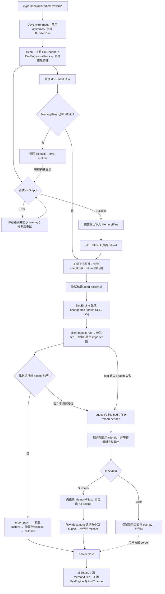

# 12B. Bundled Dev：Rolldown 增量整包、内存文件与浏览器 HMR 图

> **证据基线**：Vite `v8.2.1`，commit `421615865dad3ed39137d17281814fc78a41246c`。行为与可执行
> 代码结论均限定于该版本；本工作树已在对应源码和测试上补充中文解释性注释，涉及注释原文时会另行标明。

## 先给结论

普通 Vite 开发模式把浏览器请求当作模块转换入口；Bundled Dev 则让 Rolldown 长期维护一份可增量更新的
完整 bundle，再由 Vite 把输出存在内存、按 HTTP 请求交付，并把 HMR 边界计算移动到浏览器中的真实执行图。

两者最重要的差别不是“有没有 bundle”，而是**谁拥有运行时事实**：

| 问题 | 普通 unbundled dev | Bundled Dev |
|---|---|---|
| 模块何时转换 | 浏览器请求 URL 时 | Rolldown DevEngine 构建/增量构建时 |
| 长期图状态 | 服务端 `EnvironmentModuleGraph` | Rolldown 构建图 + 浏览器 `DevRuntime` 执行图 |
| HMR 边界由谁算 | 服务端 `server/hmr.ts` | 浏览器 `BundledDevHMRClient` |
| 未执行分支的 accept | 静态分析后可能进入服务端图 | 不形成边界；浏览器知道它没有执行 |
| 动态入口 | 浏览器请求源码模块 | `/@vite/lazy` 触发按客户端编译入口 |
| 输出落点 | `transformResult` + HTTP 响应 | `MemoryFiles` |
| full reload 时机 | 服务端直接发 payload | 必须等最新完整输出已进入内存 |
| 依赖预构建 | 独立 optimizer | 禁用；完整 bundle 自己处理依赖 |

因此，不能把第 08、11、12 章的 pending、optimizer、服务端 HMR 边界直接套到本章。Bundled Dev 仍复用
Vite 配置、插件、HTTP、HotChannel、ErrorOverlay 与客户端 HMR 生命周期，但重新分配了状态所有权。

## 阅读边界

本章只解释 `experimental.bundledDev` 的 client Environment：

```text
启用配置
→ 创建 BundledDev / Rolldown DevEngine
→ 首轮输出尚未完成时返回 fallback 页
→ 输出进入 MemoryFiles
→ 动态入口经 /@vite/lazy 按需交付
→ 文件变化生成 client-specific patch
→ 浏览器按已执行 importer 图寻找边界
→ 局部 patch 或等待最新 bundle 后 full reload
→ server.close() 收口 DevEngine 与内存状态
```

不展开 Rolldown `dev()`、`compileEntry()`、`notifyPayloadDelivered()` 的内部算法；它们来自
`rolldown/experimental`。本文能由 Vite 仓库直接证明的是：Vite 怎样配置并调用这些接口、怎样维护自身
状态，以及真实 playground 最终观察到什么。

读完应能回答：

1. 为什么开启 Bundled Dev 后必须禁用依赖优化器？
2. `BundledDev.listen()` 为什么不等待首轮 bundle 完成？
3. 首次文档请求为何先得到 fallback，而不是挂起 HTTP 请求？
4. `MemoryFiles` 为什么保存惰性函数，增量输出时又不能整表 `clear()`？
5. payload “已生成”与“已送达”为什么是两个状态？
6. 为什么 HMR payload 只传 `changedIds + url + seq`？
7. 未执行模块、self accept、dependency accept、无 importer 根分别怎样传播？
8. 删除缓存前为什么必须冻结 accept callbacks？
9. 客户端判定 full reload 后为何不直接调用 `location.reload()`？
10. 初始构建错误、HMR patch 错误、序列缺口分别怎样恢复？
11. Bundled Dev 关闭时为什么不能再独立关闭同一个 PluginContainer？
12. 当前实现有哪些明确不支持的能力？

## 推荐阅读顺序

1. `config.ts` 的 `ExperimentalOptions.bundledDev` 与 `resolveEnvironmentOptions()`。
2. `server/environment.ts` 的 constructor、`listen()`、`warmupRequest()`、`invalidateModule()`、`close()`。
3. `server/bundledDev.ts` 的字段、`listen()`、`storeOutputFiles()`。
4. `middlewares/indexHtml.ts` 的 fullBundle 分支与 `generateFallbackHtml()`。
5. `middlewares/memoryFiles.ts` 与 `triggerLazyBundling.ts`。
6. 回到 `BundledDev.handleHmrOutput()` 与 reload-needed 事件处理。
7. `client/bundledDevClient.ts`，看 Rolldown runtime 怎样接入 Vite HMR。
8. `client/bundledDevHmrClient.ts`：`computeHmrUpdate()` → `applyPush()` → `applyUpdate()`。
9. 最后读 `playground/hmr-full-bundle-mode`；按 INITIAL、lazy、patch、reload、close 五组状态复盘。

## 配置入口与对象所有权

CLI 的 `--experimentalBundle` 最终写入 `InlineConfig.experimental.bundledDev`。在当前实现里，只有这个
**全局实验开关**会同时切换 watcher、中间件、server 初始化与 HMR 分流；它是本章所述完整 Bundled Dev
链路唯一可用的启用入口。配置解析据此只让 client Environment 的 `isBundled` 默认成 `true`；其他
Environment 仍默认 `false`。

目标版本源码摘录，来源：`packages/vite/src/node/config.ts`，`resolveEnvironmentOptions()`：

```ts
const isBundled =
  options.isBundled ?? (isBuild || (isClientEnvironment && isBundledDev))
```

`DevEnvironment` 构造时把“完整打包”和“依赖预构建”设为互斥所有者。

目标版本源码摘录，来源：`packages/vite/src/node/server/environment.ts`，`DevEnvironment.constructor()`：

```ts
if (
  options.isBundled ||
  (name === 'client' && config.experimental.bundledDev)
) {
  context.disableDepsOptimizer = true
  this.bundledDev = new BundledDev(this)
}
```

`BundledDev` constructor 又明确只接受名为 `client` 的 Environment；如果用户给其他 Environment 显式设置
`isBundled: true`，这里会直接报错，而不是悄悄退回普通模式。

这里必须区分“解析后的能力标记”和“完整 server 模式开关”：单独配置
`environments.client.isBundled: true` 虽会在 constructor 中创建 `BundledDev`，但
`server/index.ts` 的 watcher、中间件与初始化分支，以及 `server/hmr.ts::handleHMRUpdate()`，仍只检查
`config.experimental.bundledDev`。结果会把 bundled 对象与普通 serve 管线拼在一起，当前源码和测试均未把
它证明为受支持的启用方式。因此下文一律假设 `experimental.bundledDev === true`，不把显式 `isBundled`
当作等价入口。

对象所有权如下：

```text
ViteDevServer
└─ environments.client: DevEnvironment
   ├─ hot: NormalizedHotChannel
   ├─ pluginContainer / moduleGraph（兼容公共 Environment 形状）
   └─ bundledDev: BundledDev
      ├─ DevEngine（Rolldown）
      ├─ MemoryFiles
      ├─ Clients 双向索引
      ├─ pendingPayloadFilenames
      ├─ reload 状态
      └─ lastBuildError

浏览器页面
├─ ViteDevRuntime（页面级 singleton）
│  ├─ module factories / module cache
│  └─ hooks → 当前 BundledDevHMRClient
└─ BundledDevHMRClient（客户端入口每执行一次便重建）
   ├─ runtime → 上面的 ViteDevRuntime
   ├─ hotModulesMap / dataMap / disposeMap
   ├─ applyQueue
   ├─ lastSeq
   └─ reloadPending
```

服务端 `moduleGraph` 仍存在，因为 Environment 公共 API 和部分横切能力仍需要统一对象形状；但 bundled
HMR 不再用它计算 accept 边界。`server/hmr.ts::handleHMRUpdate()` 在 bundled 模式直接返回，文件变化由
Rolldown DevEngine 自己监听和分类。

## 核心状态与不变量

| 状态 | 所有者 | 写入点 | 不变量 |
|---|---|---|---|
| `_devEngine` | `BundledDev` | `listen()` 调用 `dev()` | 初始化前访问必须抛错，不能伪装成普通 undefined |
| `initialBuildCompleted` | `BundledDev` | 首轮等待完成 / `close()` | stale 重构建只在首轮稳定后启用 |
| `memoryFiles` | `BundledDev` | `storeOutputFiles()`、`handleHmrOutput()` | 增量输出不能整表清空，未变化文件可能被复用 |
| `pendingPayloadFilenames` | `BundledDev` | lazy/HMR payload 生成时 | 只有 HTTP `finish` 后才通知 DevEngine 已交付 |
| `clients` | `BundledDev` | HotChannel connect/disconnect | connection 与 clientId 必须双向一致 |
| `lastBuildError` | `BundledDev` | `onOutput` | 新连接客户端也必须看到最近一次完整输出错误 |
| `fullReloadPending` | `BundledDev` | 服务端判定 FullReload | `onOutput` 成功前不能兑现 reload |
| `reloadNeededClientIds` | `BundledDev` | 浏览器发 reload-needed | 只刷新实际遇到死端的页面 |
| `applyQueue` | 浏览器 HMR client | push/invalidate | patch 与 invalidate 不能交叉删同一 runtime 缓存 |
| `lastSeq` | 浏览器 HMR client | `applyPush()` | 服务端 patch 必须严格连续 |
| `reloadPending` | 浏览器 HMR client | `requestFullReload()` | 发出 reload-needed 后忽略后续 patch |

三类“完成”必须分开：

```text
构建完成     = Rolldown onOutput 给出最新完整产物
payload 生成 = compileEntry / HMR 产生一个可请求文件
payload 送达 = 对应 HTTP response 发出 finish
```

把它们合并会产生三种错误：刷新后仍读旧 bundle、后续 chunk 省略客户端没收到的模块、连接中断却被当成
成功交付。

## 启动：listen 只完成装配，不等待首轮 bundle

`server/index.ts::initServer()` 在 HTTP server 真正 listen 前调用所有 Environment 的 `listen()`。
Bundled client 同时启动 HotChannel 和 `BundledDev`；optimizer 因 constructor 中的互斥标记不会创建。

目标版本源码摘录，来源：`packages/vite/src/node/server/environment.ts`，`DevEnvironment.listen()`：

```ts
async listen(server: ViteDevServer): Promise<void> {
  this.hot.listen()
  await Promise.all([this.bundledDev?.listen(), this.depsOptimizer?.init()])
  warmupFiles(server, this)
}
```

`BundledDev.listen()` 做五件事：

1. 从普通 build 配置派生 DevEngine 配置；
2. 注册 client connect/disconnect、reload-needed 等 HotChannel 事件；
3. 创建 `DevEngine`，安装 `onHmrUpdates/onOutput/onAdditionalAssets`；
4. 调用 `devEngine.run()`，但不 await 整个长期任务；
5. 载入 bundled 版 HMR runtime，后台等待首轮输出。

派生配置固定：

- `experimental.devMode.lazy = true`；
- `skipCommonRuntimeInjection = true`，由 Vite 自己注入客户端 runtime；
- `optimization.inlineConst = false`，规避当前已知正确性问题；
- 固定 entry/chunk/asset 文件名模板；
- 关闭 minify，开启 sourcemap；
- watcher `skipWrite = true`，输出只进内存。

`listen()` 返回时 DevEngine 已可工作，但 `memoryFiles` 可能仍只有客户端 runtime。这样 HTTP server 能尽快
响应，首轮等待通过专用 fallback 页表达，不把一个长构建绑死在 server listen Promise 上。

## 首次文档请求：fallback 是一个可恢复运行态

Bundled Dev 不走普通 `transformIndexHtml()` 读磁盘分支。`indexHtmlMiddleware()` 先按输出文件名查
`memoryFiles`；文档请求若没有结果或检测到 stale 输出，则返回内嵌 HMR runtime 的等待页。

目标版本源码摘录（删节：只保留 bundled document 分支），来源：
`packages/vite/src/node/server/middlewares/indexHtml.ts`，`indexHtmlMiddleware()`：

```ts
let file = fullBundle.memoryFiles.get(filePath)
if (!file && fullBundle.hasBuildOutput) {
  return next()
}
const secFetchDest = req.headers['sec-fetch-dest']
const isDocumentRequest = [
  'document',
  'iframe',
  'frame',
  'fencedframe',
  '',
  undefined,
].includes(secFetchDest)
if (
  isDocumentRequest &&
  ((await fullBundle.triggerBundleRegenerationIfStale()) ||
    file === undefined)
) {
  file = { source: await generateFallbackHtml(server as ViteDevServer) }
}
```

等待页设置 `globalThis.__vite_is_fallback_page__ = true`，并内嵌
`getHmrImplementation(server.config)` 的结果。首轮构建完成后，`waitForInitialBuildFinish()` 发送：

```ts
this.environment.hot.send({
  type: 'full-reload',
  path: '*',
  ifFallback: true,
})
```

`ifFallback` 让正常页面不因晚到的首轮消息误刷新；只有仍处于等待页的客户端重新导航。真实测试不只断言
最后能渲染，还先观察 “Bundling in progress”，再等待一次 load 事件，证明 fallback 与正式输出是两个
有序状态。

`triggerBundleRegenerationIfStale()` 还承担访问时自愈：

- 首轮已完成、输出 stale、当前无错误：请求 `ensureLatestBuildOutput()`，完成后 reload；
- 最近失败阶段是 HMR：触发 `triggerFullBuild()`，绕过可能已损坏的 patch 路径；
- 首轮尚未稳定或完整构建仍报错：不制造重复重构建。

## MemoryFiles：构建输出不是普通静态目录

`MemoryFiles` 的 value 可以是已经物化的内容，也可以是一次性生成函数。第一次 `get()` 才提取 Rolldown
chunk/asset 的 source、计算 ETag，并用结果覆盖生成函数。

目标版本源码摘录，来源：`packages/vite/src/node/server/bundledDev.ts`，`MemoryFiles.get()`：

```ts
get(file: string): MemoryFile | undefined {
  const result = this.files.get(file)
  if (result === undefined) {
    return undefined
  }
  if (typeof result === 'function') {
    const content = result()
    this.files.set(file, content)
    return content
  }
  return result
}
```

目标版本源码摘录，来源：同文件 `BundledDev.storeOutputFiles()`：

```ts
for (const outputFile of output) {
  this.memoryFiles.set(outputFile.fileName, () => {
    const source =
      outputFile.type === 'chunk' ? outputFile.code : outputFile.source
    return {
      source,
      etag: getEtag(Buffer.from(source), { weak: true }),
    }
  })
}
```

`storeOutputFiles()` 故意不先 `clear()`。Rolldown 增量输出只报告本轮新增或变化的部分，未变化文件仍由旧
Map 项提供；整表清空会让 HTML 引用的稳定 chunk 突然 404。同名新输出则直接覆盖旧值。

客户端 runtime 与普通构建文件略有不同：

- `bundledDevClient.mjs` 在 Vite 读取时已经是字符串，立即算弱 ETag；
- chunk/asset 延迟物化，避免生成后从未被浏览器请求的输出浪费转换与哈希成本；
- HMR patch 是短生命 payload，`handleHmrOutput()` 直接放入字符串；
- `onAdditionalAssets` 把 HMR 期间新发射的图片、Worker 等补进同一表。

## 内存文件 HTTP 边界

`server/index.ts::_createServer()` 在 bundled 模式不安装普通 transform 与 root 静态中间件，而是安装：

```text
public 原样文件
→ triggerLazyBundlingMiddleware
→ memoryFilesMiddleware
→ HTML fallback
→ indexHtmlMiddleware
→ 404 / error
```

`memoryFilesMiddleware()` 排除 `.html`，因为 HTML 还需要 fallback/stale 协调；其他路径安全解码后去掉首个
`/`，直接以 Rolldown fileName 查 Map。

目标版本源码摘录（删节：保留命中响应），来源：
`packages/vite/src/node/server/middlewares/memoryFiles.ts`，`memoryFilesMiddleware()`：

```ts
const file = memoryFiles.get(filePath)
if (file) {
  if (file.etag) {
    if (req.headers['if-none-match'] === file.etag) {
      res.statusCode = 304
      res.end()
      return
    }
    res.setHeader('Etag', file.etag)
  }

  const mime = mrmime.lookup(filePath)
  if (mime) {
    res.setHeader('Content-Type', mime)
  }

  for (const name in headers) {
    res.setHeader(name, headers[name]!)
  }

  res.on('finish', () => bundledDev.markPayloadDelivered(filePath))
  return res.end(file.source)
}
```

中间件同时复制 `server.headers`；畸形百分号编码只 `next()`，由统一后续链决定 404/错误。目标版本中，
带 ETag 的普通 build 输出不在 `pendingPayloadFilenames`；lazy code 由专用中间件直接响应，HMR patch
写入内存时也没有 ETag。因此 304 提前返回不会跳过一个尚待提交的 payload ack。

这里使用 `finish` 而非调用 `res.end()` 后立即确认。`end()` 只表示应用停止写入，底层响应仍可能因连接
中断而未完成；`finish` 才是 Vite 可以提交“已交付”状态的边界。

## Lazy bundle：动态入口按客户端生成

完整 bundle 并不表示启动时必须生成所有动态分支。Rolldown dev runtime 在首次执行动态入口时请求：

```text
GET /@vite/lazy?id=<moduleId>&clientId=<clientId>
```

生成这条 URL 的实现属于 Rolldown experimental runtime，不在 Vite 仓库；Vite 从 HTTP 入口开始接管。
`triggerLazyBundlingMiddleware()` 只拦截精确前缀，解析失败、缺少参数或 DevEngine 没有结果时继续 Connect
链，不把畸形请求冒充成有效模块。

目标版本源码摘录，来源：
`packages/vite/src/node/server/middlewares/triggerLazyBundling.ts`，
`triggerLazyBundlingMiddleware()`：

```ts
const moduleId = params.get('id')
const clientId = params.get('clientId')
const result = await bundledDev.triggerLazyBundling(moduleId, clientId)
if (result == null) {
  return next()
}

res!.setHeader('Content-Type', 'application/javascript')
res!.on('finish', () => bundledDev.markPayloadDelivered(result.filename))
return res!.end(result.code)
```

服务端把 moduleId 与稳定 clientId 一起交给 DevEngine。不同页面可能执行不同动态分支，clientId 使
Rolldown 能为各自维护已经 ship 的模块集合。

目标版本源码摘录，来源：`packages/vite/src/node/server/bundledDev.ts`，
`BundledDev.triggerLazyBundling()`：

```ts
const result = await this.devEngine.compileEntry(moduleId, clientId)
this.pendingPayloadFilenames.add(result.filename)
return result
```

`pendingPayloadFilenames` 不是内容缓存，而是一个提交日志。响应完成后：

目标版本源码摘录，来源：同文件 `BundledDev.markPayloadDelivered()`：

```ts
markPayloadDelivered(filename: string): void {
  if (this.pendingPayloadFilenames.delete(filename)) {
    this.devEngine.notifyPayloadDelivered(filename)
  }
}
```

`delete()` 同时完成“是否仍 pending”的原子判断。重复 finish、普通静态文件名或已处理 payload 不会重复通知
DevEngine。源码注释还明确 payload 文件名在所有客户端之间全局唯一，所以这里无需再用 clientId 组成 key。

真实 playground 的 `main.js` 只有点击按钮才执行 `import('./dynamic.js')`。对应测试先点击
`#load-dynamic`，再等待 `.dynamic === 'loaded'`；它证明 lazy 请求最终可执行，但没有单独断言 URL 或 delivery
ack。因此“点击后模块可用”是测试证明，“ship map 只在 finish 后推进”来自上述源码，不应把两类证据混写。

## 客户端身份：一个页面对应一个 runtime client

Bundled 客户端入口不是普通 `client.ts` 的另一份完整复制，而是：

1. 继续复用 transport、overlay、CSS helper 和公共 `createHotContext`；
2. 创建稳定 `clientId` 并告诉服务端；
3. 每个页面保存一个全局 `ViteDevRuntime`；
4. 用 `BundledDevHMRClient` 接管 bundled payload；
5. 把 runtime 缓存删除与 HMR dispose 连接起来。

目标版本源码摘录（删节：省略 logger 配置），来源：
`packages/vite/src/client/bundledDevClient.ts`，模块初始化：

```ts
const clientId = nanoid()

transport.send({
  type: 'custom',
  event: 'vite:client-connected',
  data: { clientId },
})

const runtime = ((globalThis as any).__rolldown_runtime__ ??=
  new ViteDevRuntime(clientId))

const bundledDevHmrClient = new BundledDevHMRClient(
  {
    error: (err) => console.error('[vite]', err),
    debug: (...msg) => console.debug('[vite]', ...msg),
  },
  transport,
  runtime,
  {
    base,
    beforeApply: clearOverlayOrReloadOnFirstUpdate,
  },
)
registerBundledDevClient(bundledDevHmrClient)

runtime.hooks = {
  createModuleHotContext: (id: string) => runtime.createModuleHotContext(id),
  onModuleCacheRemoval: (id: string) =>
    bundledDevHmrClient.handleModuleCacheRemoval(id),
}
```

`??=` 只复用 Rolldown runtime 的 factory 与模块缓存，**不复用** `BundledDevHMRClient`。客户端入口每执行
一次，仍会生成新 clientId、新 HMR client 与新的 accept/data/dispose maps，并覆盖全局注册和 runtime
hooks。因此当前源码不能支持“重复载入入口不会丢全部 HMR 状态”这个结论；它只证明 runtime cache 被保留。
正常情况下每个页面加载一次入口并得到独立 clientId；服务端 `Clients` 使用 connection→id 和
id→connection 两张 Map 路由 patch。一个连接若后来宣告不同 ID，`setupIfNeeded()` 抛出
“client ID conflict detected”，避免两个执行图串线。

普通 `client.ts::handleMessage()` 仍是消息分派入口，但 `bundled-dev-update` 会直接交给注册后的客户端：

```ts
case 'bundled-dev-update':
  bundledDevClient!.handlePush(payload)
  break
```

所以 HotChannel/WebSocket 仍只负责传输；边界算法不在 transport 中。

## 服务端文件变化：先由 DevEngine 分类

普通模式从 Vite watcher 进入 `handleHMRUpdate()`。Bundled Dev 在该函数中提前返回，TODO 还明确记录
`handleHotUpdate/hotUpdate` hooks 尚未接入；真正的文件监听与增量分类由 DevEngine 完成。

`BundledDev.listen()` 的 `onHmrUpdates` 把结果分成四类：

| DevEngine 结果 | Vite 动作 |
|---|---|
| `Error` | 记录 build error，向现有客户端广播 overlay |
| `changedFiles.length === 0` | 无用户可见变化，返回 |
| 所有 update 都是 `Noop` | 只写 debug 日志 |
| `FullReload` | 设置等待标志，不立即刷新 |
| HMR patch | 写入内存、发送指定 client |

同一轮可以含多个 clientId；Vite 逐项查 `Clients`，断开的页面不再接收结果。

目标版本源码摘录，来源：`packages/vite/src/node/server/bundledDev.ts`，
`BundledDev.handleHmrOutput()`：

```ts
if (hmrOutput.type === 'FullReload') {
  const reason = hmrOutput.reason
    ? colors.dim(` (${hmrOutput.reason})`)
    : ''
  this.environment.logger.info(
    colors.green(`trigger page reload `) + colors.dim(shortFile) + reason,
    { clear: true, timestamp: true },
  )
  this.fullReloadPending = true
  return
}

this.pendingPayloadFilenames.add(hmrOutput.filename)
this.memoryFiles.set(hmrOutput.filename, {
  source: hmrOutput.code + '\n; export {}',
})
client.send({
  type: 'bundled-dev-update',
  changedIds: hmrOutput.changedIds,
  url: hmrOutput.filename,
  seq: hmrOutput.seq,
})
```

上面模板字符串中的 `reason` 行为来自原码；摘录只省略 debug、sourcemap 和日志尾部。

patch 末尾强制追加 `export {}` 有实际安全语义：浏览器必须把响应当 ESM 导入，恶意跨源页面不能用 classic
`<script>` 直接读取/执行本地开发响应。这是响应内容侧的 XSSI 缓解，不替代 Host、Origin/token 等网络
校验。

若 patch 另外携带 sourcemap，服务端把它作为单独内存文件登记。若 HMR 新增 asset/Worker 输出，
`onAdditionalAssets` 调用 `storeOutputFiles()`；不能只等下一次完整 `onOutput`，否则 patch 已执行而新 URL
仍会 404。

## 为什么 HMR 边界必须移到浏览器

静态 bundle 图知道“可能 import 谁”，却不知道某个分支在当前页面是否执行。真实 fixture
`dead-accept.js`：

```js
if (globalThis.__NEVER_TRUE__) {
  import.meta.hot?.accept(() => {})
}
```

静态分析能看到 accept，当前页面却从未登记 callback。若服务端只凭源码把它当边界，就会发送一个没有运行时
接收者的 patch。Bundled Dev 让 `BundledDevHMRClient` 查询 `runtime.isExecuted(id)` 与实际
`hotModulesMap`，消除这类假边界。

服务端只发送三个必要事实：

```text
changedIds：哪些 runtime factory 变化
url：下载并注册新 factory 的 ESM patch
seq：客户端是否漏过中间 patch
```

## 浏览器图算法：computeHmrUpdate

`computeHmrUpdate()` 对每个已执行 changed id 向 importer 冒泡，同时收集：

- `boundaries`：`[接受边界, 被接受模块]`；
- `updateSet`：从 changed module 到边界之间必须清缓存的全部模块；
- `traversedModules`：跨多条路径去重；
- 单条 `stack`：识别当前 import 环。

目标版本源码摘录，来源：
`packages/vite/src/client/bundledDevHmrClient.ts`，
`BundledDevHMRClient.computeHmrUpdate()`：

```ts
for (const changed of changedIds) {
  if (!this.runtime.isExecuted(changed)) {
    continue
  }
  const fullReload = this.bubble(
    changed,
    [changed],
    updateSet,
    boundaries,
    opts?.firstInvalidatedBy,
    traversedModules,
  )
  if (fullReload) return fullReload
}
return boundaries.length
  ? { type: 'boundaries', boundaries, updateSet: [...updateSet] }
  : { type: 'noop' }
```

`bubble()` 的决定顺序：

| 当前状态 | 结果 | 原因 |
|---|---|---|
| 已跨路径遍历 | 返回 | 同一祖先不重复处理 |
| 回到 `firstInvalidatedBy` | full reload | invalidate 传播已绕回发起者 |
| 当前模块 self accept | `[id, id]` boundary | 当前模块能重建自己 |
| 没有已执行 importer | full reload | 到达运行时根仍无边界 |
| parent 接受当前 id | `[parent, id]` boundary | callback 属于 parent |
| 单条路径回到已有 parent | full reload | 无明确边界的 import 环执行顺序不安全 |
| 其他 | 递归 parent | 继续寻找边界 |

目标版本源码摘录，来源：同文件 `BundledDevHMRClient.bubble()`：

```ts
updateSet.add(id)
if (firstInvalidatedBy !== undefined && id === firstInvalidatedBy) {
  return {
    type: 'full-reload',
    reason: `update propagated back to ${firstInvalidatedBy}, which already called \`import.meta.hot.invalidate()\``,
  }
}
if (this.isSelfAccepted(id)) {
  boundaries.push([id, id])
  return
}
const parents = this.runtime
  .getImporters(id)
  .filter((p) => this.runtime.isExecuted(p))
if (!parents.length) {
  return {
    type: 'full-reload',
    reason: `no hmr boundary found for module \`${id}\``,
  }
}
```

### 用真实 `hmr.js` 手工走一遍

playground 首屏执行 `main.js → hmr.js`，而 `hmr.js` 执行：

```js
import.meta.hot?.accept((mod) => {
  if (mod) {
    text('.hmr', mod.foo)
    text('.asset', mod.assetUrl)
  }
})
```

编辑 `hmr.js` 后：

```text
changedIds = [hmr.js]
runtime.isExecuted(hmr.js) = true
updateSet.add(hmr.js)
isSelfAccepted(hmr.js) = true
boundaries = [[hmr.js, hmr.js]]
→ 下载 patch
→ 清 hmr.js 缓存
→ 用新 factory 初始化 hmr.js
→ callback 收到新 exports
→ DOM 从 hello 变成 hello1
```

编辑 `dead-accept.js` 时，条件内 callback 从未登记，传播继续到 `main.js`；根节点没有 importer，也没有接受
该依赖的 callback，结果是 full reload。这正是“静态可见”与“运行时已执行”必须分开的经典场景。

## Patch 事务：先冻结，再统一删缓存

`handlePush()` 与本地 invalidate 共用一个 `applyQueue`。队列不是性能优化，而是事务边界：两个 patch 若并行
删除相同模块缓存，dispose、factory 注册与 callback 会跨版本交错。

`applyPush()` 固定顺序：

1. `reloadPending` 时忽略；
2. 校验 `seq === lastSeq + 1`；
3. 计算边界；
4. 通知 `vite:beforeUpdate` 并清 overlay；
5. 动态 import patch，注册新 factory；
6. `applyUpdate()` 分阶段应用；
7. 通知 `vite:afterUpdate`。

patch import 失败不能继续使用一半更新的 factory 图，直接请求 full reload。

`applyUpdate()` 的顺序更加严格。

目标版本源码摘录，来源：
`packages/vite/src/client/bundledDevHmrClient.ts`，
`BundledDevHMRClient.applyUpdate()`：

```ts
for (const id of update.updateSet) {
  if (!this.runtime.hasFactory(id)) {
    this.requestFullReload(`no factory for module \`${id}\``)
    return
  }
}

const applies = update.boundaries.map(([boundary, acceptedVia]) => ({
  boundary,
  acceptedVia,
  callbacks:
    this.hotModulesMap
      .get(boundary)
      ?.callbacks.filter((c) => c.deps.includes(acceptedVia)) ?? [],
}))

for (const id of update.updateSet) {
  this.runtime.removeModuleCache(id)
}

for (const { boundary, acceptedVia, callbacks } of applies) {
  this.runtime.initModule(acceptedVia)
  const fresh = this.runtime.loadExports(acceptedVia)
  try {
    this.currentFirstInvalidatedBy = firstInvalidatedBy
    for (const { deps, fn } of callbacks) {
      fn(
        deps.map((dep) =>
          dep === acceptedVia ? (fresh as any) : undefined,
        ),
      )
    }
  } finally {
    this.currentFirstInvalidatedBy = undefined
  }
}
```

先校验全部 factory，防止删完旧缓存才发现 patch 不完整。删除缓存会通过 runtime hook 同步执行 dispose，
dispose 又可能改变 hot context；所以 callback 必须在删除前冻结。`acceptedVia` 初始化完成后再读取 exports，
callback 才拿到新 namespace。`finally` 则保证用户 callback 抛错也不会把 invalidate 发起者泄漏到下一轮。

## `hot.data` 与本地 invalidate

`runtime.removeModuleCache(id)` 调用 `handleModuleCacheRemoval()`，后者把当前 `dataMap.get(id)` 交给 disposer。
随后重新执行模块时，同一个 data 对象继续可见。playground 连续编辑 `data.js` 两次，断言：

```text
count:    1 → 2 → 3
disposed: 0 → 1 → 2
```

它证明每轮旧实例只 dispose 一次，而且不是给 disposer 新建空对象。

Bundled 版 `hot.invalidate()` 不回服务端模块图。`BundledDevHMRContext.invalidate()` 把模块加入同一个客户端
队列，`applyInvalidate()` 从它的**已执行 importers** 开始重新计算边界，不下载新 patch，使用 runtime
现有 factory。`firstInvalidatedBy` 沿嵌套 callback 传播；若图最终绕回发起者，升级为 full reload，防止无限
自触发。

真实 fixture `invalidation-child.js` self accept 后立即 invalidate，`invalidation-parent.js` self accept。
测试修改 child 后看到 parent DOM 更新，并检查浏览器日志包含 invalidate；这证明第二轮传播在客户端完成。

## 两类 full reload，共用“输出就绪”门禁

Bundled Dev 有两个 reload 来源：

| 来源 | 服务端状态 | 影响范围 |
|---|---|---|
| DevEngine 直接返回 `FullReload` | `fullReloadPending = true` | 当前实现通过 HotChannel 广播全部客户端 |
| 浏览器运行时图发现死端 | `reloadNeededClientIds.add(clientId)` | 只刷新该执行图对应页面 |

浏览器发现死端时不直接导航，只发送自定义事件。

目标版本源码摘录，来源：
`packages/vite/src/client/bundledDevHmrClient.ts`，
`BundledDevHMRClient.requestFullReload()`：

```ts
private requestFullReload(reason: string): void {
  if (this.reloadPending) return
  this.reloadPending = true
  this.logger.debug(`full reload needed: ${reason}`)
  this.send({
    type: 'custom',
    event: 'vite:bundled-dev:reload-needed',
    data: { reason },
  })
}
```

服务端收到事件后记录 clientId，并调用 `ensureLatestBuildOutput()`。只有 `onOutput` 成功把最新产物写入
`memoryFiles`，才兑现两类 reload：

目标版本源码摘录（删节：保留成功提交），来源：
`packages/vite/src/node/server/bundledDev.ts`，`BundledDev.listen()` 的 `onOutput`：

```ts
this.lastBuildError = null

this.storeOutputFiles(result.output)

if (this.fullReloadPending) {
  this.fullReloadPending = false
  this.debouncedFullReload()
}
if (this.reloadNeededClientIds.size) {
  this.debouncedReloadNeededFlush()
}
```

顺序不能交换。若先发 reload，新的 document 请求可能仍读旧 bundle，或再次进入 fallback 后二次导航。
20ms trailing-edge debounce 只合并同一波通知；正确性门禁来自 `onOutput`，不是 debounce。

## 错误路径与自愈

| 触发条件 | 状态变化 | 用户可见结果 | 恢复 |
|---|---|---|---|
| 非 client Environment 构造 `BundledDev` | 无实例 | 明确抛错 | 改回 client 或 unbundled |
| output options 多于一组 | DevEngine 不创建 | `listen()` 抛错 | 使用单 output |
| `onHmrUpdates(Error)` | 不提交 patch | 现有客户端 overlay | 修复文件，下一轮 HMR |
| `onOutput(Error)` | `lastBuildError = error`，清 `fullReloadPending` | 广播 overlay，新连接也重放 | 后续成功 `onOutput` 清错误 |
| HMR stage 失败后访问 document | bundle state 标记失败 | fallback/旧页面等待 | `triggerFullBuild()` 强制完整输出 |
| patch `seq` 缺号 | `reloadPending = true` | 请求 full reload | 最新 bundle 就绪后导航 |
| patch 动态 import 失败 | 不删旧缓存 | 请求 full reload | 同上 |
| `updateSet` 缺 factory | 不进入缓存删除 | 请求 full reload | 同上 |
| 无 importer 根/无边界环 | 不做局部更新 | 请求 full reload | 同上 |
| clientId 冲突 | 双向索引不改成冲突值 | 抛“restart dev server”错误 | 重启连接/server |

`onOutput(Error)` 保存 `lastBuildError` 很重要：错误可能发生在页面建立 HotChannel 连接之前。新页面连接时，
服务端重放同一 prepared error；否则用户只看到空白 fallback，却不知道构建为什么无法完成。

`ensureOutputAndFlushReloadNeeded()` 的失败回调故意不发 reload。构建失败时留在当前页面和 overlay，比刷新到
不可用输出更安全；修复后下一轮成功 HMR 会再次检查 `reloadNeededClientIds` 并补做输出。

错误类型也不能混为一个标志：

- HMR patch 生成错误来自 `onHmrUpdates`；
- 最新完整输出错误来自 `onOutput`，写 `lastBuildError`；
- DevEngine 的 `getBundleState()` 另带 `lastErrorStage`，用于访问时判断是否强制 full build。

## 关闭：DevEngine 是插件构建生命周期的唯一收口者

`DevEnvironment.close()` 在 bundled 模式关闭 `BundledDev`，否则才关闭普通 `PluginContainer`。两者不能一起
执行：DevEngine 已经驱动插件 `buildStart/buildEnd`，再关一次容器会重复结束同一插件生命周期。

目标版本源码摘录，来源：
`packages/vite/src/node/server/environment.ts`，`DevEnvironment.close()`：

```ts
await Promise.allSettled([
  this.bundledDev ? this.bundledDev.close() : this.pluginContainer.close(),
  this.depsOptimizer?.close(),
  isWebSocketServer in this.hot ? Promise.resolve() : this.hot.close(),
  (async () => {
    while (this._pendingRequests.size > 0) {
      await Promise.allSettled(
        [...this._pendingRequests.values()].map(
          (pending) => pending.request,
        ),
      )
    }
  })(),
])
```

目标版本源码摘录，来源：`packages/vite/src/node/server/bundledDev.ts`，`BundledDev.close()`：

```ts
async close(): Promise<void> {
  this._closed = true
  this.memoryFiles.clear()
  await this._devEngine?.close()
  this.initialBuildCompleted = false
}
```

`_closed` 让首轮异步等待在每个 await 后提前退出，避免 server 已关闭却迟到发送 fallback reload。
`memoryFiles.clear()` 释放 chunk、asset、map 与 runtime 引用；`devEngine.close()` 停止 Rolldown watcher 和插件
构建生命周期；首轮标记复位，不把旧输出状态带到潜在的新实例。

`Promise.allSettled()` 保证 bundled engine、HotChannel 与在途 transform 中任一清理失败，都不跳过其他项。
虽然 bundled 模式不走普通 transform 主线，Environment 仍保持统一的关闭契约。

真实测试 `build-hooks.spec.ts` 创建计数插件，启动 bundled server 后等待 `buildEndCount === 1`，再
`server.close()`，最后断言 `buildStartCount` 和 `buildEndCount` 仍都等于 1。它直接证明“关闭不重复触发
build hooks”这条资源所有权约束。

## 明确能力边界

| 边界 | 目标版本事实 |
|---|---|
| 稳定性 | `experimental.bundledDev`，高度实验性 |
| Environment | `BundledDev` 仅接受 client |
| 多 output | `listen()` 明确拒绝多组 output |
| optimizeDeps | constructor 禁用 |
| `renderBuiltUrl` | serve + bundled 时配置解析主动清空 |
| warmup | `DevEnvironment.warmupRequest()` 直接返回 |
| Vite HMR plugin hooks | `server/hmr.ts` 留 TODO 后直接返回 |
| 常规 transform middleware | 不安装，改用 lazy/memory 中间件 |
| invalidate | 完全在客户端 runtime 图处理 |
| 未执行 accept | 不构成边界 |
| 循环 invalidate | playground 有因 Rolldown #10340 跳过的用例，不能宣称全部解决 |

这些是版本边界，不应改写成 Bundled Dev 的永久设计承诺。尤其不能因为普通 HMR 支持
`hotUpdate/handleHotUpdate`，便推断 bundled 模式也执行相同插件钩子。

## 状态转换总表

| 变化前 | 触发动作 | 变化后 | 异常/清理 |
|---|---|---|---|
| client Environment 未创建 | `experimental.bundledDev=true` | client 默认 `isBundled=true`，创建 `BundledDev`，禁用 optimizer | 单独显式 `isBundled` 不会切换完整 server 管线；非 client bundled 直接抛错 |
| DevEngine 未初始化 | `BundledDev.listen()` | HotChannel handlers、DevEngine、runtime 已装配 | 多 output 抛错，不暴露半初始化 engine |
| 首轮输出未完成 | 浏览器请求 HTML | 返回带 HMR runtime 的 fallback | 构建错误发 overlay，不盲目 reload |
| `MemoryFiles` 无应用输出 | `onOutput(success)` | 惰性写入 HTML/chunk/asset/map | 同名覆盖，未变化旧项保留 |
| 浏览器仍在 fallback | 首轮等待完成 | 收到 `full-reload(ifFallback)` | `_closed` 时不发送迟到消息 |
| 动态入口未 ship | `/@vite/lazy` | `compileEntry` 生成 code，filename 进入 pending | 参数缺失/URL 畸形继续中间件链 |
| payload pending | HTTP `finish` | pending 删除，DevEngine 收到 delivered | 连接未 finish 不提交 |
| 文件稳定 | DevEngine 文件事件 | Error、Noop、FullReload 或 client patch | Error 只进 overlay，不提交输出 |
| patch 已生成 | `handleHmrOutput()` | 内存保存 patch，client 收到 changedIds/url/seq | patch 强制含 ESM 语法 |
| client 无在途事务 | `handlePush()` | push 加入 `applyQueue` | seq 缺口转 full reload |
| 已找到 boundaries | patch import 成功 | factory 注册，缓存统一删除，callback 执行 | 缺 factory/import 失败不删旧缓存，转 reload |
| client 图有死端 | `requestFullReload()` | `reloadPending=true`，服务端记录 clientId | 后续 patch 忽略 |
| reload 等最新输出 | `onOutput(success)` | 先更新 MemoryFiles，再发送 full-reload | `onOutput(Error)` 保留页面并显示 overlay |
| server 活动 | `server.close()` | 内存清空、DevEngine/HotChannel 等并行关闭 | `allSettled` 防止单项失败跳过其他清理 |

## 同一 Demo 的完整执行流程图



主线与下方 `dead-accept.js` 测试一致；`seq`/patch 失败和 `onOutput(Error)` 是同一链上的源码失败分支，
测试没有逐项触发。Lazy bundle 不属于这个 Demo，因此不塞进图中；它的独立提交点是 HTTP `finish`。

## 真实完整用例：死 accept 如何只导航一次

选择
`playground/hmr-full-bundle-mode/__tests__/hmr-full-bundle-mode.spec.ts` 的
`a full reload navigates once, onto the rebuilt bundle`。fixture `dead-accept.js` 含静态可见但运行时永不执行的
accept；这是最能区分普通静态图和 bundled 执行图的场景。

下面只保留该用例实际使用的 import，并摘录当前中文注释工作树中的完整 test body；仅省略 `isBuild` 外层、
同文件其他测试并去掉一层缩进，可执行逻辑、输入、断言和 `onTestFinished` 清理均未改写。需要区分版本层次：这些中文注释
属于本仓库在 Vite v8.2.1 基线之上补充的解释层；上游 commit 中对应注释为英文且少一条解释性 TSDoc，
但测试的可执行 token 相同。

```ts
import { setTimeout } from 'node:timers/promises'
import type { Response } from 'playwright-chromium'
import { expect, test, onTestFinished } from 'vitest'
import {
  addFile,
  editFile,
  page,
  readFile,
  serverLogs,
} from '~utils'

test('a full reload navigates once, onto the rebuilt bundle', async () => {
  const original = readFile('dead-accept.js')

  // 客户端不能自行导航：先发 reload-needed，服务端等新 bundle 可访问后才回 full-reload。
  // 因此页面不会经过 bundling fallback，document 也只加载一次（#23106）。
  let documentLoads = 0
  let sawFallbackPage = false
  /** 统计 document 响应，并侦测 reload 是否短暂经过 bundled-dev fallback 页面。 */
  const onResponse = async (response: Response) => {
    if (response.request().resourceType() !== 'document') return
    documentLoads++
    if ((await response.text()).includes('__vite_is_fallback_page__')) {
      sawFallbackPage = true
    }
  }
  page.on('response', onResponse)
  onTestFinished(async () => {
    page.off('response', onResponse)
    addFile('dead-accept.js', original)
    await expect
      .poll(() => page.textContent('.dead-accept'))
      .toBe('dead-accept')
  })

  const serverLogIndex = serverLogs.length
  editFile('dead-accept.js', (code) =>
    code.replace("'dead-accept'", "'dead-accept-reloaded'"),
  )
  await expect
    .poll(() => page.textContent('.dead-accept'))
    .toBe('dead-accept-reloaded')

  await expect
    .poll(() =>
      serverLogs
        .slice(serverLogIndex)
        .some((l) => l.includes('bundling for page reload')),
    )
    .toBe(true)

  // 留出潜在第二次导航发生的时间，再断言确实只有一次 document load。
  await setTimeout(300)
  expect(documentLoads).toBe(1)
  expect(sawFallbackPage).toBe(false)
})
```

### Given

- 首屏已经执行 `main.js` 和 `dead-accept.js`；
- `dead-accept.js` 的 accept 位于 `if (globalThis.__NEVER_TRUE__)`，所以运行时没有 callback；
- test 保存原文件，并注册恢复文件、移除 response listener 的清理；
- response listener 只统计 document，并检查正文是否含 fallback marker。

### When

唯一关键动作是把 `'dead-accept'` 改成 `'dead-accept-reloaded'`。DevEngine 产生变化，浏览器收到 patch 信息后
在实际执行图中寻找边界。

### Then

1. DOM 最终显示 `dead-accept-reloaded`，证明新完整输出已被页面加载；
2. server 日志含 `bundling for page reload`，证明服务端处理了某个客户端发来的 reload-needed；测试没有断言
   日志里的具体 reason，死 accept 是触发原因还需结合 fixture 与 `bubble()` 源码判断；
3. 额外等待 300ms 后 `documentLoads === 1`；
4. `sawFallbackPage === false`，证明唯一导航直接落在重建后的 bundle；
5. `onTestFinished` 恢复 fixture，避免后续测试继承变更。

### Mechanism（fixture + 源码推导）

```text
edit dead-accept.js
→ DevEngine 生成 client update
→ BundledDev 发送 changedIds/url/seq
→ runtime 确认 dead-accept 已执行，但条件内 accept 未执行
→ bubble 到 main.js 根仍无边界
→ requestFullReload()
→ vite:bundled-dev:reload-needed
→ ensureLatestBuildOutput()
→ onOutput success
→ storeOutputFiles()
→ 定向 full-reload
→ 唯一 document 请求直接命中新 HTML
```

### Source

| 阶段 | 决定性源码 |
|---|---|
| patch 服务端出口 | `server/bundledDev.ts::handleHmrOutput()` |
| 消息分派 | `client/client.ts::handleMessage()` |
| 真实执行图传播 | `client/bundledDevHmrClient.ts::computeHmrUpdate()/bubble()` |
| 请求 reload | 同文件 `requestFullReload()` |
| 等待输出 | `server/bundledDev.ts` 的 reload-needed handler |
| 输出提交 | 同文件 `onOutput/storeOutputFiles()` |
| 新 document 响应 | `middlewares/indexHtml.ts::indexHtmlMiddleware()` |

这条测试直接证明的是“该 fixture 最终发生一次客户端请求的 reload，且没有经过 fallback”。它没有直接断言
`pendingPayloadFilenames` 或 reload reason；payload ack 的精确提交时点只由中间件 `finish` 分支锁定，
lazy/HMR 成功用例只能提供端到端结果，不能识别 ack 是否发生。

## 章节—源码—测试证据表

| 章节机制 | 关键源码 | 代表性测试 | 证据结论 |
|---|---|---|---|
| 配置与所有权 | `config.ts::resolveEnvironmentOptions`、`server/environment.ts::constructor` | `build-hooks.spec.ts` | bundled client 拥有 DevEngine，optimizer 不并行 |
| 首轮启动 | `BundledDev.listen()/waitForInitialBuildFinish` | `show bundling in progress` | server 可先响应，正式输出后仅 fallback reload |
| HTML fallback | `indexHtmlMiddleware()/generateFallbackHtml` | 同上、单次 reload test | fallback 含 runtime，重建后不必二次经过 |
| 内存输出 | `MemoryFiles`、`storeOutputFiles`、`memoryFilesMiddleware` | 新 asset/worker tests | 源码证明惰性物化与增量保留；测试只证明新产物可经 HTTP 读取 |
| Lazy payload | `triggerLazyBundlingMiddleware`、`triggerLazyBundling`、`markPayloadDelivered` | `lazy bundling` | 测试证明动态入口最终执行；源码证明按 client 生成并在 finish 后确认交付 |
| 服务端 patch | `onHmrUpdates/handleHmrOutput` | `generate hmr patch` | patch 按 client 路由并强制 ESM |
| 浏览器边界 | `computeHmrUpdate/bubble` | self accept、dead accept tests | 边界取决于实际执行图 |
| Patch 应用 | `applyPush/applyUpdate` | continuous patch、hot.data | seq、队列、callback 冻结、dispose 顺序 |
| invalidate | `BundledDevHMRContext.invalidate/applyInvalidate` | `invalidate` | 无服务端 rebuild 的客户端二次传播 |
| reload 门闩 | `requestFullReload`、服务端 reload-needed、`onOutput` | 单次 reload test | 输出写入后才导航 |
| 错误恢复 | `onHmrUpdates`、`onOutput`、`triggerBundleRegenerationIfStale` | 两个 error tests | 测试证明 overlay 与修复后恢复；错误重放、访问时 full build 由源码分支证明 |
| 清理 | `DevEnvironment.close/BundledDev.close` | `build-hooks.spec.ts` | DevEngine 只结束一次插件生命周期 |

每个关键机制至少有真实源码摘录；上表没有把一个测试扩大成全部系统保证。比如 lazy 测试只证明动态入口
最终执行，delivery ack 的精确提交时点仍由 `finish` 分支源码锁定。

同一 playground 另有 bundle/HMR error、新 asset、Worker 与连续 patch 用例；这里只把它们放在对应机制行，
不再用第二张测试清单重复索引。Worker 构建本体见第 13B 章。

## 建议断点与观察值

用 `playground/hmr-full-bundle-mode`，分四轮调试：

1. 首轮：`BundledDev.listen()`、`waitForInitialBuildFinish()`、`indexHtmlMiddleware()`。
2. 动态 import：`triggerLazyBundling()`、`markPayloadDelivered()`。
3. self accept：`handleHmrOutput()`、`computeHmrUpdate()`、`applyUpdate()`。
4. dead accept：`bubble()` 根分支、`requestFullReload()`、服务端 `onOutput`。

观察：

```text
服务端
  initialBuildCompleted
  memoryFiles.size
  pendingPayloadFilenames
  fullReloadPending
  reloadNeededClientIds
  lastBuildError
  Clients: connection ↔ clientId

浏览器
  runtime.isExecuted(id)
  runtime.getImporters(id)
  hotModulesMap
  dataMap / disposeMap
  boundaries / updateSet
  lastSeq
  reloadPending
```

不要只在 WebSocket message 上断点；那只能看到 transport payload，看不到 DevEngine 何时提交输出，也看不到
runtime 清缓存与 callback 的顺序。

## 结论与继续阅读

Bundled Dev 把状态所有权分给 Rolldown DevEngine、Vite server 与浏览器 runtime。判断一条链是否正确，只需
核对五个提交条件：

```text
没有最新完整输出 → 不 reload
没有 HTTP finish     → 不确认 payload delivered
没有实际执行 callback → 不构成 HMR boundary
没有完整 factory 集  → 不删除旧模块缓存
没有全部资源清理     → close 不算完成
```

继续阅读：

- 第 06 章：中间件总顺序、Host/CORS 与错误响应；
- 第 09 章：普通 HTML transform 与 bundled fallback 的分界；
- 第 12 章：普通服务端 ModuleGraph HMR，对照状态所有权；
- 第 13B 章：Worker/asset 如何补进 bundled patch；
- 第 14A 章：Bundled Dev 复用的 build 配置与 Rolldown options；
- Rolldown experimental 源码：若要继续追 `compileEntry` 与 per-client ship map 内部实现，必须固定对应
  Rolldown 版本，不能由 Vite 调用点反推未检查的细节。
