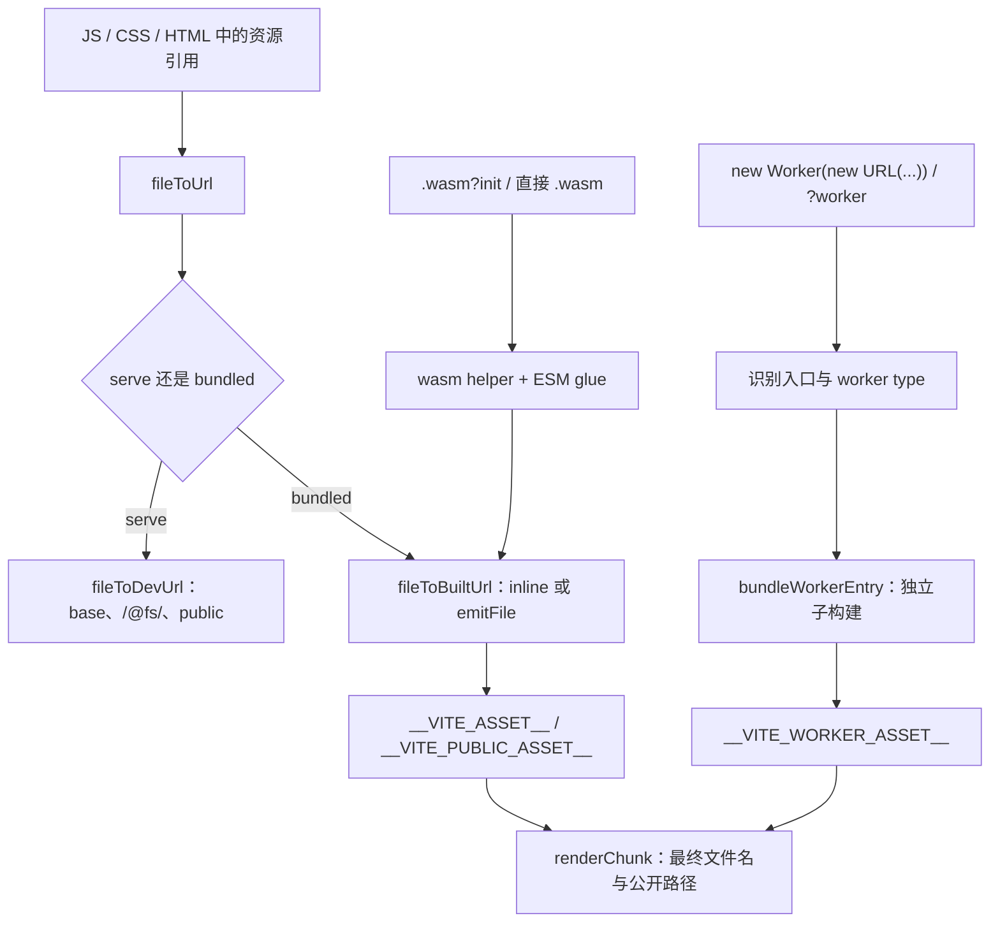

# 13B. Asset、Worker 与 Wasm

> **证据基线**：Vite `v8.2.1`，commit `421615865dad3ed39137d17281814fc78a41246c`。本文所有源码、测试与行为结论均限定于该版本。

## 阅读边界

本章研究三类“不是普通 JS、最终却要进入 JS 模块图”的资源：

```text
图片/字体/任意资产
→ URL 或 data URL
→ 开发服务器路径 / 构建资产占位符
→ renderChunk 最终公开路径

Worker / SharedWorker
→ 构造器 URL 识别或 ?worker 导入
→ 独立 worker 子构建
→ 构造器包装模块 / inline blob 或 data URL

Wasm
→ ?init 显式初始化，或直接 .wasm ESM 导入
→ 运行时 helper + imports/exports 胶水
→ 浏览器 fetch / SSR 文件读取
```

CSS 中的 URL 怎样进入 asset 流水线见 13A；第 14 章会从完整 build 生命周期继续解释
`renderChunk`、文件名、manifest 和 public base。本章只关心资源插件自己的协议。

读完应能回答：

1. 为什么开发态返回真实 URL，构建态却先返回 `__VITE_ASSET__...__`？
2. public 文件为什么不调用 `emitFile()`，又怎样进入最终 URL？
3. `?inline`、`?no-inline`、inline limit、SVG fragment 和 Git LFS pointer 如何共同决定内联？
4. 动态 ``new URL(`./${name}.png`, import.meta.url)`` 为什么能转成 glob，动态 worker 为什么不能？
5. `?worker` 导入和 `new Worker(new URL(...))` 最终怎样汇合？
6. worker 为什么是一次嵌套的完整构建，而不是把源文件直接复制出去？
7. worker 缓存怎样避免重复构建，又怎样只让受影响入口失效？
8. classic、module、ignore 三种 worker type 分别怎样注入 `/@vite/env`？
9. IIFE worker 为什么必须改写 `import.meta`，SharedWorker 内联为什么不用 blob URL？
10. `.wasm?init` 与直接 `.wasm` 导入分别生成什么 API？
11. Wasm Global 为什么需要 instance/wrapper 两层模块？
12. SSR Wasm 为何还要把资产占位符换成相对当前 chunk 的运行时 URL？

## 推荐阅读顺序

1. `asset.ts` 的 query 正则、占位符正则和 `assetPlugin()`。
2. `fileToUrl()` → `fileToDevUrl()` / `fileToBuiltUrl()`，先理解开发与构建分叉。
3. `shouldInline()`、`assetToDataURL()`、`svgToDataURL()`，补齐内联策略。
4. `renderAssetUrlInJS()`，看占位符怎样在已知 chunk 文件名后落地。
5. `assetImportMetaUrl.ts`，对比静态 URL 与动态模板 glob。
6. `workerImportMetaUrl.ts`，重点读 options 的静态 type 提取。
7. `worker.ts` 的 `webWorkerPlugin.load/transform`，再读 `bundleWorkerEntry()`。
8. `WorkerOutputCache`、`renderChunk`、`generateBundle`、`watchChange`，串起缓存与发射。
9. `webWorkerPostPlugin()`，理解 IIFE 的 `import.meta` 兼容层。
10. `wasm.ts`：先读 plugin load 分支，再读 `parseWasm()` 和两种 glue generator。
11. 最后按单元测试的算法边界、playground 的 dev/build 对照复盘。

## 总调用图



主线只有一个原则：transform 阶段通常不知道最终输出文件名，所以先建立资源引用关系并写占位符；
等 `renderChunk` 拿到 importer 与 asset 的最终文件名后，再计算 base、相对路径或运行时表达式。

## Asset 请求身份

| 写法                        | 开发态                              | 构建态                                      |
| --------------------------- | ----------------------------------- | ------------------------------------------- |
| `import url from './a.png'` | root URL、public URL 或 `/@fs/` URL | data URL 或 asset 占位符                    |
| `?url`                      | 强制按 URL 模块处理                 | 仍受合法的内联/发射规则影响                 |
| `?inline`                   | 直接读取并生成 data URL             | 强制内联                                    |
| `?no-inline`                | 保留独立 URL                        | 强制 emit asset                             |
| `?raw`                      | 导出文件文本并登记 watcher          | 导出文本                                    |
| public 根路径               | 原根 URL                            | public hash 占位符，不进入 `emitFile()`     |
| root 外文件                 | `/@fs/<absolute>`                   | 正常参与构建资产图                          |
| standalone asset entry      | 普通开发 URL                        | 发射 asset，删除只作代理的空 JS entry chunk |

query 是插件之间的身份协议。`cleanUrl()` 只用于文件系统解析，不能过早丢弃 postfix：SVG fragment、用户 query
和 `?no-inline` 的控制语义都可能仍需保留。

## 开发态 URL：把文件映射到服务器协议

`fileToDevUrl()` 的决策顺序：

```text
?inline
→ 读取文件并转 data URL

构建时会 inline 的 SVG
→ 开发态也 inline，避免两边编码/引号语义漂移

public 内文件
→ 保留根绝对 URL

root 内文件
→ 转成 /root-relative-url

root 外文件
→ 转成 /@fs/absolute-path

最后
→ encodeURIPath + base（或 origin）
```

`/@fs/` 不是简单暴露磁盘。后续静态中间件仍会执行 `server.fs.allow/deny` 校验。asset 插件只负责选择
服务器协议，访问权限属于第 06 章的请求流水线。

asset 对应的 ModuleNode 已失效时，开发 URL 会附带 HMR timestamp。浏览器即使缓存了图片，也会因为
查询串变化重新请求；历史修复见
[PR #13371](https://github.com/vitejs/vite/pull/13371)。

## 构建态：内联、emit 与占位符

`fileToBuiltUrl()` 先检查 config 级缓存。同一文件被 JS、CSS、HTML 多次引用时，应该得到同一引用协议，
不必重复读取、hash 或 emit。

### 内联优先级

`shouldInline()` 可按下面顺序理解：

```text
?no-inline                         → false
?inline                            → true
没有 build plugin context         → false
用户 assetsInlineLimit 回调有结果 → 使用回调
入口资源                           → false
lib 构建                           → true
Git LFS pointer                    → false
SVG 带 #fragment                   → false
否则 size < assetsInlineLimit      → true
```

Git LFS 未拉取时磁盘内容只是 pointer 文本。若按小文件内联，页面得到的不是资源而是 LFS 元数据；跳过逻辑
来自 [PR #9795](https://github.com/vitejs/vite/pull/9795)。

SVG 带 fragment 往往引用内部 symbol。将它转成 data URL 会改变复用与 fragment 行为，因此保持外置。
普通 SVG 从 Vite 5 开始可按阈值内联，见
[PR #14643](https://github.com/vitejs/vite/pull/14643)；若包含单双引号组合、`<text>`、
`<foreignObject>` 等高风险内容，则回退 MIME + base64，避免文本编码改变语义。

### 两种占位符

普通构建资源调用 `emitFile()`，得到 referenceId：

```text
__VITE_ASSET__<referenceId>__[$__query_or_hash__]
```

public 资源已经由 publicDir 复制流程管理，不能再 emit 一份。因此只在 config 级 map 中保存
`hash → 原 public URL`：

```text
__VITE_PUBLIC_ASSET__<hash>__
```

`renderAssetUrlInJS()` 扫描两类占位符：普通资源通过 `getFileName(referenceId)` 取得最终文件名，public 资源
通过 cache 还原原 URL，然后统一交给 `toOutputFilePathInJS()`。此时才具备：

- 当前 chunk 文件名；
- asset 最终文件名；
- output format；
- base 是否相对；
- `experimental.renderBuiltUrl` 是否返回运行时表达式。

因此占位符不是字符串替换技巧，而是跨 plugin hook 传递“尚未落地的资源引用”。

## `new URL(..., import.meta.url)`

`assetImportMetaUrlPlugin` 只作用于 client Environment，并避开 client runtime 与 preload helper。

### 静态字面量

```ts
new URL('./img.png', import.meta.url)
```

插件以 importer 目录解析文件，支持相对路径、alias/package 解析、public 根路径与无扩展文件，然后调用
`fileToUrl()`。文件存在时登记 watcher；不存在时保留原表达式，给出一次警告，让浏览器运行时自行解析。
只观察真实文件避免把目录或尚不存在路径交给 watcher，修复见
[PR #20507](https://github.com/vitejs/vite/pull/20507)。

### 动态模板

```ts
new URL(`./icons/${name}.png`, import.meta.url)
```

转换概念结果：

```ts
new URL(
  import.meta.glob('./icons/*.png', {
    eager: true,
    import: 'default',
    query: '?url',
  })[`./icons/${name}.png`],
  import.meta.url,
)
```

连续动态表达式合并成一个 `*`，模板顶层 query 单独进入 glob query；`${condition ? a : b}` 内部的问号
不能被误当 URL query，相关修复见
[PR #13034](https://github.com/vitejs/vite/pull/13034) 与
[PR #13121](https://github.com/vitejs/vite/pull/13121)。若 pattern 从 `*` 开始，插件无法确定安全搜索根，
保持原表达式。完全动态 URL 的边界见
[PR #10549](https://github.com/vitejs/vite/pull/10549)。

`/* @vite-ignore */` 明确要求保持运行时语义；支持该逃生口见
[PR #16590](https://github.com/vitejs/vite/pull/16590)。

## Worker 的两个入口语法

Vite 支持两条表面不同的路径：

```ts
import WorkerCtor from './worker.ts?worker'
const worker = new WorkerCtor()

new Worker(new URL('./worker.ts', import.meta.url), { type: 'module' })
```

前者由 `webWorkerPlugin.load()` 生成包装模块；后者先由 `workerImportMetaUrlPlugin` 识别构造器和入口 URL。
两者在 bundled 模式最终都进入 `bundleWorkerEntry()`，所以 worker plugins、target、format、资源发射和缓存
行为一致。

`?sharedworker` 只改变构造器；`?inline` 选择内联包装；`?url` 只导出 worker URL，不生成构造函数。

## Worker options 为什么只关心 type

浏览器 options 中 `name` 可以动态计算，但 `type` 决定 Vite 用 ESM import 还是 classic `importScripts` 注入
运行时，因此必须静态确定。

解析策略：

1. 用 `stripLiteral()` 屏蔽字符串与注释，定位当前 Worker 调用闭括号；
2. 尝试 `evalValue()` 静态求值完整 options；
3. 失败时解析 AST，只提取 ObjectExpression 的 `type`；
4. 无 type 且无 spread，安全回退 classic；
5. spread 位于 type 之后时拒绝，因为它可能覆盖已读到的 type；
6. `@vite-ignore` 返回 `ignore`，让用户承担动态装载方式。

动态 name 支持见 [PR #19010](https://github.com/vitejs/vite/pull/19010)，字符串插值修复见
[PR #19476](https://github.com/vitejs/vite/pull/19476)，type 检测边界见
[PR #19462](https://github.com/vitejs/vite/pull/19462)。尾逗号、注释和多行 URL 是括号定位算法的回归面，
可沿 [PR #10211](https://github.com/vitejs/vite/pull/10211)、
[PR #10226](https://github.com/vitejs/vite/pull/10226)、
[PR #20644](https://github.com/vitejs/vite/pull/20644) 阅读。

普通 asset 动态模板可以枚举候选 URL；worker 入口却必须静态，因为每个候选都意味着一次独立构建、运行时
type 和嵌套 bundle chain。当前实现直接拒绝动态 worker 模板，避免生成不完整的子构建集合。

## Worker 独立子构建

worker 不是把源码复制成文件。它可以 import npm 依赖、CSS、资产、动态 chunk，甚至创建下一层 worker，
因此 `bundleWorkerEntry()` 创建新的 `BuildEnvironment`，用 `config.worker.plugins()` 和
`worker.rolldownOptions` 执行完整 Rolldown 构建。

关键配置继承/覆盖：

- `build.target` 传给 worker transform，修复见
  [PR #22404](https://github.com/vitejs/vite/pull/22404)；
- define 仍由 Vite define 插件处理，并转发给子构建，修复见
  [PR #22408](https://github.com/vitejs/vite/pull/22408)；
- format 来自 `worker.format`；错误消息也把 Rolldown 的 `output.format` 改写成用户认识的配置名；
- entry/chunk/asset 文件都写入 `build.assetsDir`；
- sourcemap 作为关联 worker asset 交给主构建发射。

`bundleChain` 保存当前嵌套 worker 入口链。若下一入口已经在链中，报告带完整 import chain 的循环；合法的
运行时自引用另有特殊分支改写为 `self.location.href`。循环检测与自引用支持见
[PR #16103](https://github.com/vitejs/vite/pull/16103)，依赖中的 URL 自引用修复见
[PR #17846](https://github.com/vitejs/vite/pull/17846)。

## WorkerOutputCache

缓存挂在 `ResolvedConfig` 的 WeakMap 上；嵌套 Environment 通过 `mainConfig` 共享主构建缓存。

```text
bundles: input id → entry code/name、watchedFiles、referencedAssets
assets: fileName → source
fileNameHash: placeholder hash → entry filename
invalidatedBundles: 等待惰性删除的 worker input
```

同一 worker 被多个入口引用时只构建一次。watchChange 不清空全部缓存，只扫描 `watchedFiles` 标记受影响
bundle；该入口下次被请求时才删除旧 bundle，并只回收不再被其他 bundle 引用的 assets。按影响范围重建
来自 [PR #20559](https://github.com/vitejs/vite/pull/20559)。

worker 子构建产生的资源最终由主构建 `generateBundle` 统一发射：

- legacy/modern 共享缓存，避免重复；
- 嵌套 worker 构建不重复发射；
- 主 bundle 已有同名同内容资源时复用；
- 同名不同内容给出覆盖警告，见
  [PR #19591](https://github.com/vitejs/vite/pull/19591)；
- worker 引用遗漏的历史回归见
  [PR #21074](https://github.com/vitejs/vite/pull/21074)。

bundled-dev 的 HMR patch 不经过常规 `generateBundle`，所以 `emitWorkerAssetsForBundledDev()` 会在
load/transform 阶段补发缓存资源；worker 文件更新支持见
[PR #23068](https://github.com/vitejs/vite/pull/23068)。

## Worker 包装与运行时注入

开发请求统一附加：

```text
?worker_file&type=classic|module|ignore
```

`webWorkerPlugin.transform()` 据此给 worker 入口前置环境代码：

| type    | 注入方式                                                        |
| ------- | --------------------------------------------------------------- |
| classic | `importScripts(base + '/@vite/env')`                            |
| module  | `import '/@vite/env'`                                           |
| ignore  | 无法判断语法时，非 bundled 环境直接复制 `/@vite/env` 的变换结果 |

classic 必须显式拼 base，因为 `importScripts()` 不经过普通 JS import URL 改写；相关修复见
[PR #13941](https://github.com/vitejs/vite/pull/13941)。

构建态 worker 入口 URL 先写成：

```text
__VITE_WORKER_ASSET__<entry-filename-hash>__
```

`renderChunk` 通过 hash 找回 worker 文件名，再结合当前主 chunk 计算相对或公共路径。

### 内联 Worker 与 SharedWorker

普通 inline Worker 优先用 blob URL，构造失败时回退 data URL；代码放入 Blob 时会在 worker 启动后回收
object URL，不能提前回收，否则 WebKit 无法加载，修复见
[PR #20460](https://github.com/vitejs/vite/pull/20460)。Unicode 内容不再先做 base64，相关修复见
[PR #15866](https://github.com/vitejs/vite/pull/15866)。

SharedWorker 以 URL 作为共享身份；每次创建新 blob URL 会得到多个实例，所以 inline SharedWorker 固定使用
data URL，见 [PR #12014](https://github.com/vitejs/vite/pull/12014)。

### IIFE 与 `import.meta`

IIFE 没有 `import.meta`：

```text
import.meta.url   → self.location.href
其他 import.meta → const _vite_importMeta = { url: self.location.href }
```

这使 worker 不依赖主文档 `document`，修复见
[PR #12629](https://github.com/vitejs/vite/pull/12629)；更完整的 IIFE 改写边界见
[PR #15321](https://github.com/vitejs/vite/pull/15321)。

## Wasm 的两种 API

### `.wasm?init`

```ts
import init from './module.wasm?init'
const instance = await init(importObject)
```

插件返回显式初始化函数。浏览器端 helper：

- data URL：解 base64 后 `WebAssembly.instantiate()`；
- URL 且 MIME 为 `application/wasm`：`instantiateStreaming()`；
- MIME 不正确：读取 ArrayBuffer 再 instantiate，兼容配置不完整的静态服务器。

SSR 端 helper 不 fetch，而用 `new URL(file, import.meta.url)` + `readFile()`。SSR `?init` 支持来自
[PR #21102](https://github.com/vitejs/vite/pull/21102)。

### 直接 `.wasm` ESM 导入

```ts
import { add } from './add.wasm'
```

`parseWasm()` 在构建机读取并编译二进制，通过 `WebAssembly.Module.imports/exports` 得到静态模块接口，
生成：

1. 依赖模块的 ESM import；
2. WebAssembly import object；
3. 顶层 await 实例化；
4. 对 Wasm exports 的 ESM 命名导出。

非法 JS 标识符或保留字不能直接声明绑定，胶水代码会生成内部占位名，再用字符串模块导出名重导出。
直接导入实现见 [PR #21779](https://github.com/vitejs/vite/pull/21779)。

JS String builtins 等保留模块由 WebAssembly 引擎提供，不能生成普通 JS import；旧 Node 即使在 imports
列表中报告它们，也会由 `wasmReservedModules` 显式过滤。

## Wasm Global 的两层胶水

Wasm-to-Wasm 导入 Global 时需要 `WebAssembly.Global` 对象本身，因为它表示可变的活单元格；JS 使用者
通常期望拿到 `.value`。同一导出无法同时满足两种形态，所以包含 Global 导出的 Wasm 拆成：

```text
foo.wasm?vite-wasm-instance
→ 持有 Instance
→ 原样导出 WebAssembly.Global
→ 供另一个 Wasm 模块导入

foo.wasm
→ export * from instance 层
→ Global 用 .value 覆盖成普通 JS 值
→ 供应用代码导入
```

`export *` 不包含 default，所以 default 需要显式重导出。v128 Global 没有可读 JS 值，读取会抛错；
wrapper 捕获后令其保持 undefined。两层设计、Global 解包与 string builtins 用例扩充见
[PR #22674](https://github.com/vitejs/vite/pull/22674)。

## SSR Wasm 占位符

普通 asset 占位符面向浏览器公开 URL；SSR `?init` 需要的是相对 server chunk 的文件 URL。因此 load 阶段
把 `__VITE_ASSET__` 标记改为 `__VITE_WASM_INIT__`，`renderChunk` 再：

1. 由 referenceId 取得 Wasm 输出文件名；
2. 把它登记到 chunk `importedAssets` metadata；
3. 生成相对当前 server chunk 的运行时表达式；
4. 交给 `new URL(..., import.meta.url)` 在 Node 中定位文件。

使用全局正则 `.test()` 前必须重置 `lastIndex`。否则连续 Wasm 资产中第二个可能随机漏掉替换并在运行时报
ENOENT；修复与最小回归用例见
[PR #21780](https://github.com/vitejs/vite/pull/21780)。

## 测试怎样对应源码

### 单元测试

`assetImportMetaUrl.spec.ts` 直接调用 transform：

- 变量位于路径段或扩展名前时的 glob pattern；
- 连续动态表达式只生成一个 `*`；
- 模板从变量开始时保持不变。

`workerImportMetaUrl.spec.ts` 重点不是浏览器，而是代码边界：

- 无 options / SharedWorker 默认 classic；
- identifier/literal type 都能识别；
- 动态 name 保留、静态 type 仍能提取；
- spread 可能覆盖 type 时必须报错；
- 多行、尾逗号、注释、内部括号不破坏参数定位。

`worker.spec.ts` 对同一 `?worker&url` 做 client 与 SSR 构建，要求提取出的 worker hash URL 相同。

`wasm.spec.ts` 故意先复现 `/g` 正则的 lastIndex 缺陷，再验证每次归零后的修复。

### Playground

`playground/assets/__tests__/assets.spec.ts` 以 dev/bundled-dev/build 同表对照：

- JS、CSS、HTML、public 的 URL；
- raw/url/inline/no-inline；
- SVG fragment、Unicode、未知扩展；
- 静态与动态 `new URL()`；
- asset HMR、manifest 和旧文件清理。

`playground/worker/__tests__/es/worker-es.spec.ts` 与 `iife/worker-iife.spec.ts` 对照：

- Worker / SharedWorker、named、inline；
- nested/deeply nested 与自引用；
- worker 内资产、依赖、glob 和动态 chunk；
- 构建产物是否残留 import/export；
- IIFE 的 import.meta 与环境注入 sourcemap。

阅读用例时先看场景注释，再回到对应 transform/load/renderChunk 分支，不必顺序通读全部断言。

## 建议断点

### Asset

1. `fileToUrl()`：观察同一文件在 serve/build 返回值差异。
2. `fileToBuiltUrl()`：记录 `id`、inline 决策、referenceId、cache 命中。
3. `renderAssetUrlInJS()`：观察 chunk.fileName 与最终 replacement。
4. `assetImportMetaUrlPlugin.transform()`：对比 rawUrl、file、builtUrl 和 glob pattern。

### Worker

1. `getWorkerType()`：用动态 name、spread、尾逗号观察参数边界。
2. `bundleWorkerEntry()`：观察 bundleChain、worker config 和 watchedFiles。
3. `WorkerOutputCache.saveWorkerBundle()` / `removeBundleIfInvalidated()`：观察复用与惰性失效。
4. `webWorkerPlugin.load()`：对比 `?worker`、`?inline`、`?url`。
5. `webWorkerPlugin.renderChunk()`：观察占位符 hash 如何恢复 entryFilename。
6. `webWorkerPostPlugin.transform()`：在 IIFE worker 中观察 import.meta 改写。

### Wasm

1. plugin `load.handler()`：分别导入 `?init`、普通 Wasm、含 Global 的 Wasm。
2. `parseWasm()`：查看 imports/exports 与 isGlobal。
3. `generateInstanceGlue()`：观察普通导入与 Global 导入来自不同层。
4. `generateWrapperGlue()`：观察合法/非法导出名与 Global 解包。
5. SSR `renderChunk`：观察 `__VITE_WASM_INIT__` 到 runtime URL。

## 关键源码证据

目标版本源码摘录，来源：`packages/vite/src/node/plugins/asset.ts`，`assetPlugin()` 的
`resolveId`：

```ts
handler(id) {
  if (!config.assetsInclude(cleanUrl(id)) && !urlRE.test(id)) {
    return
  }
  // imports to absolute urls pointing to files in /public
  // will fail to resolve in the main resolver. handle them here.
  const publicFile = checkPublicFile(id, config)
  if (publicFile) {
    return id
  }
},
```

资源插件只接管配置识别的 asset 或 `?url`；public 绝对 URL 保留公开 ID，不转换成磁盘路径。
Worker 与 Wasm 最终复用的正是这条“请求身份”和“文件身份”分界。

## 复盘题

1. 为什么 public 资产需要自己的 hash 占位符，不能统一用 `emitFile()`？
2. 为什么 SVG 在开发态也要复用构建的 inline 判断？
3. `new URL()` 的文件不存在时，为何保留表达式比直接构建报错更合理？
4. 为什么动态 asset 模板可以 glob，而动态 worker 模板直接报错？
5. Worker options 中 name 可动态，type 却必须静态，根本原因是什么？
6. worker 子构建的 assets 为什么由主构建统一发射？
7. WorkerOutputCache 删除一个 bundle 时，为什么不能直接删除它的全部 referencedAssets？
8. inline SharedWorker 改成 blob URL 会出现什么浏览器语义变化？
9. IIFE 中为什么不能只替换 `import.meta.url`，而要兼容其他 `import.meta` 属性？
10. `.wasm?init` 与直接 `.wasm` 在 API、静态分析和初始化时机上分别有什么差异？
11. 若面向 JS 的 Wasm 模块直接导出 Global 对象，应用层与 wasm-to-wasm 分别会怎样？
12. SSR Wasm 为什么不能直接复用浏览器 asset URL？
