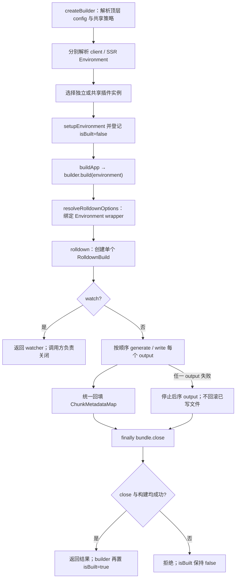

# 14A. 生产构建编排与 Environment

> **证据基线**：Vite `v8.2.1`，commit `421615865dad3ed39137d17281814fc78a41246c`。本文所有源码、测试与行为结论均限定于该版本。

## 阅读边界

本章研究 Vite 怎样把已解析配置变成一次或多次 Rolldown 构建：

```text
build(inlineConfig)
→ createBuilder()
→ 为每个命名环境解析 config / 创建插件实例
→ BuildEnvironment
→ resolveRolldownOptions()
→ rolldown() / watch()
→ generate 或 write 每个 output
→ 回填 viteMetadata
```

本章不展开 HTML/CSS/asset 插件内部算法，它们分别见 09、13A、13B。动态 import preload、
manifest、压缩与报告放在 14B；SSR 模块执行语义放在第 15 章。

读完应能回答：

1. `build()` 与 `createBuilder()` 有什么关系？
2. build 配置的默认值为什么依赖 client/server、lib 和 bundled-dev？
3. 顶层 input、lib entry、SSR entry、rolldownOptions.input 的优先级是什么？
4. 应用、库与 SSR 为什么使用不同 `preserveEntrySignatures`？
5. package.json 的 `type` 怎样影响 `.js/.mjs/.cjs`？
6. 为什么 ES 库压缩必须保留 pure annotations？
7. BuildEnvironment 怎样进入传统 Rollup/Rolldown plugin hook？
8. `viteMetadata` 为什么放在外置 Map，而不是只写 chunk 对象？
9. watch 重建为何要重置 metadata 和重新准备 outDir？
10. 多 Environment 为什么默认重新解析配置并创建插件实例？
11. sharedConfigBuild 与 sharedPlugins 分别共享什么？
12. `buildApp` hook 与默认“构建全部环境”的顺序是什么？

## 推荐阅读顺序

1. `BuildEnvironmentOptions` 与 `resolveBuildEnvironmentOptions()`。
2. `resolveBuildPlugins()`，只看构建插件前后顺序。
3. 旧 `build()` API，再进入 `createBuilder()`。
4. `resolveRolldownOptions()`：入口、平台、插件、output。
5. `resolveBuildOutputs()` 与 `resolveLibFilename()`。
6. `buildEnvironment()` 的 watch 和一次性分支。
7. `injectEnvironmentToHooks()` 与四类 wrapper。
8. `ChunkMetadataMap` 与 `injectChunkMetadata()`。
9. `toOutputFilePathInJS/WithoutRuntime()`。
10. `prepareOutDirPlugin()`。
11. 最后读 `createBuilder()` 的共享配置/插件策略。

## 两层 API

### `build()`：兼容单环境入口

```ts
const builder = await createBuilder(inlineConfig, true)
const environment = Object.values(builder.environments)[0]
return builder.build(environment)
```

它保留传统 Vite Build API：只建立 client 或 ssr 环境，返回一个 output、output 数组或 watcher。
`true` 表示使用 legacy Builder 兼容路径。

### `createBuilder()`：多环境编排器

Builder 暴露：

- `environments`：已初始化的 BuildEnvironment；
- `build(environment)`：构建指定环境并标记 `isBuilt`；
- `buildApp()`：让插件和框架决定构建顺序；
- `runDevTools()`：可选构建工具集成。

Environment API 引入 Builder 的演进见
[PR #18432](https://github.com/vitejs/vite/pull/18432)，`buildApp` hook 见
[PR #19971](https://github.com/vitejs/vite/pull/19971)。

## Build 配置归一化

`resolveBuildEnvironmentOptions()` 不只是填默认值。它把多个历史形态归一成后续可直接消费的协议。

### 与环境相关的默认值

| 配置          | client               | server / SSR   | bundled-dev    |
| ------------- | -------------------- | -------------- | -------------- |
| platform      | browser              | node           | 按 consumer    |
| minify        | oxc                  | false          | false          |
| emitAssets    | true                 | false          | 按 consumer    |
| cssCodeSplit  | 非 lib 时 true       | 非 lib 时 true | 非 lib 时 true |
| cssMinify     | 跟随 build.minify    | lightningcss   | 跟随规则       |
| modulePreload | `{ polyfill: true }` | 配置仍归一化   | 配置仍归一化   |

SSR target=webworker 是例外：platform 使用 browser；若 external 中残留 CJS require，再追加
`esmExternalRequirePlugin()`，因为 worker 运行时没有 Node `createRequire`。对应修复见
[PR #21963](https://github.com/vitejs/vite/pull/21963)。

### 特殊值

- `baseline-widely-available` 展开成固定浏览器 target 数组；默认 target 更新见
  [PR #21193](https://github.com/vitejs/vite/pull/21193)；
- target 数组去重，因为 Oxc 不接受重复值；
- 字符串 `'false'` 归一成布尔 false，`minify: true` 归一成 oxc；
- `modulePreload` 最终只有 false 或完整对象；
- 旧 rollupOptions 与新 rolldownOptions 通过 getter 保持兼容。

对象展开会把 getter 求值成普通数据属性，所以 resolved 对象上必须再次建立兼容访问器。相关修复见
[PR #22691](https://github.com/vitejs/vite/pull/22691)。

顶层 input 可补给缺少 entry 的 `build.lib`，但必须复制 lib 对象，不能修改用户配置；回归见
[PR #23135](https://github.com/vitejs/vite/pull/23135)。

## 构建专用插件顺序

`resolveBuildPlugins()` 返回 pre/post 两组：

```text
pre
├─ prepareOutDir（正式 build，且非 worker）
├─ build.rolldownOptions.plugins
└─ webWorkerPost（worker 构建）

post
├─ buildImportAnalysis
├─ esbuild final transform（选择 esbuild minify 时）
├─ terser
├─ license / manifest / ssrManifest / reporter（非 worker）
└─ native load fallback
```

用户放进 `build.rolldownOptions.plugins` 的插件也需要 `perEnvironmentPlugin`：它们只有在正式 build 或
bundled 环境中展开，且读取当前环境的 build 配置。

## 入口优先级

`resolveRolldownOptions()` 的入口决策：

```text
库模式：
rolldownOptions.input
→ build.lib.entry
→ resolveBuildEnvironmentOptions 已从顶层 input 补入的 lib.entry

非库模式：
build.ssr 字符串入口
→ rolldownOptions.input
→ 顶层 input
→ root/index.html
```

顶层 input 是较新的统一选项，见
[PR #22642](https://github.com/vitejs/vite/pull/22642)；让插件参与顶层 input 解析的回归见
[PR #23101](https://github.com/vitejs/vite/pull/23101)。

边界校验：

- SSR 入口不能是 HTML；服务端需要明确模块入口；
- `cssCodeSplit=false` 时不能把 CSS 本身列为 input；单 CSS bundle 需要由 JS/HTML 图聚合；
- lib 已启用却仍无 entry 时立即报错。

## Rolldown 输入配置

Vite 主要覆写：

- `preserveEntrySignatures`：SSR=`allow-extension`，lib=`strict`，应用=false；
- plugins：全部经 Environment wrapper；
- onLog：进入 Vite 日志适配；
- transform.target：build target；
- define：禁止 Rolldown 重复替换 NODE_ENV；
- `.css` 暂按 JS 模块代理；
- experimental.viteMode=true；
- chunkImportMap：按当前环境配置并注入 baseUrl。

用户 rolldownOptions 在内部默认值之后展开，但 Vite 会对 input、plugins、onLog 等关键协议再明确设值。

## Output 与库模式

### format 展开

`resolveBuildOutputs()`：

| lib 入口 | 未指定 formats 的默认值 |
| -------- | ----------------------- |
| 单入口   | es + umd                |
| 多入口   | es + cjs                |

UMD/IIFE 需要唯一入口和 `name`，否则无法生成单一全局变量。用户若显式提供 output 数组，该数组完全决定
格式，`lib.formats` 只给出忽略警告。

### 文件扩展名

`resolveOutputJsExtension()` 同时观察 package.json `type` 与 output format：

| package type | ES output | CJS/UMD output |
| ------------ | --------- | -------------- |
| module       | `.js`     | `.cjs`         |
| commonjs     | `.mjs`    | `.js`          |

这样 Node 不会按包级默认类型误读文件。库入口文件名优先级：用户函数 → 用户字符串 → package name（单字符串
入口）→ entry alias。

### 默认文件名

```text
应用 entry/chunk/asset → assets/[name]-[hash].ext
SSR entry              → [name].mjs/js/cjs
库 entry               → resolveLibFilename()
库 chunk               → [name]-[hash].ext
库 asset               → [name].[ext]
```

## 压缩与 ES 库纯标注

ES 库是给下游打包器消费的中间产物。若压缩空白时删除 `/* @__PURE__ */`，下游无法 tree-shake 构造调用，
所以 Vite：

- comments.annotation 在 ES lib 下保持；
- Oxc 只 compress/mangle，不执行 codegen whitespace minify；
- esbuild/Terser 分支也采用相同原则（14B 详述）。

相关修复见 [PR #21740](https://github.com/vitejs/vite/pull/21740) 与
[PR #20522](https://github.com/vitejs/vite/pull/20522)。

## `buildEnvironment()`

### 一次性构建

```text
创建 ChunkMetadataMap
→ resolveRolldownOptions
→ rolldown(options)
→ 对每个 output 调 write 或 generate
→ 给最终 output 回填 viteMetadata
→ 输出耗时
→ finally bundle.close()
```

`write=false` 仍执行完整输出生成，只是不写磁盘，适合框架读取内存产物。

### Watch 构建

watch 分支：

1. 解析所有 output dirs 与 emptyOutDir；
2. 把旧 Chokidar 选项转换为 Rolldown watcher；
3. BUNDLE_START 清除本轮 metadata reset 标记；
4. BUNDLE_END 关闭 event.result 并报告耗时；
5. ERROR 增强错误并输出。

watch 选项完整转发修复见
[PR #20674](https://github.com/vitejs/vite/pull/20674)，watch 重建重新清理 outDir 见
[PR #22207](https://github.com/vitejs/vite/pull/22207)。

## Environment 怎样进入插件 Hook

Rolldown 调用标准 hook 时不知道 Vite Environment。`injectEnvironmentToHooks()` 克隆插件并包装：

```text
resolveId/load/transform
→ context.environment = 当前 Environment
→ options.ssr = consumer === server（兼容旧 API）

renderChunk/augmentChunkHash/generateBundle/writeBundle
→ 注入 Environment
→ 同步 viteMetadata
```

插件可能是 class 实例，克隆时必须保留原型。对象式 hook 还带 `filter/order`；sharedPlugins 下同一原 hook
会产生多个环境 wrapper，`wrappedHookMap` 让后续 filter/order 赋值同步到全部副本。每环境独立 hook 对象的
修复见 [PR #21472](https://github.com/vitejs/vite/pull/21472)。

旧 options.ssr 正在走向废弃。启用 future deprecation 时，它被定义成 getter：只有插件真的读取才报警，
不会让未使用旧参数的插件产生噪声。实现背景见
[PR #20433](https://github.com/vitejs/vite/pull/20433)。

## ChunkMetadataMap

Vite 插件需要给 chunk/asset 追加：

- `importedCss`；
- `importedAssets`；
- 暂时共享的 modules 对象。

这些数据被 CSS、manifest、SSR manifest、preload 等多个插件跨 hook 使用。Rolldown 在不同阶段可能给出
不同 chunk 对象，因此用 preliminaryFileName/fileName 作为 key 放入外置 Map，再用 defineProperty 把同一
metadata 挂回对象。

使用 defineProperty 而非赋值，是为了不被 Rolldown 误判为输出发生修改。metadata 的枚举性和 build 返回值
修复可沿 [PR #261](https://github.com/vitejs/vite/pull/261)、
[PR #262](https://github.com/vitejs/vite/pull/262) 阅读。

watch 模式每轮第一次 renderChunk 重置该 chunk metadata，防止旧 CSS/asset 集合残留；修复见
[PR #342](https://github.com/vitejs/vite/pull/342)。

## 构建 URL 运行时

资源插件只知道最终 filename 后，统一调用：

- `toOutputFilePathInJS()`：允许返回 runtime 表达式；
- `toOutputFilePathWithoutRuntime()`：CSS/HTML 只能接受字符串；
- `createToImportMetaURLBasedRelativeRuntime()`：按 format 生成相对 URL 代码。

相对 base 的运行时机制：

| format      | 基准                                            |
| ----------- | ----------------------------------------------- |
| es          | `import.meta.url`                               |
| cjs         | Node `__dirname` 或浏览器 currentScript/baseURI |
| iife        | currentScript/baseURI                           |
| umd         | Node、location、document 三路兼容               |
| worker-iife | `self.location.href`                            |

`experimental.renderBuiltUrl` 可直接返回字符串、要求 relative，或为 JS 返回 runtime 表达式。CSS/HTML 无法
嵌入任意 JS，收到 runtime 时必须报错。

文档基准 URL 构造还需防 DOM Clobbering，相关修复见
[PR #18115](https://github.com/vitejs/vite/pull/18115)。

## 输出目录准备

`prepareOutDirPlugin` 在每个环境首次 renderStart：

1. 汇总所有 output dir；
2. 解析 emptyOutDir 安全默认值；
3. 清空目录，但保留 `.git` 与嵌套的其他 output dir；
4. 检查 publicDir/outDir 是否重叠；
5. 把 publicDir 复制到每个输出目录。

决定“首次”的不是进入过 `renderStart`，而是已经执行过一次写盘准备。源码中的 `rendered` 只在
`write=true` 时登记 Environment：

来源：`packages/vite/src/node/build.ts`，`prepareOutDirPlugin()`。

```ts
renderStart: {
  order: 'pre',
  handler() {
    if (rendered.has(this.environment)) return

    const { config } = this.environment
    if (config.build.write) {
      rendered.add(this.environment)
      const { root, build: options } = config
      const resolvedOutDirs = getResolvedOutDirs(
        root,
        options.outDir,
        options.rolldownOptions.output,
      )
      const emptyOutDir = resolveEmptyOutDir(
        options.emptyOutDir,
        root,
        resolvedOutDirs,
        this.environment.logger,
      )
      prepareOutDir(resolvedOutDirs, emptyOutDir, this.environment)
    }
  },
},
```

所以第一次 `write=false` 只生成内存产物，不会消费“已准备”机会；同一 Environment 下一次改为
`write=true`，仍会清理安全目录并复制 publicDir。多个 output dir 存在父子关系时，`prepareOutDir()`
把嵌套 output 加入 `skipDirs`，避免清父目录时删掉同轮其他输出。

worker 子构建不运行它，避免嵌套构建清空主输出，修复见
[PR #20556](https://github.com/vitejs/vite/pull/20556)。

Vite Task 会追踪读写输入；emptyDir 对目录的枚举不是真正构建输入，需要 `ignoreInput(outDir)` 排除，集成见
[PR #22453](https://github.com/vitejs/vite/pull/22453)。首轮 write=false 后再次 write=true 仍须复制 public，
回归见 [PR #22328](https://github.com/vitejs/vite/pull/22328)。

## 多 Environment 共享策略

默认：每个环境重新 resolveConfig，并创建新插件实例。原因是构建插件通常假定一个实例一次只处理一个
bundle；开发态才长期并发服务多个 Environment。

| 选项              | 行为                          |
| ----------------- | ----------------------------- |
| sharedConfigBuild | 环境间复用同一 ResolvedConfig |
| sharedPlugins     | 复用首次解析的全部插件实例    |
| sharedDuringBuild | 单个插件主动选择复用          |

即使共享插件，插件也必须通过 `this.environment.config` 读取环境级 minify/chunkImportMap 等配置，不能捕获
顶层 config 的某个环境值。sharedPlugins 下 chunkImportMap 的隔离回归见
[PR #23184](https://github.com/vitejs/vite/pull/23184)。

`buildApp()` 顺序：pre/normal 插件 hooks → `builder.buildApp` → post hooks。若全部自定义逻辑结束后仍没有
任何 Environment 标记为 built，Builder 回退为构建全部环境，保证最小配置有产物。

## 错误与日志

`enhanceRollupError()` 给错误补：插件名、文件/行列、统一 code frame。stack 可能已被读取缓存，所以不能
只改 message，要先剥离旧 message 前缀再显式重建 stack。

`onRollupLog()`：

- 未解析 import 默认升级为错误，`?commonjs-external` 除外；
- 过滤已知循环与动态 import variables 噪声；
- 补 `[plugin name]`；
- 兼容新 onLog 与旧 onwarn；
- 未知 level 至少按 info 输出。

构建日志接入 Environment context 见
[PR #18142](https://github.com/vitejs/vite/pull/18142)，插件名前缀见
[PR #205](https://github.com/vitejs/vite/pull/205)。

## 贯穿案例：先固定一张真实模块图

14A 与 14B 共用仓库现成 fixture：
`packages/vite/src/node/__tests__/fixtures/shared-plugins/chunk-import-map/`。
它很小，却同时包含动态 import 与 CSS side effect：

下列合并展示三个文件；`// 文件名` 是教程边界标注，不属于 fixture 原文。

```js
// entry.js
import('./lazy.js')

// lazy.js
import './lazy.css'
export const lazy = true

// lazy.css
.lazy {
  color: red;
}
```

本章只追踪**控制平面**：谁解析配置、谁拥有插件、谁调用 Rolldown、何时写盘、失败时谁清理。
14B 接着追踪同一模块图的**数据平面**：lazy chunk、CSS、preload marker、import map 与 manifest
怎样成为可交付产物。这样避免把 `createBuilder()` 与 `generateBundle()` 讲成两条互不相干的函数清单。

仓库测试使用两个命名 Environment：client 开启 `chunkImportMap`，SSR 关闭；二者复用插件实例，
但构建配置必须隔离。为了观察交付阶段，可在同一模块图上再开启 `manifest`、`write` 与 output 数组。
后者是基于公开配置协议的讲解扩展，不冒充仓库测试已执行的场景。

### 所有权地图

| 对象/状态 | 创建者 | 持有者 | 生命周期 | 不应误解为 |
| --- | --- | --- | --- | --- |
| 顶层 `ResolvedConfig` | 首次 `resolveConfigToBuild()` | `ViteBuilder.config` | Builder 生命周期 | 每个 Environment 的最终 build 配置 |
| 环境 `ResolvedConfig` | 默认逐环境重新解析；可共享 | `BuildEnvironment` | Environment 生命周期 | 必然与顶层对象同一引用 |
| 原插件实例 | 每次配置解析；共享策略可替换 | 环境配置的 plugin 列表 | 配置生命周期 | 直接交给 Rolldown 的对象 |
| hook wrapper | `resolveRolldownOptions()` | 本次 `RolldownOptions.plugins` | 单次 build 调用 | 新的业务插件实例 |

`sharedPlugins: true` 共享的是原插件实例，不是 wrapper；插件若闭包捕获首次 config，wrapper 也无法修复。

## 控制平面源码闭环

下面四段分别锁定所有权、动态分派、metadata 同步和资源释放。

### 证据 A1：Environment 默认独立解析，随后并行初始化

来源：`packages/vite/src/node/build.ts`，`createBuilder()`。

```ts
for (const environmentName of Object.keys(config.environments)) {
  let environmentConfig = config
  if (!configBuilder.sharedConfigBuild) {
    const patchConfig = (resolved: ResolvedConfig) => {
      ;(resolved.build as ResolvedBuildOptions) = {
        ...resolved.environments[environmentName].build,
      }
    }
    const patchPlugins = (resolvedPlugins: Plugin[]) => {
      let j = 0
      for (let i = 0; i < resolvedPlugins.length; i++) {
        const environmentPlugin = resolvedPlugins[i]
        if (
          configBuilder.sharedPlugins ||
          environmentPlugin.sharedDuringBuild
        ) {
          for (let k = j; k < config.plugins.length; k++) {
            if (environmentPlugin.name === config.plugins[k].name) {
              resolvedPlugins[i] = config.plugins[k]
              j = k + 1
              break
            }
          }
        }
      }
    }
    environmentConfig = await resolveConfigToBuild(
      inlineConfig,
      patchConfig,
      patchPlugins,
    )
  }
  environmentConfigs.push([environmentName, environmentConfig])
}
await Promise.all(
  environmentConfigs.map(
    async ([environmentName, environmentConfig]) =>
      await setupEnvironment(environmentName, environmentConfig),
  ),
)
```

控制关系不是“复制一个配置对象再改 name”。默认每个环境重新跑配置解析，`patchConfig` 把对应的
environment build 选项镜像到旧插件仍会读取的顶层 `config.build`；`patchPlugins` 再选择性把新解析出的
插件替换为首次解析实例。最后才并行执行 `createEnvironment → init → environments[name] = environment`。
因此配置解析是所有权决策，Environment 初始化是登记阶段。

### 证据 A2：当前 Environment 在 Rolldown 边界变成 hook wrapper

来源：`packages/vite/src/node/build.ts`，`resolveRolldownOptions()`。

```ts
const plugins = environment.plugins.map((p) =>
  injectEnvironmentToHooks(environment, chunkMetadataMap, p),
)
```

入口优先级已在前文完整列出；这里的新增事实是 Rolldown 收到的不是裸插件，而是绑定当前 Environment 与
本轮 metadata map 的 wrapper；随后同名变量写入 `rolldownOptions.plugins`。

### 证据 A3：输出 hook 调用前恢复共享 metadata

来源：`packages/vite/src/node/build.ts`，`wrapEnvironmentHook()`。

```ts
const handler: Plugin[HookName] = function (
  this: PluginContext,
  ...args: any[]
) {
  if (hookName === 'renderChunk') {
    injectChunkMetadata(chunkMetadataMap, args[1], true)
  }
  if (hookName === 'augmentChunkHash') {
    injectChunkMetadata(chunkMetadataMap, args[0])
  }
  if (hookName === 'generateBundle' || hookName === 'writeBundle') {
    const bundle = args[1] as OutputBundle
    for (const chunk of Object.values(bundle)) {
      injectChunkMetadata(chunkMetadataMap, chunk)
    }
  }
  return fn.call(injectEnvironmentInContext(this, environment), ...args)
}
```

这段是 14A 到 14B 的桥。`renderChunk` 先为新轮次重置该 chunk 的 metadata；
`augmentChunkHash`、`generateBundle`、`writeBundle` 再把同一份集合挂到阶段性输出对象，最后才调用业务 hook。
于是 CSS 插件在前一 hook 写入的 `importedCss`，manifest/preload 插件能在后一 hook 读取。
顺序反过来会让插件看到未注入或上一轮的 metadata。

### 证据 A4：一个 bundle 串行处理全部 output，失败也关闭

来源：`packages/vite/src/node/build.ts`，`buildEnvironment()` 一次性分支。

```ts
const { rolldown } = await import('rolldown')
startTime = Date.now()
bundle = await rolldown(rolldownOptions)

const res: RolldownOutput[] = []
for (const output of arraify(rolldownOptions.output!)) {
  res.push(await bundle[options.write ? 'write' : 'generate'](output))
}
for (const output of res) {
  for (const chunk of output.output) {
    injectChunkMetadata(chunkMetadataMap, chunk)
  }
}
return Array.isArray(rolldownOptions.output) ? res : res[0]
```

同一函数的清理尾部（与上段之间省略日志和 catch 增强逻辑）：

```ts
} finally {
  if (bundle) await bundle.close()
}
```

多 output 不是多次解析模块图：一个 `RolldownBuild` 按数组顺序执行多个 `write()`/`generate()`。
任何 output 抛错，后续 output 不再执行，catch 增强原错，finally 关闭 bundle；此实现没有“删除已写入前序
output”的事务回滚。调用方应把失败理解为“构建资源已释放”，不能理解为“磁盘恢复到构建前”。

`write=false` 只把输出副作用改为内存 `generate()`，不会跳过 render/generate hooks，所以 preload、manifest
仍可被测试读取。反之，watch 分支返回长期 watcher，不进入这里的 `bundle.close()`；关闭 watcher 是调用方责任。

## 编排状态表：同一案例从配置到释放

| 时点 | 触发动作 | 关键状态变化 | 可见副作用 | 失败/退出语义 |
| --- | --- | --- | --- | --- |
| S0 配置 | `createBuilder(inlineConfig)` | 顶层 config、共享策略确定 | config hooks 可产生日志 | 解析失败时 Builder 不返回 |
| S1 环境 | 重解析并 `setupEnvironment()` | 插件独立或共享；登记环境，`isBuilt=false` | 无产物 | 初始化失败的环境不登记 |
| S2 翻译 | `resolveRolldownOptions()` | 新 metadata map、wrappers、outputs | 无产物 | input/output 校验失败时尚无 bundle |
| S3 建图 | `rolldown(options)` | 创建一个 `RolldownBuild` | build hooks 执行 | 若已创建 bundle，错误路径最终关闭 |
| S4 输出 | 逐 output generate/write | metadata 跨 hook 同步 | 内存结果或部分磁盘文件 | 后序失败不回滚前序磁盘输出 |
| S5 释放 | `finally bundle.close()` | 一次性 bundle 先关闭 | 无新增产物 | close 失败会使本次构建拒绝 |
| S6 返回 | 回到 `builder.build()` | 此时才置 `isBuilt=true` | 返回 output；watch 返回 watcher | 失败或 close 失败均不置位 |

其中 S6 的 chunk/CSS/asset/preload/manifest 状态变化由 14B 展开。这个边界很重要：14A 证明**何时**各 hook
得到正确 Environment 和 metadata，14B 证明这些 hook **写了什么**。



图中 client/SSR 是下方共享插件测试的两个真实 Environment；多 output 与失败分支由源码锁定，测试未直接
触发。一次性构建的资源提交点不是写完某个 output，而是 `bundle.close()` 成功后调用方取得结果。

## 源码—测试证据

| 机制 | 决定性源码 | 代表测试 | 证据边界 |
| --- | --- | --- | --- |
| Environment 所有权 | `createBuilder()` | 14B 完整 chunkImportMap 测试 | 动态证明共享插件下 client/SSR 配置隔离 |
| hook wrapper / metadata | `resolveRolldownOptions()`、`wrapEnvironmentHook()` | 同上、CSS hash 回归 | 源码证明注入顺序；测试证明 CSS specifier 最终进入 client 产物 |
| output 与关闭 | `buildEnvironment()` | `write:false` 构建测试 | 测试只覆盖 generate 成功；失败停止与 finally close 来自源码 |
| 输出目录 | `prepareOutDirPlugin()` | write=false 后再 write=true 复制 publicDir | 动态证明首轮内存构建不消费后续写盘准备 |
| 格式与入口 | `resolveBuildOutputs()`、input 解析 | lib formats、虚拟/顶层 input 测试 | 覆盖约束与优先级，不证明磁盘事务回滚 |

## 建议断点

1. `resolveBuildEnvironmentOptions()`：比较 client/ssr/custom 的 resolved 值。
2. `createBuilder()`：观察 sharedConfigBuild=false 时 resolveConfig 次数。
3. `resolveRolldownOptions()`：记录 input、platform、preserveEntrySignatures、outputs。
4. `injectEnvironmentToHooks()`：查看同一插件在两个环境中的 clone/context。
5. `ChunkMetadataMap.reset/get()`：watch 两轮观察集合生命周期。
6. `buildEnvironment()`：对比 write=false、write=true 与 watch。
7. `prepareOutDir()`：多 output dir 时观察 skipDirs。
8. `toOutputFilePathInJS()`：切换 base 与 format 查看 runtime。

## 复盘题

1. 为什么旧 `build()` 只取 Builder 的第一个 Environment？
2. lib entry 从顶层 input 补入时，为何必须复制用户对象？
3. SSR webworker 为什么 platform=browser 却还需要处理 external CJS？
4. UMD/IIFE 为什么不能像 ES/CJS 一样自然支持多入口？
5. package type 与 output format 不匹配时，为何要改变扩展名？
6. ES 库 whitespace minify 会怎样影响下游？
7. 为什么不能给每个 Rolldown chunk 对象各存一份 viteMetadata？
8. 对象式 hook 的 filter/order 为什么需要跨环境 wrapper 同步？
9. sharedPlugins=true 后，插件读取顶层 config 会产生什么错误？
10. write=false 的构建为什么不应永久跳过下一轮 publicDir 复制？
11. CSS/HTML 为什么不能接受 renderBuiltUrl runtime 返回值？
12. buildApp 自定义编排什么情况下会触发默认全环境构建？
