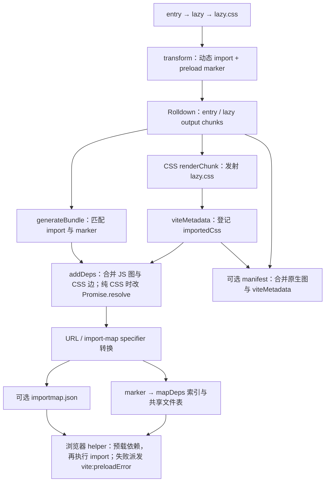

# 14B. 动态导入预加载、压缩与构建清单

> **证据基线**：Vite `v8.2.1`，commit `421615865dad3ed39137d17281814fc78a41246c`。本文所有源码、测试与行为结论均限定于该版本。

## 阅读边界

14A 已把配置变成 Rolldown output。本章研究 output 生成期间，Vite怎样补齐浏览器装载语义和交付产物：

```text
动态 import
→ transform 注入 __vitePreload(factory, __VITE_PRELOAD__)
→ generateBundle 追踪输出 chunk/CSS 依赖
→ marker 替换为压缩的依赖索引
→ 浏览器 helper 并行加载 CSS/module

最终 chunk
→ target 转换 / Oxc、esbuild 或 Terser 压缩
→ manifest / license / reporter
```

读完应能回答：

1. preload 为什么不能在 transform 时直接写最终依赖列表？
2. 嵌套动态 import 怎样与各自 marker 正确配对？
3. modulePreload=false 时为什么仍可能注入 CSS 依赖？
4. 纯 CSS 动态 chunk 被删除后，原 import 怎样保持 Promise 语义？
5. resolveDependencies 为什么不能删除 CSS？
6. 相对 base、renderBuiltUrl 与 chunkImportMap 怎样改变 deps 表达？
7. preload helper 如何避免与 SSR HTML 重复加载？
8. `vite:preloadError` 为什么可取消？
9. esbuild 为什么分单模块转译和最终 chunk 转换两阶段？
10. UMD/IIFE 中 esbuild helper 为什么必须移入 wrapper？
11. Terser 哪些选项会迫使 worker 回退主线程？
12. manifest 怎样合并多个 output，并补入 Vite CSS/asset metadata？

## 推荐阅读顺序

1. `importAnalysisBuild.ts` 的常量与 `preload()` 运行时 helper。
2. `getPreloadCode()`，理解 helper 怎样按 base 序列化。
3. `buildImportAnalysisPlugin()` 的 renderChunk：现代格式标记。
4. generateBundle：先读关闭 preload 时的纯 CSS 清理。
5. 再读正常分支的 imports/marker 配对、`addDeps()` 与 marker 替换。
6. `matchImportsToPreloadMarkers()`，结合嵌套用例手推栈。
7. sourcemap 合并与剩余 marker 清理。
8. `esbuild.ts`：`esbuildPlugin()` 与 `buildEsbuildPlugin()` 对照。
9. `resolveEsbuildTranspileOptions()` 与 `injectEsbuildHelpers()`。
10. `terser.ts` 的 worker fallback。
11. `manifest.ts`、`license.ts`、`reporter.ts`。

## 为什么要两阶段生成 preload

transform 阶段只知道源码 import：

```ts
import('./feature')
```

此时不知道：

- feature 最终 chunk 文件名；
- 它的静态 imports；
- 每个 chunk 抽取了哪些 CSS/assets；
- 某动态入口是否被内联；
- 纯 CSS JS 代理是否会被删除；
- import map 是否把文件名换成 specifier。

因此原生 build import analysis 先注入：

```ts
__vitePreload(() => import('./feature-hash.js'), __VITE_PRELOAD__)
```

`generateBundle` 拿到最终 bundle 图与 viteMetadata 后，再把 marker 填成真实依赖列表。marker 是 transform 与
output 阶段之间的延迟协议，与 13B 的 asset/worker 占位符思路相同。

## 现代格式标记

helper 内部使用 `__VITE_IS_MODERN__`。`renderChunk` 按 output format 把它等长替换为 true/false：

- ES output：true，保留 preload 逻辑；
- CJS/legacy：false，让压缩器删除 DOM/preload 分支。

决定性源码位于 `buildImportAnalysisPlugin()`：

```ts
renderChunk(code, _, { format }) {
  if (code.includes(isModernFlag)) {
    const re = new RegExp(isModernFlag, 'g')
    const isModern = String(format === 'es')
    const isModernWithPadding =
      isModern + ' '.repeat(isModernFlag.length - isModern.length)
    return {
      code: code.replace(re, isModernWithPadding),
      map: null,
    }
  }
  return null
},
```

等长填充减少位置偏移，且 plugin-legacy 可继续协同处理现代/旧输出。

## import 与 marker 配对

简单输出可以按“import 后的下一个 marker”配对；嵌套时不成立：

```ts
import('a').then(() => import('b'))
```

wrapper 嵌套后，marker 顺序可能是：

```text
import a → import b → marker b → marker a
```

算法单次从左到右：

1. imports 已按源码位置排序；
2. 遇到 marker 前，把结束位置在它之前的 imports 压栈；
3. marker 弹出最近的未闭合 import；
4. 记录 marker 起点到与 imports 平行的数组。

这就是“括号闭合”而非“邻近文本”模型。嵌套 CSS preload 修复见
[PR #22759](https://github.com/vitejs/vite/pull/22759)，用例中的 #22700 是最小复现场景。

仅一个 import/marker 时还保留 #3051 时代 marker 可能位于 import 之前的兼容分支。

## 递归收集依赖

对每个可静态解析的动态 import，`addDeps()` 从其输出 chunk 开始深度遍历：

```text
动态入口 chunk
→ 自身文件
→ chunk.imports 的静态依赖
→ 每个依赖的 imports
→ 每个 chunk.viteMetadata.importedCss
```

Set 同时去重并保存遍历插入顺序。当前 chunk 的 CSS 在递归静态依赖之后追加，保证依赖样式先加载，当前
chunk 样式后加载，避免依赖规则意外覆盖当前模块。

不能只看 `chunk.dynamicImports.length`：动态导入常量 JSON 等模块可能被 Rolldown 内联，但 transform 留下的
marker 仍要清理。

## 纯 CSS 动态入口

CSS 插件会删除没有运行时代码的 JS proxy chunk，详情见 13A。此时 bundle 中查不到 filename，但
`removedPureCssFilesCache` 保存其 metadata。

处理方式：

1. 收集被删 chunk 的 importedCss；
2. 把动态 import 表达式替换为 `Promise.resolve({})`；
3. 仍把 CSS 传给 preload helper；
4. 尽量用等长空格保持 sourcemap 位置。

关闭 preload 的库/worker/服务端路径也必须做这一步，否则输出会 import 一个不存在的纯 CSS JS 文件。
相关修复见
[PR #17601](https://github.com/vitejs/vite/pull/17601)、
[PR #17371](https://github.com/vitejs/vite/pull/17371)；chunkImportMap 开启时的组合回归见
[PR #22841](https://github.com/vitejs/vite/pull/22841)。

## modulePreload=false 仍需加载 CSS

module preload 是性能优化；动态 chunk 对应 CSS 是正确性依赖。两者复用同一个 helper，但语义不同：

```text
modulePreload=true  → JS 直接依赖 + CSS
modulePreload=false → 只保留 CSS
```

同理，`modulePreload.resolveDependencies(filename, deps, context)` 可以修改/删除 JS preload，却不能删除 CSS。
实现先拆成 cssDeps/otherDeps，只把 otherDeps 交给用户，最后重新附加 cssDeps。

传给用户的是输出 URL，而非 import map specifier；hostId/hostType 告诉框架该列表属于哪个 JS chunk。

## 压缩依赖表

直接为每个 import 重复写字符串数组会放大 bundle。插件为当前 chunk 建立唯一 `fileDeps`，marker 只写
`__vite__mapDeps([0, 1])` 一类索引；真实生成源码见后文证据 B3。

依赖表惰性挂到函数属性，只有动态 import 真正执行时才求值；优化见
[PR #17602](https://github.com/vitejs/vite/pull/17602)。没有任何依赖时不注入映射器，见
[PR #16271](https://github.com/vitejs/vite/pull/16271)。

文件有 hashbang 时，额外代码必须插到第一行之后。对不常见换行符的修复见
[PR #23038](https://github.com/vitejs/vite/pull/23038)。

动态 import 被内联后可能没有对应输出依赖；所有未改写 marker 最终变成 `void 0`，不允许占位符泄漏到产物。

## 相对 Base、renderBuiltUrl 与 Import Map

### 普通绝对 base

deps 相对 outDir 保存，运行时 `assetsURL(dep)` 前置 config.base。

### 相对 base

依赖必须相对当前 chunk，helper 接收第三参数 importerUrl 并执行：

```ts
new URL(dep, importerUrl).href
```

### renderBuiltUrl

每个 dep 进入 `toOutputFilePathInJS()`：

- 字符串返回值进入依赖表字符串；
- runtime 返回值以未加引号表达式进入表；
- 相对 URL 仍由 importerUrl 解析。

相对 renderBuiltUrl 与 preload 的组合修复见
[PR #16084](https://github.com/vitejs/vite/pull/16084)。

### chunkImportMap

bundle 文件名先映射成 import map specifier，依赖收集完成后再按 reverse mapping 输出 specifier。
运行时用 `import.meta.resolve()` 解析；因此该实验选项要求浏览器支持它。

client、SSR、自定义 Environment 可独立开关。sharedPlugins 时不能捕获首次环境值，修复见
[PR #23184](https://github.com/vitejs/vite/pull/23184)。chunk import map 的引入见
[PR #21580](https://github.com/vitejs/vite/pull/21580)。

## 浏览器 Preload Helper

运行时顺序：

1. 现代格式且 deps 非空才工作；
2. 读取 CSP nonce meta，兼容浏览器 nonce hiding；
3. 把 dep 转绝对 URL；
4. 用全局 seen 去重；
5. 再扫描现有 `<link>`，避免与 SSR markup 重复；
6. CSS 创建 stylesheet link；JS 创建 modulepreload，浏览器不支持时退成 preload as=script；
7. 等待全部 CSS load/error；
8. 执行真正动态 import factory。

CSP nonce 支持见 [PR #16052](https://github.com/vitejs/vite/pull/16052)，CSS link crossorigin 修复见
[PR #17930](https://github.com/vitejs/vite/pull/17930)。

为兼容 Chrome 64–75、Firefox 67–70、Safari 11.1–12.1，helper 自带小型 allSettled 实现，修复见
[PR #19805](https://github.com/vitejs/vite/pull/19805)。

任何 CSS preload 或动态 import 错误都会派发：

```ts
window.addEventListener('vite:preloadError', (event) => {
  event.preventDefault()
  // 应用可刷新页面或展示恢复 UI
})
```

未 preventDefault 时重新抛错；可取消机制见
[PR #18046](https://github.com/vitejs/vite/pull/18046)，module 本身错误也进入同一事件见
[PR #18098](https://github.com/vitejs/vite/pull/18098)。

## Modulepreload Polyfill 虚拟入口

用户或 HTML 构建可导入稳定 ID `vite/modulepreload-polyfill`。插件把它解析为 `\0` 虚拟模块：

- bundled client：交给 Rolldown 原生 modulepreload polyfill 插件生成兼容实现；
- bundled server/CJS：按非现代目标让无用分支被 tree-shake；
- unbundled dev：load 返回空模块，因为浏览器直接加载开发模块图，不需要构建产物级 polyfill。

公共 ID 与内部虚拟 ID 分离，既允许用户显式导入，也防止其他 resolve 插件把它当 npm 包。对应快照用例
对照 ES 与 CJS 输出，验证不是“始终塞一份 polyfill”。

## Sourcemap 维护

MagicString 生成当前 marker/代码注入 map，再与原 chunk.map 合并。需要保留：

- 原 `map.file`；
- debugId；
- inline sourcemap 时移除旧注释并追加新 data URL；
- 外置 map 时更新 bundle 中 `.map` asset source。

保留原 map.file 的回归见
[PR #20926](https://github.com/vitejs/vite/pull/20926)。

## Esbuild 的两个阶段

### 单模块转译 `esbuildPlugin`

目标是快速把 TS/TSX/JSX 变成 JS：

- 按完整 id/query 推断 loader；
- 读取最近 tsconfig 的少数有意义字段；
- 开发态把所有 tsconfig extends 文件加入 watcher；
- 用户显式 JSX options 覆盖 tsconfig；
- 强制 sourcemap；
- 关闭 minify、treeShaking、keepNames；
- 可选拼接 jsxInject。

优化在此阶段关闭，因为同一模块可能继续被 Rolldown tree-shake，最终 chunk 还会统一 target/minify。多次
keepNames 破坏 tree-shaking 的背景见代码中的 #9164。

`transformWithEsbuild()` 是旧公开 API，现要求项目自行安装可选 esbuild，并提示迁移 Oxc。

### 最终 chunk `buildEsbuildPlugin`

它在 renderChunk 按 `build.target` 和 `build.minify='esbuild'` 工作：

- legacy chunk 跳过，避免再次生成旧环境不安全语法；
- ES/CJS 映射成 esbuild format；
- IIFE 不再指定 format，避免给 Rolldown wrapper 多包一层；
- ES lib 永远禁用 whitespace minify，保留 pure annotations；
- 用户细粒度 minifyIdentifiers/Syntax/Whitespace 优先。

保留 ES lib 标注见 [PR #20522](https://github.com/vitejs/vite/pull/20522)。

## UMD/IIFE Helper 注入

esbuild 可能生成：

```text
<helper with minified globals>
(function () { "use strict"; <actual content> })()
```

helper 位于 wrapper 外会污染全局，且短变量可能碰撞。`injectEsbuildHelpers()` 用 indexOf/slice 找 wrapper，
把 helper 移到 `"use strict"` 后。不用复杂正则，是为避免历史回溯性能问题。

原问题见 [PR #7188](https://github.com/vitejs/vite/pull/7188)，新版 esbuild 与 `$` 变量边界修复见
[PR #20761](https://github.com/vitejs/vite/pull/20761)、
[PR #20906](https://github.com/vitejs/vite/pull/20906)。

## Terser Worker

Terser 是可选依赖，首次真正需要压缩时才解析和创建 worker pool；项目安装版本优先于 Vite自身位置。

以下选项不能安全结构化克隆，worker helper 自动回退主线程：

- `mangle.nth_identifier.get` 函数；
- properties nth_identifier；
- `format.comments` / `output.comments` 函数；
- 可变 `nameCache`。

nameCache 回退修复见
[PR #20750](https://github.com/vitejs/vite/pull/20750)。worker 抛出的 Error 会展开成普通对象，显式保留
不可枚举 stack；主线程再根据 line/col/pos 补 chunk 文件位置与 code frame，后者见
[PR #20642](https://github.com/vitejs/vite/pull/20642)。

即使首选 minifier 是 Oxc，plugin-legacy 仍可能对 legacy chunk 请求 Terser，所以插件 apply 条件是任意
非 false minify，renderChunk 再判断当前 output 是否真的需要它。

## Manifest

原生 manifest 插件生成基础字段，兼容层再从 `viteMetadata` 补：

- chunk 的 importedCss；
- chunk 的 importedAssets；
- standalone CSS entry 的 assets；
- 多个 originalFileNames 指向同一去重资产的 key。

manifest key 优先使用相对 root 的 facadeModuleId；虚拟 null byte 被移除。无原始输入名时使用
`_<basename>`，避免与真实入口 key 混淆。

当用户显式把 `build.rolldownOptions.output` 配成数组时，每个 output 都会触发 generateBundle。
`perEnvironmentState` 累计 manifest 与 outputCount：中间 output 删除 manifest asset；当兼容 manifest 的
`generateBundle` hook 计数达到配置长度时，才输出合并 JSON 并 reset。默认 library formats 自动展开的
ES+UMD 不会被这里的原始 `output` 长度识别为 2，不能拿它作为本分支的例子。失败边界见证据 B4。

standalone CSS assets 字段见
[PR #21015](https://github.com/vitejs/vite/pull/21015)，同 basename CSS entry 隔离见
[PR #22039](https://github.com/vitejs/vite/pull/22039)。

### SSR Manifest

SSR manifest 解决另一个方向的问题：服务端渲染知道本次用到了源码模块，却不知道这些模块最终对应哪些
客户端 JS/CSS/asset。`ssrManifestPlugin()` 生成：

```text
root-relative module id
→ [非入口 chunk URL, imported CSS, imported assets]
```

entry chunk 的 script/link 已写入静态 HTML，manifest 不重复记录其 JS/CSS；非 entry chunk 才需要 SSR
在命中异步组件时追加 preload。asset 无论 entry 与否都从 `viteMetadata.importedAssets` 收集。

含 `__vitePreload` helper 的 chunk 还要解析最终代码中的字面量动态 import：

```text
动态 import 目标 chunk
→ 递归静态 imports
→ 汇总各 chunk importedCss
→ 以动态模块 basename 建立 CSS deps 条目
```

遍历跳过 owner 自环并用 analyzed Set 处理循环/共享 chunk。这里必须读最终 chunk code，而不能只依赖源码
模块图：分包、合并和文件名已由 bundler 决定。

清单同样使用 `perEnvironmentState`，多客户端 Environment 不能共享对象。`build.ssrManifest` 为字符串时
使用自定义路径，为 true 时输出 `.vite/ssr-manifest.json`；最终 key 排序保证产物稳定。

## License 与 Reporter

license 插件遍历输出 chunk.moduleIds，只处理 node_modules：

```text
module id
→ 最近 package.json
→ name@version 去重
→ SPDX identifier
→ LICENSE/LICENCE/COPYING 文件
→ JSON 或 Markdown asset
```

许可证构建功能见
[PR #18546](https://github.com/vitejs/vite/pull/18546)。输出正文属于交付物，源码注释不应翻译其中的英文
模板或许可证全文。

Reporter 使用原生插件显示产物与可选压缩体积。大 chunk 警告只针对已压缩的客户端应用构建：库消费者会
再次 tree-shake，SSR chunk 也不直接对应浏览器下载，使用同一阈值会误导。

## 接续 14A：同一 fixture 的产物闭环

继续使用 `fixtures/shared-plugins/chunk-import-map`：`entry.js` 动态导入 `lazy.js`，后者静态导入
`lazy.css`。14A 已把 client/SSR Environment、plugin wrapper、RolldownBuild 与 output 循环建立起来；
本节只回答一件事：这张三节点源码图怎样变成浏览器和部署系统能消费的产物协议。

仓库真实测试选择 `write=false`，因此能直接断言 `RolldownOutput`。讲解多 output、manifest 与 publicDir 时，
沿用同一模块图，但把它视为“交付模式扩展”：`write=true`、`manifest=true`，output 可为数组。
源码静态证明这些分支；本轮没有运行扩展配置，不能把它描述成已通过测试。

### 产物与状态账本

| 产物/状态 | 首次出现阶段 | 生产者 | 消费者 | 本案例作用 |
| --- | --- | --- | --- | --- |
| `entry` / `lazy` chunks | Rolldown chunk graph | Rolldown | import analysis、manifest、浏览器 | 保存动态 import 与静态 JS 边 |
| `lazy-*.css` asset | CSS `renderChunk` | `vite:css-post` | metadata、preload、manifest | lazy 模块执行前必须装载 |
| `chunk.viteMetadata.importedCss` | CSS 输出 | CSS 插件写，wrapper 注入 | preload/manifest/HTML | 把不可见 CSS 边连接回 JS chunk |
| marker → `__vite__mapDeps` | transform → `generateBundle` | 原生/Vite import analysis | 浏览器 preload helper | 延迟确定依赖，再用索引复用字符串 |
| `importmap.json` | output 生成 | chunk import map 插件 | HTML/运行时 resolve | 把 chunk/CSS 文件映射为 specifier |
| `.vite/manifest.json` | `generateBundle` | manifest 插件组 | 后端/部署工具 | `manifest: true` 时的默认交付索引；字符串配置可改路径 |

这里有两种不同“边”：Rolldown 原生 `chunk.imports/dynamicImports` 表示 JS chunk 关系；
Vite `viteMetadata.importedCss/importedAssets` 表示打包器原生图之外的交付关系。preload 与 manifest 必须合并
两者，单看 `chunk.imports` 会漏掉 lazy CSS。

## 数据平面源码闭环

下面四段锁定 CSS 交付边、依赖递归、marker 压缩和 manifest 聚合。

### 证据 B1：CSS 发射后立刻登记到所属 chunk

来源：`packages/vite/src/node/plugins/css.ts`，CSS post plugin 的 `renderChunk`。

```ts
const referenceId = this.emitFile({
  type: 'asset',
  name: cssAssetName,
  originalFileName,
  source: chunkCSS,
})
chunkCssReferences.set(chunk.fileName, referenceId)
if (isEntry) {
  cssEntriesMap
    .get(this.environment)!
    .set(chunk.fileName, { referenceId, name: chunk.name })
}
chunk.viteMetadata!.importedCss.add(
  this.getFileName(referenceId),
)
```

`lazy.css` 不只是 `emitFile()` 后出现在 bundle 里；插件还把最终文件名写入 lazy chunk 的
`importedCss`。14A 的 hook wrapper 保证这里拿到的 metadata 与稍后 `generateBundle` 读取的是同一集合。
若 CSS 是被删除的纯 CSS proxy，插件会把 metadata 转移给 importer 或放入 `removedPureCssFilesCache`，
因此“删空 JS chunk”不等于“删交付边”。

### 证据 B2：从动态入口递归合并 JS 图与 CSS 边

来源：`packages/vite/src/node/plugins/importAnalysisBuild.ts`，`generateBundle()` 内部 `addDeps()`。

```ts
const analyzed: Set<string> = new Set<string>()
const addDeps = (rawFilename: string) => {
  const filename = importMapMapping?.[rawFilename] ?? rawFilename
  if (filename === ownerFilename) return
  if (analyzed.has(filename)) return
  analyzed.add(filename)
  const chunk = bundle[filename]
  if (chunk) {
    deps.add(chunk.fileName)
    if (chunk.type === 'chunk') {
      chunk.imports.forEach(addDeps)
      chunk.viteMetadata!.importedCss.forEach((file) => {
        deps.add(file)
      })
    }
  } else {
    const removedPureCssFiles = removedPureCssFilesCache.get(config)!
    const chunk = removedPureCssFiles.get(filename)
    if (chunk) {
      if (chunk.viteMetadata!.importedCss.size) {
        chunk.viteMetadata!.importedCss.forEach((file) => {
          deps.add(file)
        })
        hasRemovedPureCssChunk = true
      }
      s.update(expStart, expEnd, 'Promise.resolve({})')
    }
  }
}
addDeps(normalizedFile)
```

本案例从 lazy chunk 递归静态 JS 边后追加 `lazy-*.css`；若目标是已删纯 CSS chunk，则保留 CSS，并把
失效 import 改成 `Promise.resolve({})`。算法模型已在“递归收集依赖”和“纯 CSS 动态入口”说明。

### 证据 B3：marker 变索引，文件表只注入一次

来源：`packages/vite/src/node/plugins/importAnalysisBuild.ts`，marker 重写与依赖表注入。

```ts
s.update(
  markerStartPos,
  markerStartPos + preloadMarker.length,
  renderedDeps.length > 0
    ? `__vite__mapDeps([${renderedDeps.join(',')}])`
    : `[]`,
)
rewroteMarkerStartPos.add(markerStartPos)
```

同一 `generateBundle` 处理完当前 chunk 的全部 marker 后，再注入共享文件表：

```ts
if (fileDeps.length > 0) {
  const fileDepsCode = `[${fileDeps
    .map((fileDep) =>
      fileDep.runtime ? fileDep.url : JSON.stringify(fileDep.url),
    )
    .join(',')}]`

  const mapDepsCode = `const __vite__mapDeps=(i,m=__vite__mapDeps,d=(m.f||(m.f=${fileDepsCode})))=>i.map(i=>d[i]);\n`

  if (code.startsWith('#!')) {
    s.prependLeft(getFileStartIndex(code), mapDepsCode)
  } else {
    s.prepend(mapDepsCode)
  }
}
```

最终 entry 不重复内联 `['lazy.js', 'lazy.css']`；marker 变成索引数组，文件表在 chunk 顶部惰性初始化一次。
开启 chunkImportMap 后，依赖文件名先经 reverse mapping 变 specifier；仓库测试正是从 `importmap.json` 找到
CSS specifier，再断言 entry 代码含该 specifier，直接卡住这条数据链。

### 证据 B4：多 output manifest 延迟到最后一次发射

来源：`packages/vite/src/node/plugins/manifest.ts`，`native:manifest-compatible.generateBundle()`。

```ts
const output = this.environment.config.build.rolldownOptions.output
const outputLength = Array.isArray(output) ? output.length : 1
if (manifest && outputLength === 1) {
  asset.source = JSON.stringify(manifest, undefined, 2)
  return
}

const state = getState(this)
state.outputCount++
state.manifest = Object.assign(
  state.manifest,
  manifest ?? JSON.parse(asset.source.toString()),
)
if (state.outputCount >= outputLength) {
  asset.source = JSON.stringify(state.manifest, undefined, 2)
  state.reset()
} else {
  delete bundle[outPath]
}
```

同一个 `RolldownBuild` 对用户显式配置的 output 数组逐项 generate/write，每项都会运行 `generateBundle`。中间 output 若都
发同名 manifest，会得到互相覆盖或不完整文件；实现把 manifest 累计到 Environment 隔离状态，删除中间资产，
最后一次才发合并结果并 reset。这里的“最后”按配置 output 数量计数，不按文件系统扫描推断。

边界：若后序 output 在兼容 manifest hook 达到配置计数前失败，前序 output 可能已写盘，合并 manifest
尚未发射，插件状态也可能残留；复用同一 Builder/Environment 可能继承旧计数或条目。若最终一次该 hook
已经执行并 reset，随后其他 hook 或写盘再失败，则不会残留这份计数。两种情况都没有磁盘事务回滚；稳妥的
失败恢复是新建 Builder，并在部署层使用临时目录与原子切换，而不是把 `bundle.close()` 当事务提交。

## 同一 Demo 的数据平面



图中只保留 14B 的数据变化。Builder 所有权、逐 output、关闭与 `isBuilt` 状态见 14A，不在这里重复。

## 完整真实测试：Environment 隔离一直证明到 CSS specifier

来源：`packages/vite/src/node/__tests__/build.spec.ts`。下列只保留该用例实际使用的 imports、文件级 fixture
定位常量与完整 test body；本轮只阅读，没有执行。

```ts
import { resolve } from 'node:path'
import { expect, test } from 'vitest'
import type { OutputChunk, RolldownOutput } from 'rolldown'
import { createBuilder } from '../build'

const dirname = import.meta.dirname

test('chunkImportMap per environment with shared plugins', async () => {
  const root = resolve(dirname, 'fixtures/shared-plugins/chunk-import-map')
  let client: RolldownOutput | undefined
  let ssr: RolldownOutput | undefined
  const builder = await createBuilder({
    root,
    logLevel: 'warn',
    environments: {
      client: {
        build: {
          chunkImportMap: true,
          write: false,
          rolldownOptions: {
            input: '/entry.js',
          },
        },
      },
      ssr: {
        build: {
          chunkImportMap: false,
          ssr: true,
          write: false,
          rolldownOptions: {
            input: '/entry.js',
          },
        },
      },
    },
    builder: {
      sharedPlugins: true,
      /** 在同一共享插件 builder 中依次捕获 client 与 SSR 产物，检查环境配置隔离。 */
      async buildApp(builder) {
        client = (await builder.build(
          builder.environments.client,
        )) as RolldownOutput
        ssr = (await builder.build(builder.environments.ssr)) as RolldownOutput
      },
    },
  })

  await builder.buildApp()

  const entry = client!.output.find(
    (output): output is OutputChunk =>
      output.type === 'chunk' && output.isEntry,
  )!
  const css = client!.output.find(
    (output) => output.type === 'asset' && output.fileName.endsWith('.css'),
  )!
  const importMapAsset = client!.output.find(
    (output) => output.type === 'asset' && output.fileName === 'importmap.json',
  )!
  expect(
    ssr!.output.some(
      (output) =>
        output.type === 'asset' && output.fileName === 'importmap.json',
    ),
  ).toBe(false)
  const importMap = JSON.parse(importMapAsset.source.toString())
    .imports as Record<string, string>
  const cssSpecifier = Object.entries(importMap).find(
    ([, fileName]) => fileName === `/${css.fileName}`,
  )![0]
  expect(entry.code).toContain(JSON.stringify(cssSpecifier.slice(1)))
})
```

### GWTMS 拆解

- **Given**：真实 `entry → lazy → lazy.css` 图；client 开 chunkImportMap，SSR 关；两环境
  `sharedPlugins=true`，均使用内存输出。
- **When**：`createBuilder()` 建立两 Environment；自定义 `buildApp()` 依次调用
  `builder.build(client)` 与 `builder.build(ssr)`。
- **Then**：client 同时有 entry、CSS、`importmap.json`；SSR 不得有 import map；client entry 代码必须含
  映射到该 CSS 文件的 specifier。
- **Mechanism**：Environment wrapper 让共享插件从 `this.environment.config` 读取各自开关；CSS 插件发资产并
  写 metadata；import analysis 经 import-map reverse mapping 把 CSS specifier 写进 entry 依赖表。
- **Source**：14A 的 `createBuilder()`、`resolveRolldownOptions()`、`wrapEnvironmentHook()`；14B 的 CSS
  `renderChunk()` 与 import analysis `generateBundle()`。
- **Cleanup**：`write=false` 不创建交付目录；每次 `builder.build()` 进入一次性 `buildEnvironment()`，其
  `finally` 关闭内部 `RolldownBuild`。测试没有额外长期 watcher 需要关闭。

证明边界同样重要：此测试没有写磁盘，不证明 `prepareOutDir`、public 复制、多 output manifest 合并或浏览器
真的创建 `<link>`。这些分别由 `copies public directory after building same environment with write false first`、
manifest/marker 单测与运行时 helper 源码作证，不能从一个断言扩大成整条链均已动态验证。

## 源码—测试证据矩阵

| 机制 | 决定性源码 | 代表测试 | 证据边界 |
| --- | --- | --- | --- |
| CSS 交付边 | `css.ts` CSS post `renderChunk` | 本章完整 chunkImportMap 测试 | CSS asset 到 entry specifier 的集成闭环 |
| marker/deps | `importAnalysisBuild.ts::generateBundle()` | `importAnalysisBuild.spec.ts` 的嵌套 #22700 | 单测证明配对；完整测试证明 CSS specifier 进入 entry |
| import map 隔离 | import analysis + import-map helpers | 本章完整测试 | client 有、SSR 无；不证明浏览器支持 `import.meta.resolve` |
| manifest 合并 | `manifest.ts::generateBundle()` | watch manifest、同 basename CSS entry 测试 | 累计/reset 来自源码；测试不证明失败回滚 |
| preload runtime | `importAnalysisBuild.ts::preload()` | modulepreload/构建集成测试 | 源码证明去重、CSS 等待与错误事件；本案例未启动浏览器 |

补充专项测试：`modulePreloadPolyfill.spec.ts` 对照 ES/CJS 输出；`terser.spec.ts` 覆盖 worker 压缩与
主线程回退；`build.spec.ts` 还覆盖 CSS metadata 对 hash 的传播、manifest 重建和 `emitAssets=false`。

## 建议断点

1. 原生 plugin 注入 marker 后，查看 transform 结果。
2. `matchImportsToPreloadMarkers()`：手推嵌套 import 的 openImports 栈。
3. generateBundle 的 `addDeps()`：观察 CSS 插入顺序与纯 CSS cache。
4. marker 更新处：查看 depsArray → renderedDeps → fileDeps indices。
5. `preload()`：在 SSR 已有 link 时观察去重。
6. `resolveEsbuildTranspileOptions()`：比较 app、ES lib、CJS lib。
7. `injectEsbuildHelpers()`：查看 helper 在 wrapper 前后位置。
8. Terser `shouldUseFake()`：分别传函数与 nameCache。
9. manifest compatible generateBundle：多 output 观察 state.outputCount。

## 复盘题

1. preload 依赖为什么只能在 generateBundle 阶段确定？
2. “下一个 marker”算法在嵌套 import 中怎样失败？
3. modulePreload=false 为什么不能删除动态 chunk CSS？
4. 纯 CSS import 为什么替换成 Promise.resolve({}) 而不是空字符串？
5. resolveDependencies 为什么只接收非 CSS deps？
6. 依赖字符串表为什么要按索引复用且惰性初始化？
7. SSR HTML 已有 preload link 时，客户端 helper 怎样识别同一绝对 URL？
8. vite:preloadError 的 preventDefault 给应用什么恢复能力？
9. 单模块阶段若启用 treeShaking，会怎样影响最终 bundle？
10. ES 库丢失 pure annotation 会对谁造成影响？
11. Terser nameCache 为什么不能复制到 worker 后各自修改？
12. 多 output manifest 为什么不能每轮直接各写一个同名文件？
