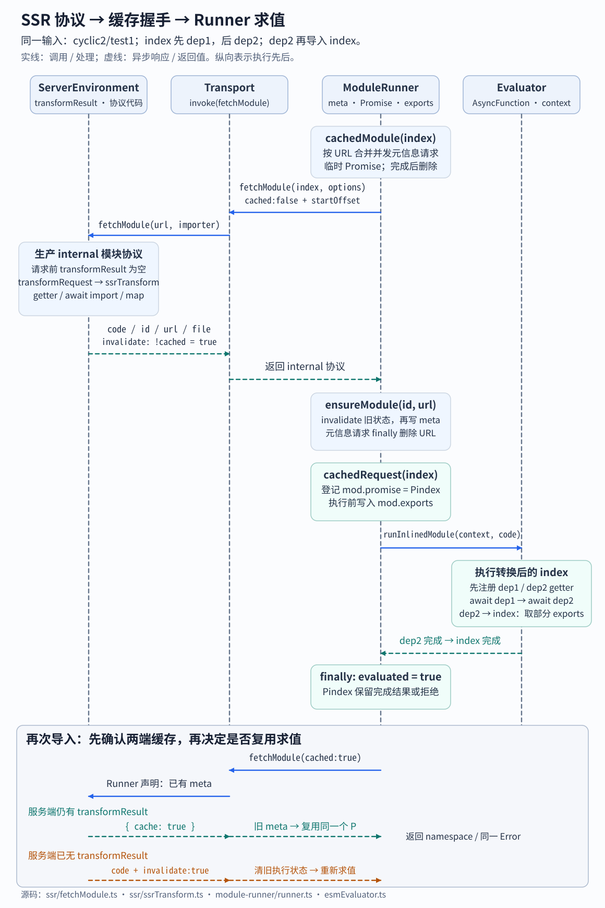

# 15A. SSR 变换、加载与错误堆栈

> **证据基线**：Vite `v8.2.1`，commit `421615865dad3ed39137d17281814fc78a41246c`。本文所有源码、测试与行为结论均限定于该版本。

## 阅读边界

本章研究开发服务器怎样把标准 ESM 变成 Module Runner 可执行的协议代码，以及旧
`server.ssrLoadModule()` API 怎样接入这条新链路：

```text
server.ssrLoadModule(url)
→ ssrLoadModule()
→ SSRCompatModuleRunner.import(url)
→ transport.invoke('fetchModule')
→ fetchModule(environment, url, importer)
→ resolve / externalize / transformRequest
→ ssrTransform(code)
→ 返回 external、cache，或 { code, id, url, file, invalidate }
→ Module Runner 执行（见 15B）
→ 可选 ssrFixStacktrace(error)
```

本章重点是协议的生产端。Runner 怎样缓存、执行、处理循环依赖与 HMR，放在 15B。

读完应能回答：

1. 为什么 SSR 开发模式不能直接让 Node import 每个源码模块？
2. `ssrTransform` 生成的 `__vite_ssr_*__` 名称由谁实现？
3. import 为什么提升，re-export 为什么也参与同一执行顺序？
4. export 为什么用 getter，而不是把当前值复制到对象？
5. import 函数调用为什么改写成 `(0, namespace.fn)()`？
6. 类声明的 superclass 别名在哪插入，与类表达式如何区分？
7. 作用域遍历为何先完成 DFS，再处理收集到的标识符？
8. fetchModule 在什么情况下返回 external、cache 或 code？
9. `options.cached` 与返回值 `invalidate` 分别表达谁的缓存状态？
10. 旧 `ssrLoadModule` 怎样与新 EvaluatedModules 保持兼容？
11. 为什么堆栈修正必须识别“已经改写过”的错误？
12. `runnerImport()` 为什么要返回 dependencies 并确保关闭环境？

## 推荐阅读顺序

1. `shared/ssrTransform.ts` 的协议 key 类型，只认清名字。
2. `ssr/ssrTransform.ts` 的 `ssrTransform()` 与 `ssrTransformScript()`。
3. 对照 `ssrTransform.spec.ts` 的最小 import/export 快照。
4. 再读 `walk()`、`isRefIdentifier()` 和作用域辅助函数。
5. `ssr/fetchModule.ts`，观察服务端返回协议的三种形态。
6. `ssr/runtime/serverModuleRunner.ts` 的 transport 适配。
7. `ssr/ssrModuleLoader.ts` 的旧 API 兼容层。
8. `ssr/ssrStacktrace.ts` 与对应测试。
9. 最后读 `ssr/runnerImport.ts`，看一次性环境如何复用整条链。

## 为什么需要 SSR Transform

开发服务器面对的是插件变换后的任意模块：TypeScript、Vue、CSS 代理、虚拟模块和带 query 的
资源。直接交给 Node import 会绕过 Vite 的 resolve、load、transform 与模块图，也无法获得 HMR。

因此 Vite 保留 ESM 语义，但把语法改成一个可注入的运行时协议。例如：

```ts
import { ref } from 'vue'
export const value = ref(0)
```

概念上转换为：

```ts
__vite_ssr_exportName__('value', () => value)
const __vite_ssr_import_0__ = await __vite_ssr_import__('vue', {
  importedNames: ['ref'],
})
const value = (0, __vite_ssr_import_0__.ref)(0)
```

这些 helper 不是全局变量。15B 中的 `ModuleRunnerContext` 会在求值时提供它们。

## 先分清 SSR 的两条解析边界

`SSROptions` 同时描述“进入 Vite 转换流水线的依赖”和“交给原生运行时的外部依赖”，两者不能共用一组
条件：

| 配置                         | 作用边界                             |
| ---------------------------- | ------------------------------------ |
| `noExternal`                 | 强制依赖进入 Vite/Rolldown 转换      |
| `external`                   | 强制依赖留给 SSR 运行时原生加载      |
| `resolve.conditions`         | 插件流水线解析内部化依赖             |
| `resolve.externalConditions` | Node/Runner import 已外部化依赖      |
| `resolve.mainFields`         | 内部化依赖的 package.json 入口优先级 |

Node 目标默认不使用 browser 字段，webworker 目标默认使用它。外部依赖默认条件为 `node`、`module-sync`。
`fetchModule()` 用这些条件选出 file URL 后交给宿主 import；包内部后续导入仍遵守宿主自身的条件，
所以自定义条件也需要在 Node 启动选项中保持一致。`resolveSSROptions()` 还把顶层
`preserveSymlinks` 写入兼容字段 `optimizeDeps.esbuildOptions`；本版 Rolldown 优化器实际从
Environment 的 `resolve.preserveSymlinks` 读取符号链接策略。

## `ssrTransform` 的三阶段算法

### 阶段一：提升依赖并建立绑定映射

扫描所有 import 和带 source 的 re-export：

```text
本地 ref
→ __vite_ssr_import_0__.ref

namespace vue
→ __vite_ssr_import_0__
```

依赖语句按源码出现顺序提升到可执行函数顶部。目的不是简单模仿 JavaScript hoist，而是让每个
依赖先完成 Runner 请求，同时保持 ESM 的依赖求值顺序。`export * from` 和
`export { x } from` 同样会执行依赖，不能推迟到普通语句之后。

`importedNames` 元数据供 external 模块校验使用：Runner 原生导入 CJS/ESM 后，可以给不存在的命名
导出提供接近 Node 的错误信息。

### 阶段二：把 export 变成 live binding

| ESM 形态                      | 协议策略                                |
| ----------------------------- | --------------------------------------- |
| `export const x`              | 删除 export，提前注册 `x` getter        |
| `export function/class X`     | 保留声明，注册 getter                   |
| `export { x as y }`           | 删除列表，为 `y` 注册指向 `x` 的 getter |
| `export default <expression>` | 创建内部 const，再注册 default getter   |
| `export * from './dep'`       | 调用 `__vite_ssr_exportAll__`           |
| `export * as ns from './dep'` | 为 ns 注册 namespace getter             |

getter 是 live binding 的关键：导出方后续修改本地值，导入方读取时仍能看到最新值。getter 中的
`try/catch` 捕获绑定尚未初始化时的读取错误，返回 `undefined`。因此循环依赖在初始化前直接读取导出
可能得到 `undefined`；继续读取它的属性则抛 `TypeError`。`server-runtime.spec.ts` 的
`cyclic invalid 1`、`cyclic invalid 2` 和 `export default getter is hoisted` 分别记录这些结果，
而 Node 在相同的未初始化绑定读取处抛 `ReferenceError`。

命名导出应覆盖 `export *` 带来的同名属性。对应回归见
[PR #19534](https://github.com/vitejs/vite/pull/19534)。re-export 的执行顺序和默认导出 live binding
分别在 [PR #19841](https://github.com/vitejs/vite/pull/19841) 与
[PR #19842](https://github.com/vitejs/vite/pull/19842) 修正。

### 阶段三：按词法作用域替换引用

不是每个同名 Identifier 都是 import 引用：

- 形参、局部变量、函数名、类名、catch 参数会遮蔽 import；
- 对象静态 key、class method key、label、break/continue label 不是值引用；
- `obj.foo` 的 `foo` 不是变量，`obj[foo]` 的 `foo` 才是；
- `import.meta` 与动态 `import()` 由专门分支处理；
- 对象简写 `{ foo }` 要展开为 `{ foo: namespace.foo }`；
- 声明解构 `const { foo } = value` 中的 foo 是新绑定，不能展开；解构赋值需与声明区分。

`walk()` 先用 DFS 建立 scope map、父节点栈并收集候选 Identifier，再按收集顺序重新检查它们。
这不是 BFS：关键是延后判断，直到后方声明也已进入作用域表。例如函数体先读取 `foo`、后声明
`var foo` 时，前面的引用仍属于这个函数，不能改成外层 import 的 namespace 读取。

几个值得单步跟踪的边界：

- `var` 找最近函数作用域，`let/const` 找最近块作用域；
- switch 的 case 共享 switch 块，但声明不能泄漏到外层函数，见
  [PR #22893](https://github.com/vitejs/vite/pull/22893)；
- label 与 import 同名时不能改写 label，见
  [PR #22451](https://github.com/vitejs/vite/pull/22451)；
- `import.meta` 中的 meta 不是普通标识符引用，见
  [PR #22019](https://github.com/vitejs/vite/pull/22019)；
- class 静态属性名与 import 同名时，只有 computed key 才是值引用，见
  [PR #22199](https://github.com/vitejs/vite/pull/22199)。

## 调用语义与 `(0, fn)`

若直接生成 `namespace.fn()`，JavaScript 会把 namespace 绑定为 `this`；原始 ESM 的
`import { fn }; fn()` 则以 `undefined` 作为严格模式 this。Vite 生成 `(0, namespace.fn)()`，先用逗号
表达式取出函数值，再调用它。

这个包装也影响 V8 堆栈列号。sourcemap 会把实参列表的 `(` 映回原 callee 起点，以匹配 Node。
相关修复见 [PR #22829](https://github.com/vitejs/vite/pull/22829)，测试同时覆盖空白、注释、换行和
可选调用。

`extends` 是另一种特殊位置：导入标识符直接作为类声明的 superclass 时，转换器会在包含该类的
顶层语句前创建一次局部别名，再让 class 使用它。这里保留的是类声明结构，类本身仍有 TDZ。

## Sourcemap 合成

MagicString 记录本轮移动和覆盖；完成后再与上游插件 map 合成。需要注意：

- `sourcesContent` 使用最初源码，而非当前已变换 code；
- 提升 import 不能让映射全部指向第一行；相关历史修复见
  [PR #16356](https://github.com/vitejs/vite/pull/16356)；
- 多 sources 的上游 map 必须逐个保留；
- hashbang 保留在第一行，但 fetchModule 送进函数 evaluator 前会把它替成等长空格；对少见换行符的
  修复见 [PR #23038](https://github.com/vitejs/vite/pull/23038)。

## `fetchModule`：服务端协议出口

### 1. 已知 external 快速路径

- `data:` 与配置的 builtin：返回 `{ externalize, type: 'builtin' }`；
- 非 file URL 的网络地址：返回 `{ externalize, type: 'network' }`；
- 有 importer 的裸依赖：用 Node 条件解析，返回 file URL 及 module/commonjs 类型。

入口没有 importer，必须先 internalize；否则裸入口会绕过 Vite 插件和虚拟模块解析。

### 2. internal 模块路径

```text
unwrapId(url)
→ environment.moduleGraph.ensureEntryFromUrl(url)
→ 检查服务端 transformResult 缓存
→ environment.transformRequest(url)
→ inlineSourceMap()
→ 返回 code/file/id/url/invalidate
```

Runner 请求时带 `cached=true`，且服务端也有 transformResult，服务端只回 `{ cache: true }`，避免重复
传输代码和 base64 map。反之返回代码和 `invalidate: !cached`。这里的 `cached` 是调用
transformRequest **之前**是否已有服务端结果；原先没有结果便要求 Runner 清掉旧求值状态，即使
本轮转换随后与另一个请求共享了结果。

两者是双向缓存握手，不应混淆：

| 字段           | 谁声明          | 含义                                             |
| -------------- | --------------- | ------------------------------------------------ |
| options.cached | Runner → server | Runner 已持有该 URL 的元信息                     |
| cache=true     | server → Runner | 服务端代码也没变，可继续复用                     |
| invalidate     | server → Runner | 请求前服务端无 transformResult，应清除旧执行状态 |

`inlineSourceMap()` 删除上游遗留的内联 data map，只保留最终 Vite map 和 sourceURL。Evaluator 若额外
插入 strict wrapper 行，则给 mappings 前置空行，保证堆栈位置对齐。

## Server transport 与旧 API

`createServerModuleRunnerTransport()` 把同进程 hot channel 适配成通用 transport：

- invoke 调用 environment 暴露的 `fetchModule/getBuiltins`；
- channel 外侧向 Runner 推送 HMR；
- custom event 可双向发送；
- connect/disconnect 同步触发 client 生命周期事件。

`createServerModuleRunner()` 再补齐 Node 专用能力：Node `import.meta`、HMR logger，以及原生或
`prepareStackTrace` sourcemap 支持。

旧 `server.ssrLoadModule()` 并没有保留另一套求值器。`SSRCompatModuleRunner` 继承 ModuleRunner，
把 EvaluatedModules 中的 exports/error 回写旧 ModuleNode 的 `ssrModule/ssrError` 字段，使插件和旧 API
仍能观察兼容状态。非 runnable SSR environment 会给出明确错误，见
[PR #21739](https://github.com/vitejs/vite/pull/21739)。

## 堆栈修正

`ssrRewriteStacktrace()` 逐帧：

1. 从 stack 提取文件、行、列；
2. 在模块图寻找对应 transformResult map；
3. 扣除 evaluator wrapper 行偏移；
4. 用 map 查询原始位置；
5. 写回 stack，并保留无法映射的帧。

Vite 运行时探测 Node `new Function` wrapper 的实际行偏移，而不是按 Node 版本硬编码。
`ssrFixStacktrace()` 用 WeakSet 记录已处理的 Error，重复调用直接返回。若某帧扣除 wrapper 后的行列
无效，该帧保留原样，并在 Error.message 追加已被其他工具改写的提示；其他可映射的帧仍继续处理。
对应能力见 [PR #21269](https://github.com/vitejs/vite/pull/21269)。

新 Module Runner 的进程级 sourcemap 拦截器在 15B 详述；这里的函数主要服务旧兼容 API。

## 一次性 `runnerImport`

`runnerImport()` 为配置加载等场景创建默认 server environment，导入入口，收集全部 internalized
依赖文件，最后在 `finally` 中关闭环境。externalized 模块由 Node 管理，不进入 dependencies；调用方
可把返回文件加入 watcher，决定配置何时需要重载。

## 用例导航

| 用例文件                 | 优先阅读内容                                   |
| ------------------------ | ---------------------------------------------- |
| `ssrTransform.spec.ts`   | import/export 最小快照、scope、顺序、sourcemap |
| `ssrLoadModule.spec.ts`  | 兼容 API、错误缓存、虚拟模块失效、导出冲突     |
| `ssrStacktrace.spec.ts`  | 重复改写与 already-rewritten 防护              |
| `server-runtime.spec.ts` | 转换协议被 Runner 执行后的最终语义             |

这些测试分别检查转换代码、最终求值结果和错误位置；把输出快照与 Runner 断言连起来，才能看到
协议改写怎样影响运行时读取。

## 关键源码证据

目标版本源码摘录，来源：`packages/vite/src/node/ssr/ssrTransform.ts`，`ssrTransform()`：

```ts
export async function ssrTransform(
  code: string,
  inMap: SourceMap | { mappings: '' } | null,
  url: string,
  originalCode: string,
  options?: ModuleRunnerTransformOptions,
): Promise<TransformResult | null> {
  if (options?.json?.stringify && isJSONRequest(url)) {
    return ssrTransformJSON(code, inMap)
  }
  return ssrTransformScript(code, inMap, url, originalCode)
}
```

调用方只在 `json.stringify === true && json.namedExports !== true` 时启用此快速路径；它把 default
export 直接赋到 exports 对象。其余输入进入 AST、live binding 与 sourcemap 重写。
`fetchModule`/transport 得到的 transform 结果因此已经带有 runner 可执行协议，而非浏览器 ESM 原文。

下面摘录 `defineExport()` 的生成动作，保留完整 getter 模板：

```ts
s.appendLeft(
  fileStartIndex,
  `${ssrExportNameKey}(${JSON.stringify(name)}, () => { try { return ${local} } catch {} });\n`,
)
```

模板被插到函数体前部，注册时尚不读取本地绑定；消费者调用 getter 时才取值。以
`export let count = 0; export function inc() { count++ }` 为例，`count` getter 每次读取当前变量，
所以 `inc()` 后得到 1；若把 helper 改成 `exports.count = count`，既会提前触及 TDZ，也会丢掉后续更新。

`fetchModule()` 的缓存握手摘录（中间的转换与 map 附加见上文）：

```ts
const mod = await environment.moduleGraph.ensureEntryFromUrl(url)
const cached = !!mod.transformResult
if (options.cached && cached) {
  return { cache: true }
}
```

两个标志同时为 true 才省去代码传输。服务端节点已失效时，`cached` 为 false，重新转换后返回
`invalidate: true`，Runner 便清掉旧 namespace 和求值 Promise。

用 runtime 测试中的 `fixtures/cyclic2/test1` 串起这次传输。三个文件的输入如下；真实的环是
`index → dep2 → index`，`dep1` 本身没有回边：

```js
// index.js
import { dep1 } from './dep1.js'
export { dep1 }

import { dep2 } from './dep2.js'
export { dep2 }

// dep1.js
export const dep1 = { ok: true }

// dep2.js
import { dep1 } from './index.js'
export const dep2 = { ok: dep1.ok }
```

首次请求先生产 SSR 协议代码，再交给 Runner。临时的元信息请求 Promise 在响应后删除，节点上的
求值 Promise 则保留。再次导入时，Runner 先声明自己已有 meta；服务端也保留 transformResult，才会
返回 `{ cache: true }`。下面的时序把这次握手与第一次求值放在同一条调用链中。



Evaluator 先注册 index 的导出 getter，再依次等待 dep1、dep2。dep2 导回 index 时，Runner 返回已建立的
部分 namespace；此时 dep1 已完成，所以 dep2 能读到 `dep1.ok === true`，随后 dep2 与 index 依次完成。
15B 的状态图继续展开这条回边如何避开互相等待，以及失败结果为什么也会保留。

测试源码摘录：`ssrTransform.spec.ts` 的 `named import`，保留该用例输入与快照，省略文件级夹具。
`ssrTransformSimpleCode` 使用相同文本作为 code/originalCode，并以 null 作为上游 map。

```ts
test('named import', async () => {
  expect(
    await ssrTransformSimpleCode(
      `import { ref } from 'vue';function foo() { return ref(0) }`,
    ),
  ).toMatchInlineSnapshot(
    `
    "const __vite_ssr_import_0__ = await __vite_ssr_import__("vue", {"importedNames":["ref"]});
    function foo() { return (0,__vite_ssr_import_0__.ref)(0) }"
  `,
  )
})
```

这里一次确认两件事：请求带上用于外部模块校验的 `importedNames`，函数调用去掉 namespace 的隐式
this。最终调用行为由 runtime 的 `this of the exported function should be undefined` 用例继续检查。

## 建议断点

1. `ssrTransformScript()` 的阶段一 `defineImport()`。
2. 阶段二 `defineExport()`。
3. 阶段三 Identifier 回调，观察 `scopeMap` 与 `idToImportMap`。
4. `fetchModule()` 的 external 与 internal 分界。
5. `inlineSourceMap()` 观察 startOffset。
6. `instantiateModule()` 看旧 ModuleNode 如何接收 Runner 结果。
7. `ssrRewriteStacktrace()` 看生成位置如何回到源码。

## 复盘题

1. 如果 export 改成普通赋值，哪类 live binding 用例会失败？
2. 如果 import 不提升，`console.log(x); import { x }` 的执行顺序会怎样变化？
3. 为什么 `obj.foo`、`{ foo }`、`{ foo } = obj` 对 foo 的处理不同？
4. 为什么入口裸 id 不能直接 externalize？
5. Runner 与 server 都有缓存时，为何仍要做一次轻量 fetchModule 握手？
6. hashbang 为什么在 transform 阶段保留、到 evaluator 前才空格化？
