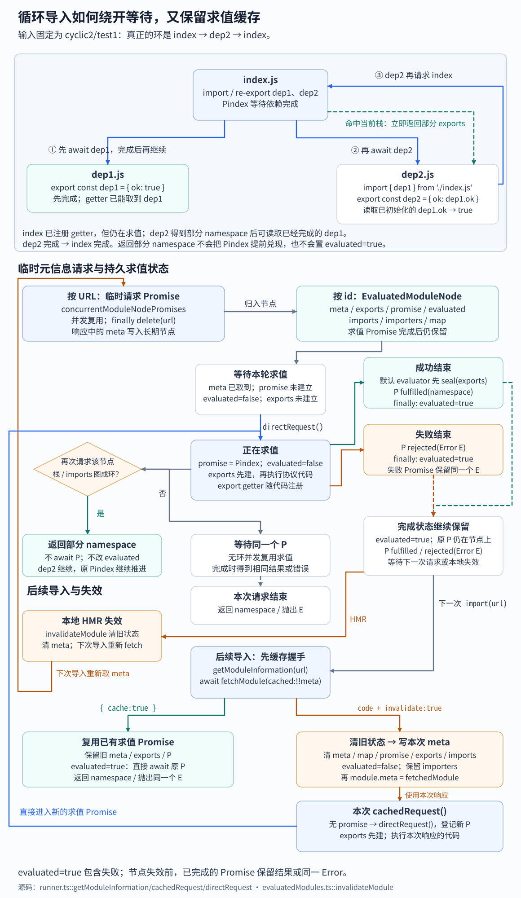

# 15B. Module Runner：求值、缓存、HMR 与 Sourcemap

> **证据基线**：Vite `v8.2.1`，commit `421615865dad3ed39137d17281814fc78a41246c`。本文所有源码、测试与行为结论均限定于该版本。

## 阅读边界

本章研究 `vite/module-runner` 怎样消费 15A 产生的协议代码：

```text
runner.import(url)
→ cachedModule(url)
→ transport.fetchModule(url, importer, cache state)
→ EvaluatedModules.ensureModule(id, url)
→ cachedRequest(url, module, callstack)
→ directRequest()
   ├─ external → evaluator.runExternalModule()
   └─ internal → 创建 exports/import.meta/protocol context
                 → evaluator.runInlinedModule()
                 → 转换代码递归 request(dep)
```

读完应能回答：

1. Runner 为什么同时保存 url、id、file 三种索引？
2. 并发 fetch 去重与并发 evaluation 去重为什么是两套 Promise？
3. 循环依赖时为什么返回“尚未完成的 exports”，而不是继续 await？
4. 为什么已 evaluated 模块可以跳过循环检测？
5. exports namespace 为什么先创建、最后才完成求值？
6. external 模块与 internal 模块分别由谁执行？
7. `export *` 怎样保持 live binding 并避免自导出递归？
8. `import.meta.hot` 为什么延迟创建？
9. full reload 如何从受影响文件回溯入口？
10. 模块失效时为什么清 imports，却保留 importers？
11. `import.meta.resolve` 为什么需要进程级 Node resolve hook？
12. sourcemap 为什么有 Node 原生与 prepareStackTrace 两条路径？

## 推荐阅读顺序

1. `module-runner/types.ts` 的 `ModuleRunnerContext` 和 options。
2. `evaluatedModules.ts`，先理解节点与三类索引。
3. `runner.ts`：constructor → import → cachedModule → cachedRequest。
4. `directRequest()` 与 `exportAll()`。
5. `esmEvaluator.ts`，确认协议代码如何成为 AsyncFunction。
6. `createImportMeta.ts` 与 `importMetaResolver.ts`。
7. `hmrHandler.ts`。
8. `sourcemap/index.ts` → interceptor 主流程；V8 格式化兼容段最后再看。
9. 对照 runtime、HMR 和 source map 三个测试文件。

## 共享协议层

在读 Runner 本体前，先把 `shared/invokeMethods.ts` 与 `shared/moduleRunnerTransport.ts` 看成一份
跨运行时协议，而不是普通工具函数。

`fetchModule` 只有三类互斥响应：

| 响应                | 含义                                                     |
| ------------------- | -------------------------------------------------------- |
| `{ cache: true }`   | Runner 与 server 缓存一致，继续复用旧节点                |
| `{ externalize }`   | 交给宿主原生 import，并携带 ESM/CJS/builtin/network 类型 |
| `{ code, id, ... }` | Vite 已变换的 internal 模块，交给 evaluator              |

transport 则支持两种集成方式：宿主直接实现 `invoke(payload)`，或实现 `connect + send`，让 Vite 在
`vite:invoke` custom payload 上补一层 RPC。后者为每个请求分配 ID，维护 pending Promise，并统一处理：

- 60 秒默认超时；计时器 `unref()`，不阻止 Node 退出；
- send Promise 失败时立即拒绝对应 RPC，见
  [PR #22450](https://github.com/vitejs/vite/pull/22450)；
- 在已连接状态显式 `disconnect()`，RPC 包装层拒绝全部 pending 请求；意外断连只重置连接标志，
  后续 `disconnect()` 会因未连接而直接返回，未完成 RPC 仍可等待响应或超时；
- 远端普通对象恢复为 Error，同时保留 Runner 本地调用边界；错误细节修复见
  [PR #18626](https://github.com/vitejs/vite/pull/18626)；
- 并发 connect 复用同一 Promise；send/invoke 等待正在建立的连接，尚未发起 connect 时才抛生命周期错误。

fetchModule 与 HMR 过去有独立通信路径，统一 transport 的背景见
[PR #18362](https://github.com/vitejs/vite/pull/18362)。`getBuiltins` 把 RegExp 序列化成普通数据，保证
WebSocket/worker transport 可传输；对应修复见
[PR #21029](https://github.com/vitejs/vite/pull/21029)。

WebSocket transport 在标准 HMR/custom 消息之外定时发送 ping，防止 nginx、Docker 等代理回收空闲
连接；open 前 close 算连接失败，open 后 close 才通知 Runner 重置连接状态。

## Runner 是可移植客户端，不是 SSR Server

Module Runner 只依赖：

- transport：向某个 Vite environment 取模块、收发 HMR；
- evaluator：执行 internal 与 external 模块；
- evaluated graph：维护本地求值状态；
- 可选 import.meta、HMR 与 sourcemap 集成。

所以服务端同进程、worker、Vitest 或其他运行时可以复用 Runner，只需实现边界。默认
`ESModulesEvaluator` 使用 AsyncFunction 和原生动态 import；集成方也能替换为 `node:vm` 等执行器。

## 构造阶段

`new ModuleRunner(options, evaluator)` 完成三件事：

1. 使用传入的 EvaluatedModules，或创建私有模块图；
2. 归一化 transport，并在启用 HMR 时连接 `HMRClient`；
3. 按配置启用 sourcemap 支持，保存恢复函数。

默认开启 HMR；transport 若没有 connect 能力却要求 HMR，会立即报错，而不是运行到第一条更新消息才
失败。该默认行为由 [PR #18749](https://github.com/vitejs/vite/pull/18749) 引入。

`close()` 的顺序是恢复全局 sourcemap → 清缓存/listener → 标记 closed → 断开 transport。标记必须早于
异步 full reload 的下一次 import，使关闭过程中的重载自然停止；相关修复见
[PR #22020](https://github.com/vitejs/vite/pull/22020)。

## EvaluatedModules：三种身份，一个节点

每个 `EvaluatedModuleNode` 保存：

| 字段      | 作用                                                             |
| --------- | ---------------------------------------------------------------- |
| id        | 服务端解析后的稳定身份，也是主缓存键                             |
| url       | 调用 import 时使用的 server URL                                  |
| file      | 规范 ID 去 query/hash 后的键，用于文件级 HMR；虚拟模块也有此字段 |
| meta      | fetchModule 返回的 external/code/cache 元信息                    |
| promise   | 当前或已完成的求值 Promise                                       |
| exports   | 提前创建的模块 namespace                                         |
| evaluated | 本轮求值是否结束，包含失败                                       |
| imports   | 本轮代码实际请求的依赖                                           |
| importers | 反向依赖，用于 HMR 回溯入口                                      |
| map       | 从代码末尾延迟提取的 Vite 内联 sourcemap                         |

三张索引解决不同问题：

```text
idToModuleMap   → 求值与循环依赖
urlToIdModuleMap → 原始 import URL 的快速复用
fileToModulesMap → 一个文件的 ?raw/?url/普通模块等全部变体
```

同一 id 可以由多个 URL 到达；同一 file 也可以有多个 query 变体。只用文件名做缓存会把
`foo.js` 与 `foo.js?raw` 错当成同一模块。

`normalizeModuleId()` 统一 file URL、Windows 分隔符和 `/@id/` 转义，修复 Windows file URL 身份的
历史问题见 [PR #20449](https://github.com/vitejs/vite/pull/20449)。

## 两层并发去重

### `cachedModule()`：合并元信息请求

`concurrentModuleNodePromises` 以原始 URL 为键，防止同时向服务端发出重复 fetchModule RPC。请求完成后
立即删除该临时 Promise；长期状态保存在 EvaluatedModules。

首次模块信息请求先由 `ensureBuiltins()` 从 server 取可序列化 builtin 规则；即使请求 `data:` 也会先
等待这次初始化。`data:` 和 builtin 随后可在客户端
直接判为 external，省掉 RPC。客户端 builtin 快速路径见
[PR #20924](https://github.com/vitejs/vite/pull/20924)。

### `cachedRequest()`：合并求值

模块节点的 `promise` 代表一次求值：

| 状态                             | 行为                                 |
| -------------------------------- | ------------------------------------ |
| evaluated=true 且 promise 存在   | 直接等待/返回缓存                    |
| promise 存在，且与当前调用栈成环 | 返回已提前创建的 exports             |
| promise 存在，不成环             | 等待同一个 in-flight Promise         |
| 没有 promise                     | 调用 directRequest，立即登记 Promise |

已完成模块不会再与当前调用栈互相等待，所以先走快速路径可省去递归图检查。该优化见
[PR #21632](https://github.com/vitejs/vite/pull/21632)。

## 循环依赖：避免 Promise 死锁

继续使用 15A 的 `fixtures/cyclic2/test1`。index 先导入并转出 dep1，再导入并转出 dep2；dep2 从 index
读取 dep1：

```js
// index.js
import { dep1 } from './dep1.js'
export { dep1 }

import { dep2 } from './dep2.js'
export { dep2 }

// dep1.js
export const dep1 = { ok: true }

// dep2.js
import { dep1 } from './index.js'
export const dep2 = { ok: dep1.ok }
```

Runner 在执行模块正文前先创建 `exports` namespace。若 `cachedRequest()` 发现目标 id 已在 callstack，或
沿 in-flight imports 图能回到当前栈，就直接返回这份部分 namespace。这个输入中，dep2 导回 index 时，
index 的 getter 已注册，dep1 也已完成，因此 dep2 能经 getter 读到 `dep1.ok === true`。若这时继续等待
Pindex，index 又正在等待 dep2，两份 Promise 就会互相等待。



返回部分 namespace 只让 dep2 继续执行，不会提前完成 Pindex，也不会提前把 index 的 `evaluated` 置为
true。dep2 完成后，index 才能完成。无环的并发请求仍等待同一份 Promise；成功时得到同一 namespace，
失败时复用同一个 Error，直到节点失效。`evaluated=true` 表示本轮求值已结束，包含失败；失效会清掉
Promise、exports 与本轮 imports，并保留 importers 供 HMR 回溯入口。

后续导入先由 `getModuleInformation()` 完成缓存握手。`{ cache: true }` 保留旧 meta，随后
`cachedRequest()` 复用已完成的 Promise；代码响应带 `invalidate: true` 时，Runner 先清旧状态，再把
本次响应写入 `module.meta`，随后 `cachedRequest()` 建立新的求值 Promise。本次响应的元信息直接供这次
求值使用。HMR 在本地清掉 meta 后，下次导入才重新请求元信息。

循环检测必须只基于正在求值的 imports 图。失效后 concurrent re-export 链曾把一份尚未完成的部分导出
暴露给另一入口；修复与确定性回归用例见
[PR #22369](https://github.com/vitejs/vite/pull/22369)。阅读 `server-hmr.spec.ts` 时重点看
`imports.add()` 被用作竞态同步信号的原因。

## `directRequest()`：真正执行模块

### external

若 fetch 结果包含 `externalize`：

```text
evaluator.runExternalModule(externalize)
→ 默认执行 import(externalize)
→ 保存原生 namespace
→ analyzeImportedModDifference 校验命名导入
```

CJS 与 ESM 的缺失命名导出使用不同提示。一次错误导入不能污染同一外部包后续正确导入的缓存。

### internal

Runner 先创建：

- null prototype exports，并设置 `Symbol.toStringTag='Module'`；
- `request()`：处理转换代码中的静态 import；
- `dynamicRequest()`：先执行 JavaScript String 强制转换，再解析相对 URL；
- import.meta；
- export-all 与 export-name helper；
- 延迟创建的 HMRContext。

然后把这些值按 `ModuleRunnerContext` 的内部 key 交给 evaluator。默认 evaluator 实际构造：

```ts
new AsyncFunction(...contextKeys, `"use strict";\n${code}`)
```

strict 指令单独占一行；`startOffset` 是运行时探测的 AsyncFunction 声明包装行数 **加一**。
服务端按这个总偏移给 map mappings 补空行，才能把求值器内部行号映回源代码。

exports 在执行前写入节点，循环依赖才能看到 namespace。`cachedRequest()` 在 `finally` 中把
`evaluated` 置为 true，因此它表示本轮已结束，包含失败；节点 Promise 保留拒绝结果，下一次导入
会抛出同一个 Error，直到节点被失效。

## Export namespace

`__vite_ssr_exportName__` 用 getter 定义单个导出。`exportAll()` 也用 getter 转发属性，因此依赖模块值变化
后仍是 live binding。它会过滤：

- default 与 `__esModule`；
- 已由命名导出占用的 key；
- primitive、Array 和 Promise；
- sourceModule 与当前 exports 是同一对象的自导出。

最后一项防止 `export *` 意外指回自身导致递归或调用栈溢出。导出属性初建时是 configurable getter，
允许后续具名导出覆盖；默认 `ESModulesEvaluator` 成功执行后调用 `Object.seal(exports)`，使属性不可
重定义或删除，也不能添加新属性。getter 没有 setter，所以赋值同样失败。自定义 evaluator 若要
保持这一约定，需要自行完成封闭步骤。上述只读属性来自脚本的 getter 协议；JSON stringify 快速路径
直接赋值 `exports.default`，它在 sealed 后仍是可写的数据属性。

## `import.meta`

### 默认对象

`createDefaultImportMeta(modulePath)` 提供：

- `url`、`filename`、`dirname`；
- `env` 的受限代理：动态读取时报错；
- `glob()` 报错：正常 glob 必须已在 transform 阶段静态展开；
- 抛出不支持错误的默认 `resolve`；Node 版本才提供真实解析。

Node 版本再补 `main=false` 与自定义 importer 的 `import.meta.resolve`。

### resolve hook

原生 `import.meta.resolve(specifier)` 的 parent 是当前实现文件，不能直接替另一个被求值模块解析。Vite 把
`[specifier, importer]` 编码进私有命名空间，由 Node resolve hook 解码并重写 `context.parentURL`，再交回
Node 默认解析。

进程级 hook 只能注册一次；重复创建 Runner 时不断叠加 hook 曾导致最大调用栈错误，见
[PR #21518](https://github.com/vitejs/vite/pull/21518)。新 Node 优先使用更快的同步
`module.registerHooks()`，见 [PR #20980](https://github.com/vitejs/vite/pull/20980)；旧 Node 通过 data URL
注册异步 hook。整体 import.meta.resolve 能力始于
[PR #20260](https://github.com/vitejs/vite/pull/20260)。

## HMR 与 full reload

`createHMRHandlerForRunner()` 消费 HotPayload：

| payload     | Runner 行为                               |
| ----------- | ----------------------------------------- |
| update      | 规范化 `/@id/`，JS 更新交 HMR client 排队 |
| custom      | 通知对应 listener                         |
| prune       | 触发 dispose/prune                        |
| error       | 通知 listener 并记录服务端错误            |
| full-reload | 找入口、清求值缓存、重新 import           |
| ping        | 无操作                                    |

Runner 无 DOM，CSS HMR 不受支持。

full reload 先收集入口；没有找到入口时直接结束，保留当前图。收集有两种方式：

- 有 `triggeredBy`：按 file 找全部模块变体，再沿 importers 递归到根；
- 没有来源：扫描图中全部没有 importer 的模块。

失效模块时清空 `imports`，因为新代码的依赖可能改变；保留 `importers`，否则 full reload 无法沿旧反向边找到
根入口。重新求值会重建 imports 并追加 importers，但不主动删除旧反向边；完整清图则同时移除两者。
full reload 只清 EvaluatedModules，HMR listener/data 表继续交给新 HMRContext 更新。重载过程捕获
单入口错误，Runner 已关闭则立即停止；关闭竞态修复见
[PR #22020](https://github.com/vitejs/vite/pull/22020)。

## Sourcemap 支持

### 两种模式

`enableSourceMapSupport()`：

1. `node`：调用 `process.setSourceMapsEnabled(true)`，关闭时只在原先未开启的情况下恢复；
2. `prepareStackTrace`：安装 Vite 拦截器，从 Runner 内存图或用户读取函数取 map。

直接创建 `ModuleRunner` 默认走第二种。`createServerModuleRunner()` 则检测 Node 原生能力，默认优先
选择第一种；调用方显式设置 `false` 时两种都不启用。

### 拦截器主流程

```text
Error.stack 首次读取
→ prepareStackTrace(error, callsites)
→ wrapCallSite(frame)
→ mapSourcePosition(generated position)
   ├─ Runner EvaluatedModules 中的 map
   ├─ 全局 sourceMapCache
   └─ 用户 retrieveSourceMap / sourceMappingURL
→ clone CallSite 并覆盖位置 getter
→ 按 V8 标准格式重新输出
```

拦截器修改全局 `Error.prepareStackTrace`，因此多个 Runner 共享一个拦截器和 handler 集合。
模块图注册 Set 为空时，恢复拦截器模块初始化时捕获的宿主函数；同一个图或 handler 对象只登记
一次，不计引用次数。多个 Runner 共享这些对象时，需要由集成方协调注销时机。

map 查询优先使用 Runner 内存内容。外部文件可由用户 handler 返回，也可从源码最后一个
`sourceMappingURL` 读取 data/相对 URL。正则使用最后一个匹配，因此文件末尾的真实 map 可以覆盖
前面字符串中的伪标记；它并未解析 JavaScript 字符串语法。
对应修复见 [PR #20554](https://github.com/vitejs/vite/pull/20554)。

没有精确原始行列时保留生成位置，因为精确的生成位置好过含糊的原始位置。其他重要边界：

- map 的 sources 要相对 map URL 解析，见
  [PR #20959](https://github.com/vitejs/vite/pull/20959)；
- 负列号不能让映射器崩溃，见 [PR #21585](https://github.com/vitejs/vite/pull/21585)；
- clone CallSite 使用 null prototype，兼容冻结的 Object.prototype，见
  [PR #23073](https://github.com/vitejs/vite/pull/23073)；
- base64 解码器在模块初始化时捕获 Buffer，兼容之后删除全局 Buffer 的 realm，见
  [PR #22945](https://github.com/vitejs/vite/pull/22945)。

`CallSiteToString()` 基本来自 V8，负责展示兼容而非 Vite 模块语义。第一遍只需读
`interceptStackTrace → mapSourcePosition → wrapCallSite → prepareStackTrace`，无需逐行研究格式化分支。

## 用例导航

| 用例文件                     | 关键问题                                                |
| ---------------------------- | ------------------------------------------------------- |
| `server-runtime.spec.ts`     | 模块身份、external、循环依赖、live binding、full reload |
| `server-hmr.spec.ts`         | HMR client 状态与并发失效 re-export 竞态                |
| `server-source-maps.spec.ts` | map 更新、列号、虚拟 source、特殊全局环境               |

`correctly runs ssr code` 用 `toBe` 比较 server URL、file URL、绝对路径的导出对象，确认三种写法
共享同一求值节点。`throws the same error` 给第一次错误加 Symbol，再从第二次错误读到该标记，
确认 rejected Promise 也被保留。并发 re-export 用例在 shared 尚未完成时启动第二入口，再释放
阻塞点；两个入口最终分别得到完整的 a、b，确认无环并发不会误取部分 exports。

## 关键源码证据

目标版本源码摘录，来源：`packages/vite/src/module-runner/runner.ts`，`ModuleRunner`
构造函数：

```ts
this.evaluatedModules = options.evaluatedModules ?? new EvaluatedModules()
this.transport = normalizeModuleRunnerTransport(options.transport)
if (options.hmr !== false) {
  const optionsHmr = options.hmr ?? true
  const resolvedHmrLogger: HMRLogger =
    optionsHmr === true || optionsHmr.logger === undefined
      ? hmrLogger
      : optionsHmr.logger === false
        ? silentConsole
        : optionsHmr.logger
  this.hmrClient = new HMRClient(
    resolvedHmrLogger,
    this.transport,
    ({ acceptedPath }) => this.import(acceptedPath),
  )
  if (!this.transport.connect) {
    throw new Error(
      'HMR is not supported by this runner transport, but `hmr` option was set to true',
    )
  }
  this.transport.connect(createHMRHandlerForRunner(this))
} else {
  this.transport.connect?.()
}
```

Runner 始终规范化 transport 与求值缓存；启用 HMR 时，accepted dependency 回调重新进入同一个
`import()` 管线。transport 没有 `connect` 就立即失败，避免产生只有半套 HMR 状态的实例。

目标版本源码摘录：`runner.ts::cachedRequest()`。省略诊断计时器，只保留 Promise 写入和结束状态：

```ts
try {
  const promise = this.directRequest(url, mod, callstack)
  mod.promise = promise
  mod.evaluated = false
  return this.processImport(await promise, meta, metadata)
} finally {
  mod.evaluated = true
  if (debugTimer) clearTimeout(debugTimer)
}
```

`directRequest()` 的 Promise 在 await 前就登记，第二个无环请求可以等它；`finally` 无论成败都会
执行，失败也成为可复用的结束状态。`processImport()` 在每个导入点检查请求的名称，所以一个模块
正确求值后，某个消费者请求不存在的导出，不会把该模块自身的 Promise 改成失败。

测试源码摘录：`server-runtime.spec.ts` 的 `throws the same error`。所属 describe 使用
`createModuleRunnerTester()` 为每例创建服务器与 Runner，afterEach 依次关闭两者。

```ts
it('throws the same error', async ({ runner }) => {
  expect.assertions(3)
  const s = Symbol()
  try {
    await runner.import('/fixtures/has-error.js')
  } catch (e) {
    expect(e[s]).toBeUndefined()
    e[s] = true
    expect(e[s]).toBe(true)
  }

  try {
    await runner.import('/fixtures/has-error.js')
  } catch (e) {
    expect(e[s]).toBe(true)
  }
})
```

夹具在模块正文抛错。第二次错误仍带第一次写入的 Symbol，说明复用了拒绝 Promise 中的错误对象，
而非重新执行后创建新错误。`invalidateModule()` 会清掉这份 Promise，下一轮导入才重新求值。

## 建议断点

1. `ModuleRunner.import()`：记录输入 URL。
2. `getModuleInformation()`：比较 fetch 返回的 url/id/file。
3. `EvaluatedModules.ensureModule()`：观察三张索引。
4. `cachedRequest()`：观察 promise/evaluated/exports/callstack。
5. `directRequest()`：在 exports 创建前后停一次。
6. 转换代码调用 context request 时，观察 imports/importers 双向边。
7. `createHMRHandlerForRunner()` 的 full-reload 分支。
8. `mapSourcePosition()`：比较 Runner map 与外部 map 两条来源。

## 复盘题

1. 若只保留 module.promise，不保留 module.exports，循环依赖会发生什么？
2. 若 invalidateModule 同时清掉 importers，full reload 还能重跑哪些入口？
3. URL、id、file 三者分别在哪个阶段产生？为什么不能合成一个字段？
4. `dynamicRequest()` 为什么先 `String(dep)`？
5. 为什么 HMR 更新要排队，而 full reload 要清空整个求值缓存？
6. 多个 Runner 为什么不能各自覆盖 `Error.prepareStackTrace`？
7. Node 原生 sourcemap 已存在时，什么场景仍可能选择自定义拦截器？
